# Agent UI：使用 LangSmith Studio 與 Agent Chat UI 測試 Agent

## 學習目標

完成本講義後，應能：

- 說明 LangSmith Studio、Agent Chat UI 與 Agent Server 的責任分工。
- 將 Notebook 中的 Agent 整理為可由 Agent Server 載入的 Python module。
- 使用 `langgraph.json` 設定 Agent Server 要載入的 Agent。
- 以 `langgraph dev` 啟動本機 Agent Server。
- 從 LangSmith Studio 與 Agent Chat UI 連線至本機 Agent。
- 在兩種 UI 中測試 Human-in-the-Loop 的 `respond`、`reject`、`edit` 與 `approve` 決策。

## Agent UI 的用途

在 Notebook 中，可以直接使用 `agent.invoke()` 測試 Agent；但這方式主要用於互動式開發，不是實際使用者操作的聊天介面。

本章改用 Chat UI 測試 Agent。使用者在瀏覽器輸入訊息後，UI 會透過 Agent Server API 呼叫 Agent，並呈現訊息、Tool Call、Tool Result 及 Human-in-the-Loop interrupt。

```text
使用者
  |
  | 瀏覽器操作
  v
LangSmith Studio 或 Agent Chat UI
  |
  | Agent Server API
  v
本機 Agent Server（http://127.0.0.1:2024）
  |
  | 載入 langgraph.json 指定的物件
  v
Agent 與 Tools
```

兩個 Chat UI 都是 Web-based application，因此不需要把 UI 安裝在本機；但是，本機仍須啟動 Agent Server，讓 UI 有可連線的 Agent backend。

## LangSmith Studio 與 Agent Chat UI

### LangSmith Studio

LangSmith Studio 是開發與測試 Agent 的整合式介面。

除了與 Agent 對話，也可以查看 graph 執行過程、節點、thread、state、interrupt 與中間結果，適合開發者分析 Agent 的行為。

常見用途包括：

- 執行並觀察 Agent。
- 查看 graph 中經過的節點與 state 變化。
- 管理 threads 與 assistants。
- 從 checkpoint 重新執行或建立分支。
- 檢查 Tool Call、Tool Result 與 interrupt payload。


參考：[LangSmith Studio](https://docs.langchain.com/langsmith/studio)


### Agent Chat UI

Agent Chat UI 是 LangChain 提供的 open-source Next.js application，主要提供接近終端使用者產品的聊天介面。

它可顯示訊息、Tool Call、Tool Result 與 interrupt，也支援 time travel、state forking 等功能。

本講義使用官方託管版本：

- [https://agentchat.vercel.app/](https://agentchat.vercel.app/)

Agent Chat UI 適合：

- 以一般使用者角度測試 Agent 對話。
- 測試 Human-in-the-Loop 的回覆、核准、編輯與拒絕操作。
- 示範 Agent 的實際互動流程。
- 作為自訂前端前的功能原型。

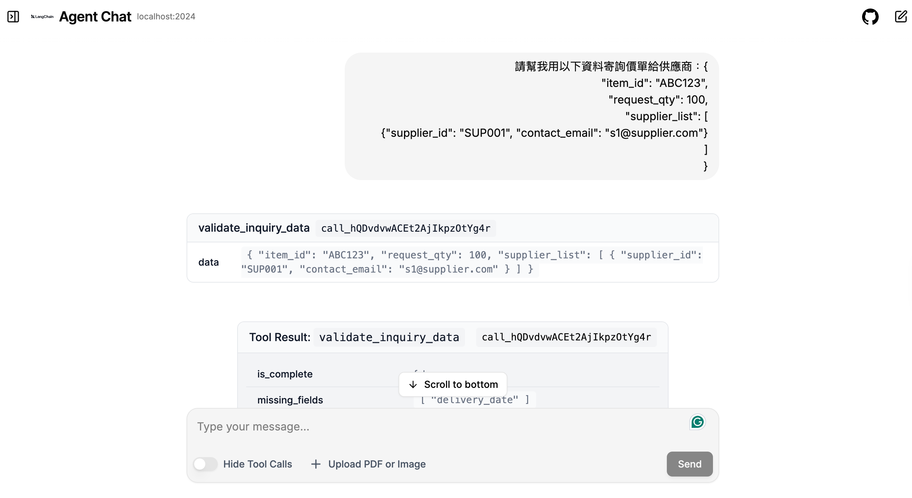

參考：[Agent Chat UI](https://docs.langchain.com/oss/python/langchain/ui)

### 兩者的定位比較

| 比較項目 | LangSmith Studio | Agent Chat UI |
|---|---|---|
| 主要使用者 | Agent 開發者、測試人員 | 應用程式使用者、展示與驗收人員 |
| 主要目的 | 觀察、測試與除錯 Agent 執行過程 | 以聊天介面操作 Agent |
| Graph 與節點資訊 | 完整，適合追蹤執行路徑 | 不是主要呈現重點 |
| Thread 與 state 檢查 | 支援完整檢視與管理 | 著重目前對話及互動 |
| Tool Call 與 interrupt | 可查看底層資料並手動提供 resume payload | 自動產生適合各種 decision 的操作表單 |


> Agent Chat UI 主要定位仍是聊天互動；若要分析 graph、node 與完整 state，應優先使用 Studio。

## 將 Notebook 中的 Agent 整理為可由 Agent Server 載入的 Python module

使用 Notebook 互動開發後，可將 Notebook 中的 Agent 轉換為 Python module, 以便在 LangSmith Studio 或 Agent Chat UI 執行。

基本流程如下：
1. 將 Notebook 中的 Agent 轉換並整理為 Python module(Python file)。
2. 建立 `langgraph.json`，指定 Agent 物件的位置。
3. 安裝 LangGraph CLI。
4. 使用 `langgraph dev` 啟動 Agent Server。
5. 以 LangSmith Studio 或 Agent Chat UI 連線至 Agent Server。

以下使用 「詢價小幫手」 `notebooks/human-in-the-loop/inquiry-helper.ipynb` 的 Agent 作為範例。


## Step 1：準備可載入的 Agent module

### 將 Notebook 轉換為 Python 檔案

若 Agent 原本寫在 `.ipynb`，可使用 `nbconvert` 轉換為 `.py`。

先將套件加入開發用 dependency group：

```bash
uv add --group dev jupyter nbconvert
```

再執行轉換：

```bash
uv run jupyter nbconvert --to script <notebook-path>.ipynb
```

本案例的指令如下：

```bash
uv run jupyter nbconvert \
  --to script notebooks/human-in-the-loop/inquiry-helper.ipynb
```

轉換後，Notebook 的同一個目錄會產生 `inquiry-helper.py`。

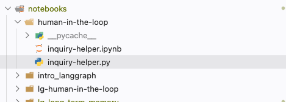


### 整理轉換後的 Python module

`nbconvert` 只負責轉換格式。

需要再做一些人工調整，包括:
- 保留可匯入的 Agent 物件及相關的 Tool、middleware 與 system prompt。
- 移除最外層的測試呼叫(`agent.invoke()` 或其他測試程式)。
- 移除 checkpointer 設定，因為由 LangGraph Server 自動管理 checkpoints 及 persistence。


#### 1. 保留可匯入的 Agent 物件

`langgraph.json` 必須能找到一個已建立的 graph 或 Agent 物件。本案例保留：

```python
agent = create_agent(
    model="gpt-5-nano",
    system_prompt=system_prompt,
    tools=[validate_inquiry_data, ask_user, send_email],
    middleware=[interrupt_policy],
)
```

此處的變數名稱是 `agent`，後續會出現在 `langgraph.json` 的 object path 中。

#### 2. 移除最外層的測試呼叫

不要在 module 最外層保留下列測試程式：

```python
response = agent.invoke(...)
```

原因是 Agent Server 載入 module 時會執行最外層程式。如果保留 `agent.invoke()`，每次載入或自動重新載入 module 都可能直接啟動一次 Agent，而不是等待 UI 或 API 的 request。

若仍要保留命令列測試，可放入「主程式判斷式」(main guard)：

```python
if __name__ == "__main__":
    response = agent.invoke(...)
```

#### 3. 不要在 graph definition 中傳入一般自訂 checkpointer

當 graph (或 Agent) 由 LangGraph Server 管理時，server 會負責 thread state 與 persistence。

因此不要把 Notebook 測試時使用的 `InMemorySaver()` 傳入 `create_agent()`：

```python
agent = create_agent(
    model="gpt-5-nano",
    system_prompt=system_prompt,
    tools=[validate_inquiry_data, ask_user, send_email],
    # 不在此處設定 checkpointer=InMemorySaver()
    middleware=[interrupt_policy],
)
```

若保留自訂 checkpointer，LangGraph Server 會拒絕載入此 graph，並回報 `GraphLoadError`，要求移除 graph definition 中的 custom checkpointer。

> 這項規則是指由 LangGraph Server 載入的 graph。
> 若直接在 Python 或 Notebook 中呼叫具有 interrupt 的 Agent，仍需為該 Agent 設定 checkpointer，並在呼叫時提供 `thread_id`。
> 正式部署若確實需要替換 server 內建的 backend，應依官方的 custom checkpointer 設定方式處理，而不是直接在 graph definition 傳入一般的 `InMemorySaver()`。
> 參考：[How to use a custom checkpointer](https://docs.langchain.com/langsmith/custom-checkpointer)

如果不移除 Checkpointer instance，會出現以下錯誤訊息：
```
The above exception was the direct cause of the following exception:

Traceback (most recent call last):
  File "/Users/hychen39/0work2/ai_agent_course_projects/ai_agent_course/.venv/lib/python3.13/site-packages/starlette/routing.py", line 638, in lifespan
    async with self.lifespan_context(app) as maybe_state:
               ~~~~~~~~~~~~~~~~~~~~~^^^^^
  ...

langgraph_api.utils.errors.GraphLoadError: Failed to load graph 'agent' from notebooks/human-in-the-loop/inquiry-helper.py: Heads up! Your graph 'agent' from 'notebooks/human-in-the-loop/inquiry-helper.py' includes a custom checkpointer (type <class 'langgraph.checkpoint.memory.InMemorySaver'>). With LangGraph API, persistence is handled automatically by the platform, so providing a custom checkpointer (type <class 'langgraph.checkpoint.memory.InMemorySaver'>) here isn't necessary and will be ignored when deployed.

To simplify your setup and use the built-in persistence, please remove the custom checkpointer (type <class 'langgraph.checkpoint.memory.InMemorySaver'>) from your graph definition. If you are looking to customize which postgres database to connect to, please set the `POSTGRES_URI` environment variable. See https://langchain-ai.github.io/langgraph/cloud/reference/env_var/#postgres_uri_custom for more details.
```


## Step 2：建立 `langgraph.json`

LangGraph Server 會讀取專案根目錄的 `langgraph.json`，以決定要載入的 graph 物件及其名稱。

此名稱會顯示在 LangSmith Studio 上供選擇不同的 Agent:

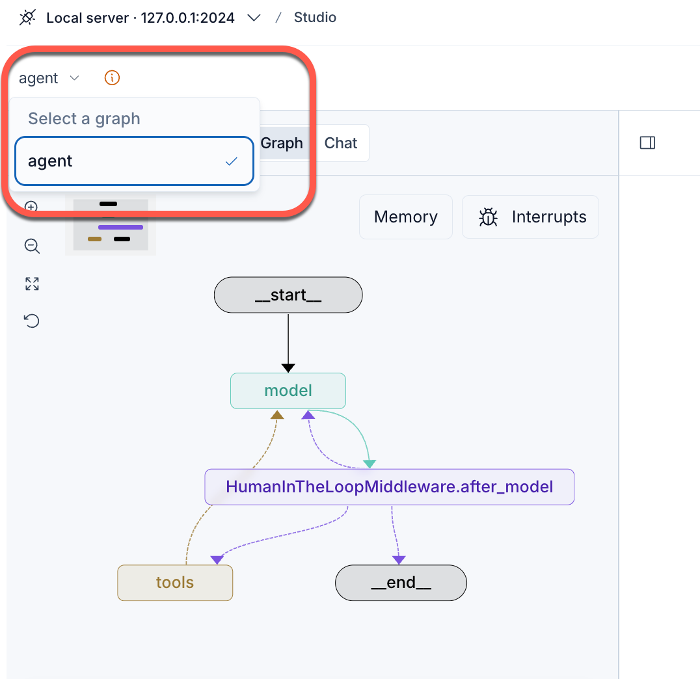

在專案根目錄建立 `langgraph.json`：

```json
{
  "dependencies": ["."],
  "graphs": {
    "agent": "notebooks/human-in-the-loop/inquiry-helper.py:agent"
  },
  "env": ".env"
}
```

### 設定欄位說明

| 欄位 | 本案例的值 | 用途 |
|---|---|---|
| `dependencies` | `["."]` | 指定專案 dependency 的位置；`.` 代表專案根目錄 |
| `graphs` 的 key | `agent` | Graph ID；連線 Agent Chat UI 時會使用此名稱 |
| `graphs` 的 value | `notebooks/human-in-the-loop/inquiry-helper.py:agent` | 指定 Python 檔案及其中的 Agent 物件 |
| `env` | `.env` | 指定環境變數檔案的位置 |

Graph object path 的格式為：

```text
<python-file-path>:<object-name>
```

因此：

```text
notebooks/human-in-the-loop/inquiry-helper.py:agent
|                                                 |
|                                                 +-- Python 中的變數 agent
+---------------------------------------------------- Python 檔案
```

路徑是相對於 `langgraph.json` 所在位置，而不是相對於目前編輯的 Notebook。

參考：[Local development & testing](https://docs.langchain.com/langsmith/local-dev-testing)

## Step 3：安裝 LangGraph CLI

在專案根目錄執行：

```bash
uv add "langgraph-cli[inmem]"
```

`inmem` extra 提供本機開發 server 所需的功能，適合開發與測試。這不是正式 production deployment 的替代方案。

參考：[Get started with Studio](https://docs.langchain.com/langsmith/quick-start-studio)

## Step 4：啟動本機 Agent Server

確認目前工作目錄中有 `langgraph.json`，再執行：

```bash
uv run langgraph dev
```

`langgraph dev` 會直接在目前的 Python environment 執行程式，支援 hot reload。

啟動成功時，終端機會顯示類似以下資訊：

```text
- API: http://127.0.0.1:2024
- Studio UI: https://smith.langchain.com/studio/?baseUrl=http://127.0.0.1:2024
- API Docs: http://127.0.0.1:2024/docs
```

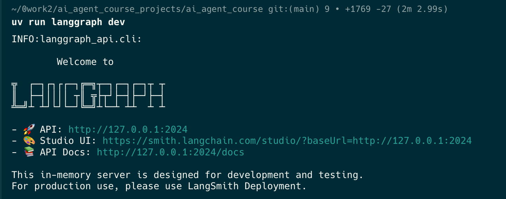


三個 URL 的責任不同：

- **API**：Agent Server endpoint，Agent Chat UI 與其他 client 透過它呼叫 Agent。
- **Studio UI**：指向 LangSmith Studio 的 URL，並指定本機 Agent Server 的 `baseUrl`。
- **API Docs**：本機 Agent Server 的 API 文件與測試頁面。


## Step 5：連線 LangSmith Studio

啟動 server 後，可以直接開啟終端機顯示的 Studio URL：

```text
https://smith.langchain.com/studio/?baseUrl=http://127.0.0.1:2024
```

Studio 可使用 Graph mode 檢查執行路徑及 state，也可使用 Chat mode 與 Agent 對話。

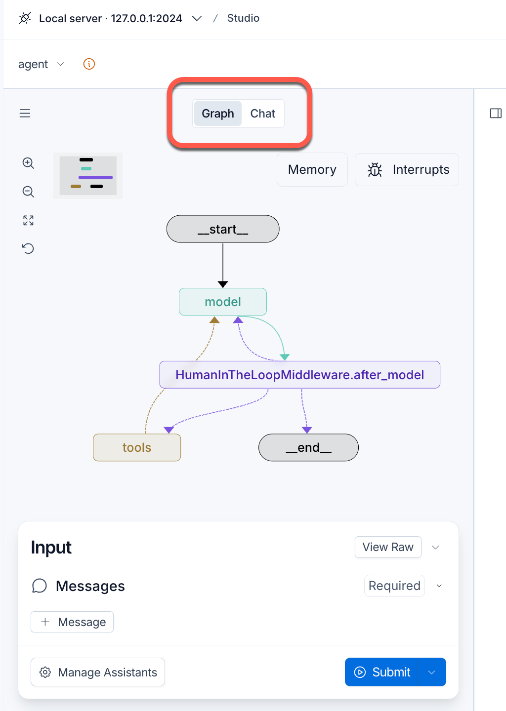

> 若瀏覽器的安全政策封鎖 HTTPS 網頁連線至本機 HTTP server，可改執行 `uv run langgraph dev --tunnel`，再依 Studio 畫面將產生的 HTTPS tunnel URL 加入 allowed origins。
> 官方文件特別指出 Safari 會封鎖這類 localhost 連線；新版 Chromium 瀏覽器也可能因 Private Network Access 政策而需要 tunnel。

參考：[Studio troubleshooting](https://docs.langchain.com/langsmith/troubleshooting-studio)

## Step 6：連線 Agent Chat UI

開啟官方託管版 Agent Chat UI：

- [https://agentchat.vercel.app/](https://agentchat.vercel.app/)

輸入以下連線資料：

| 欄位 | 本案例的值 |
|---|---|
| Graph ID | `agent` |
| Deployment URL | `http://127.0.0.1:2024` |
| LangSmith API Key | 本機 Agent Server 不需要，可留白 |

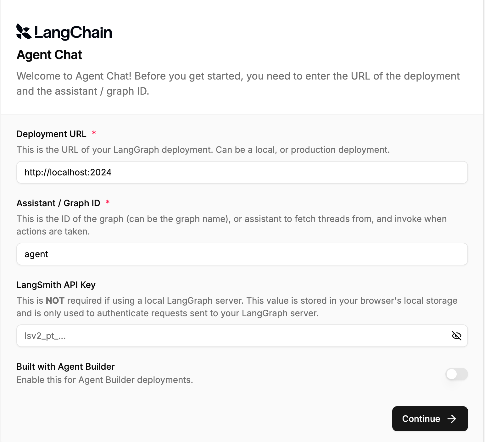

其中 Graph ID 來自 `langgraph.json` 中的 "agent" key. 

```json
"graphs": {
  "agent": "notebooks/human-in-the-loop/inquiry-helper.py:agent"
}
```

連線成功後，Agent Chat UI 會取得此 graph 的 thread 與 interrupt 資料，並將 Human-in-the-Loop request 顯示為可操作的表單。

## 詢價小幫手測試案例

### 測試目的

本案例驗證以下完整流程：

| 階段 | 步驟 | 流程 |
|---|:---:|---|
| **補齊資料** | 1 | 輸入不完整的詢價資料 |
| | 2 | `validate_inquiry_data` 發現缺少 `delivery_date` |
| | 3 | `ask_user` 產生 `interrupt` |
| | 4 | 人工以 `respond` 補充交貨日期 |
| **審核與修改郵件** | 5 | Agent 產生詢價郵件 |
| | 6 | `send_email` 產生 `interrupt` |
| | 7 | 人工 `reject` 並要求英文版 |
| | 8 | Agent 重新產生英文郵件 |
| **核准與寄送** | 9 | 人工檢查或 `edit` 後 `approve` |
| | 10 | `send_email` 才真正執行 |

在這個流程中，UI 只負責顯示 interrupt 並送回人的 decision

提醒:
- Agent Chat UI 和 LangSmith Studio 的輸入入工回覆的方式不同。
  - Agent Chat UI 會自動產生 decision 表單，使用者只要在表單中輸入訊息或修改欄位即可。
  - LangSmith Studio 需要使用者自行提供 resume JSON，並送回 Agent Server


### 初始輸入

在 Agent Chat UI 或 Studio 輸入：

```text
請幫我用以下資料寄詢價單給供應商：{
    "item_id": "ABC123",
    "request_qty": 100,
    "supplier_list": [
        {"supplier_id": "SUP001", "contact_email": "s1@supplier.com"}
    ]
}
```

輸入資料刻意省略 `delivery_date`，因此 `validate_inquiry_data` 應回報缺少欄位，Agent 再呼叫 `ask_user`。

## 使用 Agent Chat UI 測試 HITL

### 1. 回覆 `ask_user`

Agent Chat UI 會顯示 `ask_user` 的 `question`、`missing_fields` 與 `errors`。


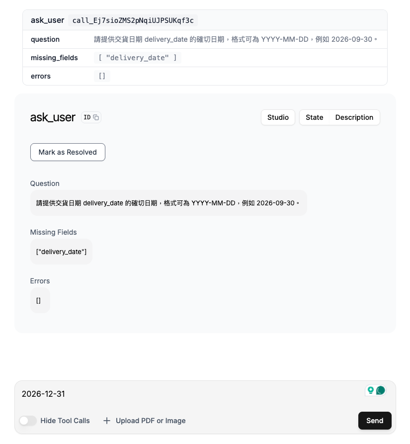


在訊息輸入區輸入交貨日期：

```text
2026-12-31
```

此操作對應 `respond` decision。

Agent Chat UI 會把文字整理為 resume 所需的 structured payload；`message` 會成為 `ask_user` 的 Tool Result，而 `ask_user` 佔位函數本身不會執行。

### 2. 拒絕中文詢價郵件

資料完整後，Agent 會建立郵件內容並呼叫 `send_email`。由於 middleware 對 `send_email` 設定 interrupt，郵件此時尚未寄出。

在 UI 的 Reject 區域輸入理由：

```text
需要英文版本
```

再按下 **Submit rejection**。

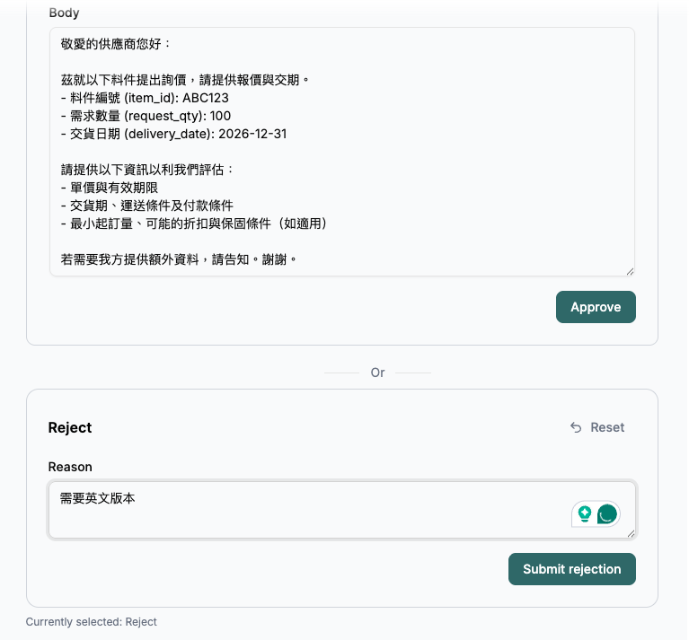

`reject` 的會拒絕這一次 Tool Call，並把原因回傳給 Agent。它不會執行原本的 `send_email`。

### 3. 要求 Agent 繼續處理

Agent 根據拒絕原因準備英文內容後，在對話框輸入：

```text
寄出郵件
```

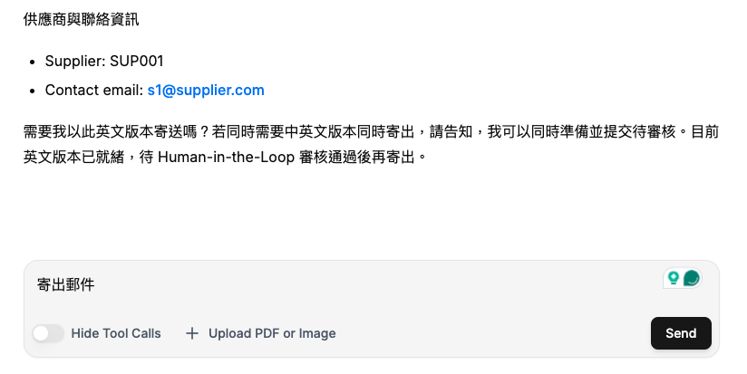

若 Agent 再次呼叫 `send_email`，UI 會產生新的人工審查畫面。

### 4. 編輯或核准英文郵件

在審查畫面確認 `contact_emails`、`subject` 與 `body`。

- 若內容正確，選擇 **Approve**，使用原始 Tool arguments 執行 `send_email`。
- 若需要修改，先編輯欄位，再送出 **Edit** decision；Tool 會使用修改後的 arguments 執行。
- 若仍不應寄出，選擇 **Reject**，並提供原因。

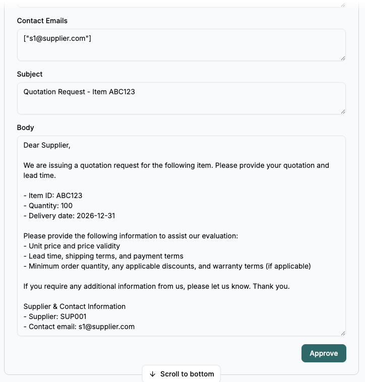

> 只有在 `send_email` 通過人工審查並實際回傳成功結果後，Agent 才會說郵件已寄出。
> 本案例的 `send_email` 是模擬用途，只將內容輸出至終端機，不會真的連線至郵件服務。

## 使用 LangSmith Studio 測試 HITL

Studio 適合查看 interrupt 的原始資料。

相較於 Agent Chat UI 會產生 decision 表單，本案例在 Studio 中需自行提供 middleware 預期的 resume JSON。

### 1. 回覆交貨日期

`ask_user` interrupt 允許的 decision 是 `respond`。

輸入以下的回覆內容(JSON 格式)：

```json
{
  "decisions": [
    {
      "type": "respond",
      "message": "delivery_date: 2026-12-31"
    }
  ]
}
```

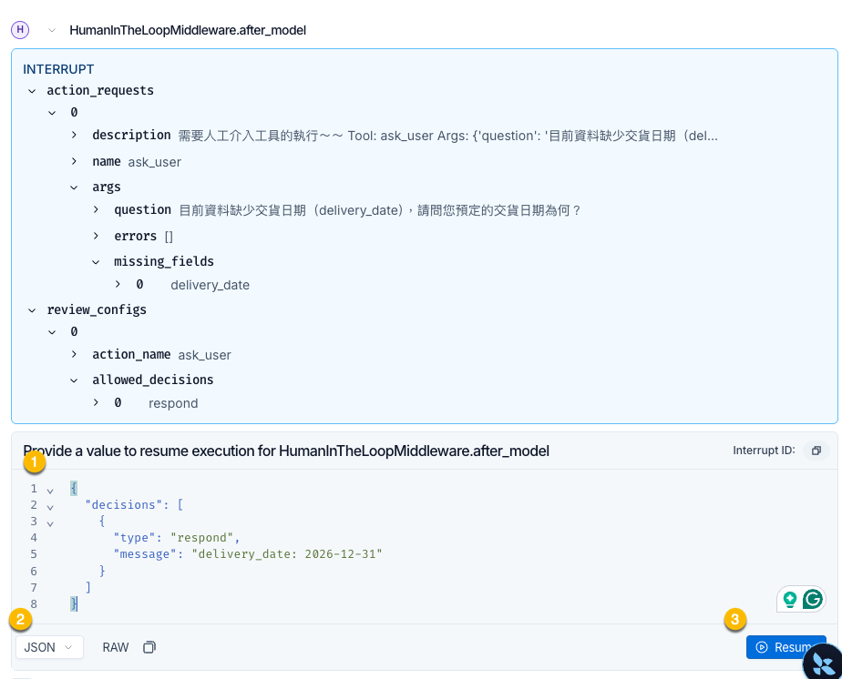

### 2. 拒絕中文詢價郵件

`send_email` interrupt 出現後，輸入：

```json
{
  "decisions": [
    {
      "type": "reject",
      "message": "需要英文版本"
    }
  ]
}
```

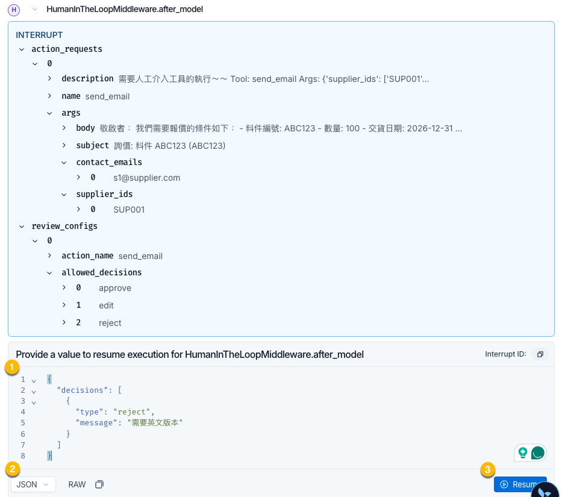


### 3. 輸入人工訊息要

Reject 後，Agent 的狀態會回到等待人工輸入，並不會產生 interrupt.

輸入並提交人工訊息：

```text
寄出郵件
```

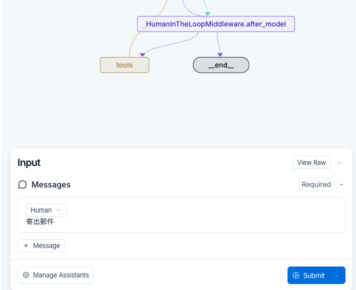


### 4. 核准寄送英文郵件

Agent 產生新的 `send_email` interrupt 後，輸入：

```json
{
  "decisions": [
    {
      "type": "approve"
    }
  ]
}
```


### Studio 送出回覆後的處理流程

上述 JSON 是使用者提供的人工決策。Studio 送出後，由 Agent Server 與 Middleware 接續處理，流程如下:

```text
HumanInTheLoopMiddleware 中斷 Agent 執行
  -> 產生 action request 與 allowed decisions

Studio 使用者
  -> 依序提供 decisions 陣列，做為 resume payload 的內容

Agent Server
  -> 將 resume payload 交回原本暫停的 thread

Middleware
  -> 將 respond 轉成 Tool Result，或依 approve/edit/reject 處理 Tool Call
```

若同一次 interrupt 中包含多個 pending actions，`decisions` 必須和 actions 依相同順序一一對應。

參考：[Human-in-the-Loop](https://docs.langchain.com/oss/python/langchain/human-in-the-loop)、[Frontend Human-in-the-Loop](https://docs.langchain.com/oss/python/langchain/frontend/human-in-the-loop)

## 常見問題與排除方式

### `GraphLoadError`：Agent 含有 custom checkpointer

**原因：** graph definition 中傳入了 `InMemorySaver()` 等一般自訂 checkpointer，但 state persistence 應由 Agent Server 管理。

**處理方式：** 移除 `create_agent(..., checkpointer=...)`，重新啟動 server。

### 載入 module 時，Agent 自動開始執行

**原因：** 轉換後的 Python 檔案仍有最外層的 `agent.invoke()` 或其他測試程式。

**處理方式：** 刪除這些呼叫，或將命令列測試放入 `if __name__ == "__main__":`。

### UI 找不到 Agent

依序檢查：

1. `langgraph dev` 是否成功啟動。
2. Deployment URL 是否為 `http://127.0.0.1:2024`。
3. Graph ID 是否和 `langgraph.json` 中 `graphs` 的 key 完全相同。
4. Python path 與 object name 是否正確。
5. `.env` 路徑與必要 API keys 是否正確。

### Studio 無法連線至 localhost

先確認 `http://127.0.0.1:2024/docs` 可以開啟。若 API Docs 正常但 Studio 仍無法連線，可改用：

```bash
uv run langgraph dev --tunnel
```

再將 CLI 產生的 HTTPS tunnel URL 加入 Studio 的 allowed origins。

### Studio 的一般文字沒有解除 interrupt

**原因：** 本案例的 Human-in-the-Loop middleware 預期 structured resume payload 的內容；一般聊天文字不一定會被 Studio 自動包裝成 `decisions`。

**處理方式：** 依 interrupt 類型輸入本講義所示的 JSON，並確認 decision type 屬於該 action 的 `allowed_decisions`。

## 重點整理

- LangSmith Studio 與 Agent Chat UI 都是 frontend；Agent 實際執行於 Agent Server。
- `langgraph.json` 負責把 Graph ID 對應至 Python module 中的 Agent 物件。
- 由 Agent Server 載入的 module 必須能安全匯入，不應在最外層執行 `agent.invoke()`。
- Agent Server 管理 thread state 與 persistence；不要直接在 server 載入的 graph definition 中加入一般 `InMemorySaver()`。
- Studio 適合觀察 graph、state 與原始 interrupt；Agent Chat UI 適合以產品化聊天介面操作 Agent。
- `respond` 提供人工答案；`reject` 拒絕本次 Tool Call；`edit` 修改 Tool arguments；`approve` 才允許原始 Tool Call 執行。
- UI 顯示核准畫面不代表工具已經執行，應以 Tool Result 或工具的實際 side effect 判斷結果。

## 參考資料

- [LangSmith Studio](https://docs.langchain.com/langsmith/studio)
- [Get started with Studio](https://docs.langchain.com/langsmith/quick-start-studio)
- [Local development & testing](https://docs.langchain.com/langsmith/local-dev-testing)
- [Agent Chat UI](https://docs.langchain.com/oss/python/langchain/ui)
- [Human-in-the-Loop](https://docs.langchain.com/oss/python/langchain/human-in-the-loop)
- [Frontend Human-in-the-Loop](https://docs.langchain.com/oss/python/langchain/frontend/human-in-the-loop)
- [Studio troubleshooting](https://docs.langchain.com/langsmith/troubleshooting-studio)
- [How to use a custom checkpointer](https://docs.langchain.com/langsmith/custom-checkpointer)
