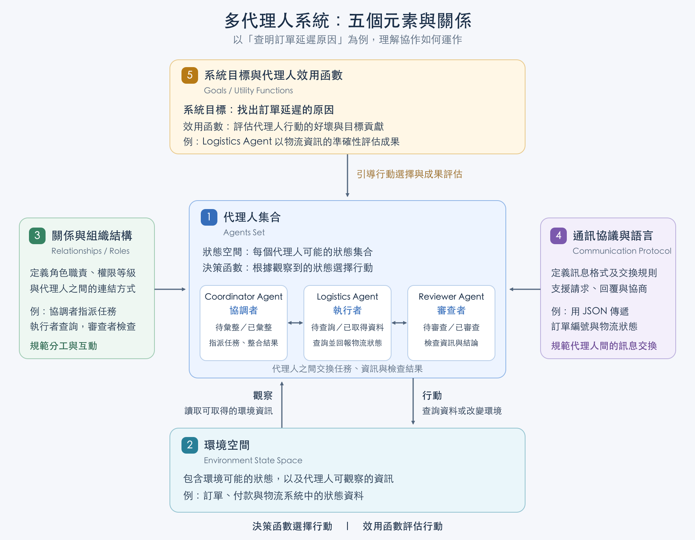
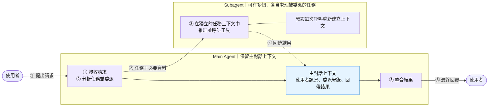
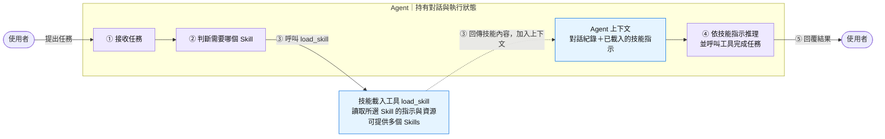
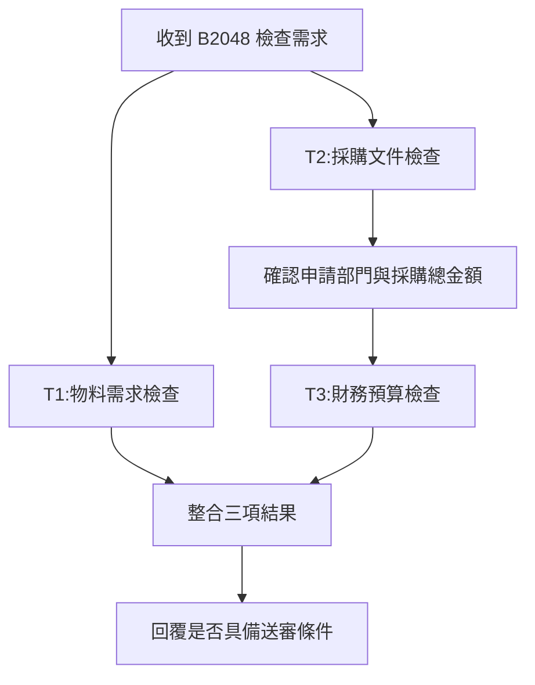
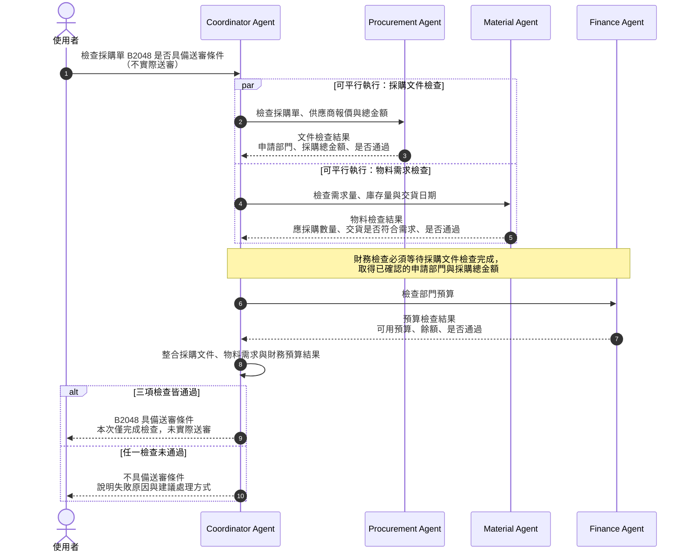

# 多代理人系統 (Multi-Agent Systems)

## 學習目標

完成本章後，學生應能：

1. 判斷多代理人系統的適用情境。
2. 說明多代理人系統的五個元素。
3. 比較 Subagents 與 Skills 的運作方式。
4. 建立 Subagent，並將之包裝成主管 Agent 可呼叫的 Tool。


## 什麼是 多代理人系統（Multi-Agent System）

多代理人系統協調各自負責專業任務的元件，共同完成複雜的工作流程。

多代理人模式適合以下情境：

- 單一 Agent 的工具過多，難以選擇合適的工具。
- 任務需要專業知識及大量上下文，例如較長的提示與特定領域的工具。
- 流程有明確的執行順序，必須先滿足指定條件，才能使用後續功能。

Ref: [Multi-agent - Docs by LangChain](https://docs.langchain.com/oss/python/langchain/multi-agent)

## 什麼時候需要 Multi-Agent？

### Single Agent 的限制 

Single Agent 通常只有一個主要推理流程，因此可能遇到：
- 上下文(context) 過載：在有限的 Context 容量，不同任務的資料、規則和對話混在一起。
- 角色衝突：同一個 Agent 同時產生答案、審查答案，容易自我認同。
- 專業提示互相干擾：財務、客服、法務等角色可能有不同規則。放在同一個 Agent，容易責任混淆。
- 只能循序執行：可獨立處理的工作仍須排隊，無法平行處理。

### 使用時機

| 明顯訊號 | 為何需要多個 Agent | 例子 |
|---|---|---|
| 工作可以真正平行進行 | 降低等待時間 | 一個 Agent 查訂單、一個查付款、一個查物流 |
| 任務需要不同專業知識 | 避免不同規則混在同一份 Prompt | 客服 Agent、財務 Agent、法務 Agent |
| 必須有獨立審查 | 產生者不應同時是唯一審查者 | Writer Agent 撰寫，Reviewer Agent 檢查 |
| Agent 必須使用不同資料或權限 | 落實最小權限與責任分離 | 查詢 Agent 可讀資料，退款 Agent 才能執行退款 |
| 子任務很長且互不依賴 | 可各自保留乾淨的上下文 | 多份研究報告分別分析後再彙整 |
| 個別任務可能失敗或需要重試 | 將錯誤限制在單一工作單元 | 物流查詢失敗，不影響訂單與付款查詢 |
| 不同角色需要協商或互相挑戰 | 系統本身包含多方觀點 | 採購、庫存與財務 Agent 協調補貨量 |
| 專業角色會被大量重複使用 | 可形成穩定、可維護的服務邊界 | ERP Agent 同時服務客服、業務與主管 |

### Single-Agent vs Multi-Agent 情境

#### Single-Agent 情境

處理「客戶詢問訂單狀態」通常只需要一個 Agent 即可，不需要 Multi-Agents：

```
Customer → Customer Service Agent → Order Tool → Response
```

因為責任單一、任務不會太長、流程簡單。

#### Multi-Agent 情境

但如果請求是「查明延遲原因、確認付款、評估補償並核准退款」，就需要多個 Agent 協作：

```
                 ┌─ Order Agent
Customer Request ├─ Payment Agent
                 ├─ Logistics Agent
                 └─ Compensation Agent
                          ↓
                   Coordinator Agent
                          ↓
                     Final Response
```

此流程中:
- 同時去確認客戶的訂單、付款與物流狀態，並決定是否需要補償。
- 每個 Agent 都有不同的專業知識、不同的資料來源
- 可以獨立、平行處理，不會互相干擾。
- 最終由 Coordinator Agent 彙整各方資訊，產生最終回覆。


### 重點 (Key takeaways)

- Multi-Agents 不是因為「一個 Agent 不夠聰明」，而是因為某些任務需要同時具備平行處理、責任分離、專業分工或獨立驗證；
- 把這些工作全部塞進同一個 Agent，會造成上下文干擾、執行瓶頸與風險集中。


## 多代理人模式 (Multi-Agent Patterns)

 
多代理人是一種架構模式(architectural blueprint)，將複雜的問題拆分給多個專門的 AI 代理人，而不是依賴單一、龐大的 LLM 提示。

一個正式的多代理人系統可以被定義包含以下五個元素：

1. 代理人集合（Agents Set）:
   - 多個獨立的代理人，有各自的狀態空間(State Space)與決策函數(Decision Function)。
   - 狀態空間表示代理人可能的狀態集合
   - 決策函數定義了代理人如何根據觀察到的狀態做出行動選擇。

2. 環境空間（Environment）:
   - 代理人所處的環境的狀態空間 (Environment State Space)，包含所有代理人可觀察的資訊。

3. 代理人間的關係與組織結構（Relationships / Roles）
   - 定義了代理人之間的社會結構、角色職責、權限等級以及系統拓撲。
   - 例如：有些代理人是專門的「審查者」，有些是「執行者」，有些是「協調者」。

4. 通訊協議與語言（Communication Protocol）
   - 定義了代理人之間如何交換訊息、協商、請求或回覆。
   - 例如：使用 JSON 或自訂的訊息格式。

5. 系統目標與代理人效用函數（Goals / Utility Functions）
   - 系統目標函數定義了整個多代理人系統的最終目標
     - 例如: 找出為什麼訂單延遲
   - 代理人效用函數定義了每個代理人如何評估自己的行動對整體目標的貢獻
     - 例如: Logistics Agent 的效用函數可能是「提供準確的物流狀態資訊」。



補充: 代理人的效用函數 vs 決策函數
- 效用函數(Utility Function)是每個代理人用來評估自己行動的好壞，通常是局部的、個別的。
- 決策函數(Decision Function)是代理人根據觀察到的狀態，選擇下一步行動的規則或演算法。

## 常見的 多代理人模式

### 子代理人模式 (Subagents pattern)

一個主管 Agent 分析任務、指派工作，再整合成員 Agent 的結果。
- 主管 Agent 決定:呼叫哪個子代理人、何時呼叫、提供什麼輸入
- Subagents 相當於 Tools, 供主管 Agent 調用。

When to use:

- 主 Agent 面對一個複雜任務，可以將它拆成數個彼此相對獨立、界線清楚的子任務，交由不同 Subagent 處理，再由主 Agent 整合結果。


系統可包含多個 Subagents，各自維護本次任務的獨立執行狀態，預設不跨呼叫保留；主 Agent 負責委派與整合結果。




### 技能 (Skills)

把一套可重複使用的專業知識、操作流程、規則與資源，封裝成「Skill」，讓 Agent 在需要時載入並依照其中的指示完成任務, 用以擴展Agent 的能力。

Skills 內為個一 "無狀態" 的流程(workflow)，以執行特定的工作。

由 Agent 決定什麼時候使用技能。

When to use:
- 想要一個 Agent 具備多種專業技能，但不想把所有技能都塞在同一個 Prompt 裡，造成混亂。

例如: 
- 訂單查詢 Skill: 給訂單編號，回傳訂單交期及狀態。
- 付款查詢 Skill: 給發票(invoice)編號，查詢應付帳款狀態。

Agent 根據任務選擇並載入 Skill，再於自己的上下文中執行。Skill 本身沒有獨立的對話狀態。



### Skills 和 Subagents 的差異:

技能模式 (Skills Pattern)本質：
- 無狀態的功能函數（Stateless Functions）, 相當於一個工作流程 (Workflow)
- 角色：代理人的「四肢」或「工具箱」。運作機制：主代理人（Master Agent）擁有完全的控制權。
- 運作機制：當它需要執行特定技術任務時（如：計算、查資料、畫圖），它會直接調用該技能，執行完畢後回傳結果。

子代理人模式 (Subagents Pattern)本質：
- 有狀態的自主實體（Stateful Autonomous Entities）。
- 角色：代理人的「專職下屬」或「智囊團」。
- 運作機制：主代理人將一個複雜的「目標」委派（Delegate）給子代理人。子代理人擁有自己的 System Prompt、內部記憶（Memory）與推論邏輯（Reasoning loop），它會自主反思修正。


## LangChain 中實作子代理人樣態

實作概念:

1. 一個 subagent 被包裝成一個 Tool
2. 主 Agent 透過 Tool 的方式呼叫 subagent
   - subagent 可以有自己的 System Prompt、Memory 與推論邏輯，並且可以獨立運作。
3. Subagent 的結果透過 ToolMessage 回到主 Agent
4. 主 Agent 整合這些 ToolMessage，產生最終回覆。


## Case Study：採購單 B2048 送審前檢查

### 1. 商業情境

製造部門需要採購一批溫度感測器，用於下個月的生產作業。採購人員已建立採購單 `B2048`，並收到供應商報價。

在送出採購單前，公司需要確認：

1. 採購單與報價資料是否完整。
2. 採購數量是否符合實際物料需求。
3. 製造部門是否有足夠預算。

使用者提出以下需求：

> 請檢查採購單 B2048 是否具備送審條件，但不要實際送審。

### 2. 業務流程

**T2:採購文件檢查**與**T1物料需求檢查**都能根據採購單編號開始，因此可以同時進行。

**T3:財務預算檢查**需要使用採購文件中已確認的申請部門與採購總金額，因此必須等待採購文件檢查完成。



### 3. 商業規則

#### 採購文件規則

1. 採購總金額為採購數量乘以單價。
2. 供應商報價必須有效。

#### 物料需求規則

1. 採購數量應等於需求量減去現有庫存量。
2. 供應商預計交貨日不得晚於物料需求日。
3. 數量不足或交貨太晚時，不具備送審條件。

#### 財務預算規則

前題: 必需完成採購文件檢查，才能進行財務預算檢查。

1. 財務檢查只能使用已確認的申請部門與採購總金額。
2. 部門可用預算必須大於或等於採購總金額。
3. 預算不足時，不具備送審條件。

#### 整體規則

1. 三項檢查都通過，才具備送審條件。
2. 任一項未通過，必須指出原因及建議處理方式。
3. 本案例只檢查送審條件，不得實際送出採購單。

### 4. 情境資料

#### 採購單 B2048

| 欄位 | 資料 |
|---|---|
| 申請部門編號 | dept-01 |
| 申請部門 | 製造部 |
| 物料編號 | T1001 |
| 物料名稱 | 溫度感測器 |
| 採購數量 | 8 個 |
| 單價 | 10,000 元 |
| 採購總金額 | 80,000 元 |
| 供應商 | AAA 電子 |
| 報價狀態 | 有效 |
| 預計交貨日 | 2026-08-20 |

採購總金額：

```text
8 × 10,000 = 80,000 元
```

#### 物料資料

現有 T1001 物料需求量、庫存量與交貨日期如下：

| 欄位 | 資料 |
|---|---|
| 生產需求量 | 10 個 |
| 現有庫存量 | 2 個 |
| 物料需求日 | 2026-08-25 |


應採購數量：

```text
10 − 2 = 8 個
```

採購單 B2048 的採購數量正好符合物料需求量，且預計交貨日 2026-08-20 早於物料需求日 2026-08-25。

因此採購單 B2048 的採購數量正確，而且預計交貨日早於物料需求日。

#### 預算資料

現有預算資料如下：

| 欄位 | 資料 |
|---|---|
| 部門編號 | dept-01 |
| 部門名稱 | 製造部 |
| 可用預算 | 100,000 元 |

採購後預算餘額：

```text
100,000 − 80,000 = 20,000 元
```

### 5. 預期商業結果

| 檢查項目 | 結果 | 原因 |
|---|---|---|
| 採購文件 | 通過 | 採購單完整，報價有效 |
| 物料需求 | 通過 | 採購數量正確，交貨日符合需求 |
| 財務預算 | 通過 | 製造部預算足夠 |
| 整體結果 | 具備送審條件 | 三項檢查皆通過 |

系統應告知使用者：

> 採購單 B2048 已具備送審條件。採購文件完整、採購數量符合物料需求，而且製造部預算足夠。本次只完成條件檢查，尚未實際送審。


## Multi-Agent 系統分析

### 1. Agent 分工角色

- Procurement Agent: 負責檢查採購文件的完整性與報價有效性(可平行執行)。
- Material Agent: 負責檢查採購數量是否符合物料需求(可平行執行)。
- Finance Agent: 負責檢查製造部的預算是否足夠支付採購總金額。
- Coordinator Agent: 負責整合三個 Agent 的檢查結果，並產生最終回覆。

### 2. Agent 間的互動流程



## 案例程式說明

完整程式請閱讀以下 Notebook：

`$code_repo/notebooks/multi-agents/case-study.ipynb`

這份 Notebook 將前述的採購單 `B2048` 情境實作為 Subagents Pattern。

實作建立三個 Subagents 及一主管 Agent(Coordination Agent)。

Coordination Agent 將有明確邊界的工作委派給三個專業 Subagent，再整合它們的結果。

使用者提出的問題為：

```text
請協助檢查採購單 B2048 是否具備送審條件。
```

系統只進行送審前的條件檢查，不會建立、修改、核准或實際送出採購單。

### 閱讀目標

完成這份 Notebook 後，應能理解：

1. 如何用不同的 System Prompt 與 Tools 建立專業 Agent。
2. 如何用 Pydantic Schema 限制專業 Agent 的輸出格式。
3. 如何將一個 Agent 包裝成另一個 Agent 可以呼叫的 Tool。
4. 如何由 Coordination Agent 控制子任務的執行順序與資料依賴。
5. 如何限制主 Agent 與專業 Agent 的責任，避免重複判斷或越權操作。

### 實作架構

Notebook 建立三個專業 Agent 與一個 Coordination Agent：

```text
使用者
  ↓
Coordination Agent
  ├── call_procurement_agent(Tool) → Procurement Agent(Agent)
  │                              └── check_procurement_rules (Tool)
  ├── call_material_agent(Tool)    → Material Agent(Agent)
  │                              └── check_material_requirements
  └── call_finance_agent(Tool)     → Finance Agent(Agent)
                                 └── check_department_budget
```

這個架構有兩層 Tools：

- **底層商業 Tools**：查詢模擬資料並執行採購、物料或預算規則。
- **Agent Tools**：將專業 Agent 包裝成 Coordination Agent 可以呼叫的 Tool。

因此，Coordination Agent 不會直接呼叫底層商業 Tools。它只負責委派工作、控制流程與整合結果。

### 專業 Agent (Subagent) 的共通結構

三個專業 Agent (Subagent)  都依照相同的步驟建立：

1. 使用 System Prompt 定義角色、工作範圍與禁止事項。
2. 使用 Pydantic Model 定義結構化輸出。
3. 建立模擬的採購、物料或預算資料。
4. 將商業檢查規則封裝成 Tool。
5. 使用 `create_agent()` 建立 Agent，並綁定該角色可以使用的 Tool。
6. 先單獨測試專業 Agent，再交給 Coordination Agent 使用。

共通的資料流如下：

```text
使用者訊息
  ↓
專業 Agent 判斷要呼叫的 Tool
  ↓
Tool 執行商業規則並回傳結果
  ↓
ToolMessage 回到專業 Agent
  ↓
依 Output Schema 產生結構化結果
```

### 建立 Procurement Agent

Procurement Agent 負責檢查採購文件. 在 System Prompt `PROCURE_AGENT_SYSTEM_PROMPT` 中，它被要求使用 Tool 檢查採購單。

將採購文件檢查規則封裝成 `check_procurement_rules()`:

```python
from langchain.tools import tool

@tool
def check_procurement_rules(document_id: str) -> dict[str, str]:
    ...
```

除此之外，`check_procurement_rules()` 會呼叫 `get_procurement_document(document_id)`，以模擬去資料庫取得採購單資料。

`check_procurement_rules()` 將回傳採檢查結果，其欄位會符合以下的 Pydantic Schema：

```python
from pydantic import BaseModel, Field
from typing import Literal

class ProcurementCheckResult(BaseModel):
    document_id: str = Field(..., description="採購單編號")
    status: Literal["ready", "blocked", "unknown"] = Field(..., description="檢查狀態")
    department_id: str = Field(..., description="申請部門編號")
    department: str = Field(..., description="申請部門")
    total_amount: float = Field(..., description="採購總金額")
    check_results: str = Field(..., description="檢查結果與原因")
    recommendations: str = Field(..., description="建議處理方式")
```

完成 System Prompt、Tool 與 Output Schema 後，使用 `create_agent()` 建立 Procurement Agent：

```python
from langchain.agents import create_agent

procurement_agent = create_agent(
    model="gpt-5-nano",
    system_prompt=PROCURE_AGENT_SYSTEM_PROMPT,
    tools=[check_procurement_rules],
    response_format=ProcurementCheckResult
    )
```

測試 Procurement Agent:

```python
# Test the Procurement Agent with a sample procurement document ID
test_document_id = "B2048"
result_of_check_procurement = procurement_agent.invoke(
    input={"messages": [
        {"role": "user", "content": f"請檢查採購單 {test_document_id} 是否符合送審前的規則。"}
    ]}
)
```

可在 `messages` 中觀察以下順序：

```text
HumanMessage → AIMessage(tool_calls) → ToolMessage → AIMessage
```

這表示 Agent 先決定呼叫 `check_procurement_rules`(ToolCall)，收到 Tool 的檢查結果後(ToolMessage)，再產生符合 Schema 的結構化回覆(AIMessage)。

### 建立 Material Agent 與 Finance Agent

Material Agent 與 Finance Agent 的建立方式與 Procurement Agent 類似。它們各自有自己的 System Prompt、Output Schema 與商業規則 Tool。

參考 Notebook 中的程式碼。

### Finance Agent 的 Tool 

Finance Agent 的 Tool `check_department_budget()` 它有三個欄位:

```python
check_department_budget(document_id, total_amount, department_id)
```

這三個欄位是來自 Procurement Agent 的回傳結果，裡面包含已確認的 `document_id`, `total_amount`, 和 `department_id`。

當採購文件是 `ready` 時，Coordinate Agent 才可使用上述的三個欄位`check_department_budget(document_id, total_amount, department_id)` 去檢查預算是否足夠。

### 將三個 Agents 包裝成 Tools

建立三個專業 Agent 後，使用 `@tool` 將它們包裝成以下 Tools:

- `call_procurement_agent(document_id)`: 呼叫 Procurement Agent，並回傳其檢查結果。
- `call_material_agent(document_id)`: 呼叫 Material Agent，並回傳其檢查結果。
- `call_finance_agent(document_id, total_amount, department_id)`: 呼叫 Finance Agent，並回傳其檢查結果。

`call_procurement_agent` 工具的程式碼如下: 

```python
# Wrap the three agents into tools

from langchain.tools import tool

@tool
def call_procurement_agent(document_id: str) -> dict[str, str]:
    """
    Call the Procurement Agent to check the procurement document.
    """
    return procurement_agent.invoke(
        input={"messages": [
            {"role": "user", "content": f"請檢查採購單 {document_id} 是否符合送審前的規則。"}
        ]}
    )   
```

其它兩個 Tools 的程式碼與此類似。

每個 Tool 的函數內部會呼叫對應專業 Agent 的 `invoke()`。從 Coordination Agent 的角度來看，它是在呼叫 Tools；但每個 Tool 背後其實各自包含一個具備 System Prompt、Tools 與推論流程的 Agent。


### 建立 Coordination Agent

在 Coordination Agent 的 System Prompt `COORD_AGENT_SYSTEM_PROMPT` 中特別說明**工作流程及商業規則**, 使主管 Agent 能委派工作:

```
1. 取得使用者指定的採購單編號。
2. 呼叫 Procurement Agent 檢查採購文件。
3. 呼叫 Material Agent 檢查物料需求。
4. 只有 Procurement Agent 回傳 `ready`，並確認申請部門與採購總金額後，才能呼叫 Finance Agent。
5. 整合三個 Agent 的檢查結果。
```

此外，指定整體狀態的判斷規則如下：

```
三項檢查都是 `ready`：整體狀態為 `ready`。
任一項檢查為 `blocked`：整體狀態為 `blocked`。
沒有 `blocked`，但任一項為 `unknown`：整體狀態為 `unknown`。
如果採購文件檢查未通過或無法確認，不得執行財務檢查，並說明財務檢查尚未進行。
```

之後，使用已定義的 System Prompt 與三個 Agent Tools，建立 Coordination Agent：

```python
coordination_agent = create_agent(
    model="gpt-5-nano",
    system_prompt=COORD_AGENT_SYSTEM_PROMPT,
    tools=[
        call_procurement_agent,
        call_material_agent,
        call_finance_agent
    ]
)
```

### 執行完整案例

最後，以採購單 `B2048` 呼叫 Coordination Agent：

```python
result_of_coordination = coordination_agent.invoke(
    input={"messages": [
        {
            "role": "user",
            "content": "請協助檢查採購單 B2048 是否具備送審條件。"
        }
    ]}
)
```

執行後的 messages 會依序顯示：

```text
HumanMessage → AIMessage(two tool_calls) → ToolMessage → ToolMessage → AIMessage(tool_call) → ToolMessage → AIMessage(final response)
```

第一個 AIMessage 會同時呼叫 `call_procurement_agent` 與 `call_material_agent` 兩個 tool calls.
之後產生兩者的 ToolMessage 回覆。

接著，第二個 AIMessage 為呼叫 `call_finance_agent` 的 tool call, 之後產生其 ToolMessage 回覆。

最後一個 AIMessage 為整合三個專業 Agent 的結果，並產生最終回覆。

參考輸出如下:

```
採購單編號：B2048

一、採購文件檢查結果
- 狀態：ready
- 申請部門：製造部（dept-01）
- 採購總金額：80000.0
- 檢查結果：採購單符合送審前的檢查規則。
- 建議是否可送審：可以進行送審。

二、物料需求檢查結果
- 狀態：ready
- 採購單審核對應物料：物料ID T1001
- 摘要檢查結果：採購單符合物料需求。
- 建議是否可送審：可以進行送審。

三、財務預算檢查結果
- 狀態：ready
- 申請部門：dept-01
- 採購總金額：80000.0
- 可用預算：100000.0
- 檢查結果：可用預算足以支付採購總金額。
- 建議是否可送審：可以進行送審。

四、整體狀態
- 整體狀態：ready

五、阻擋原因與建議處理方式
- 阻擋原因：無阻擋；三項檢查皆為 ready。
- 建議處理方式：本次僅為條件檢查，三方皆已通過與具備送審條件的初步信號；若需要正式送審，請依組織流程提出正式送審申請。我不會實際送出採購單，僅完成條件檢查。

備註
- 本回覆僅為條件檢查結果的整合與說明，尚未實際送審。若需要，我可以協助整理成送審申請材料的大綱或提供下一步操作指引。

```
