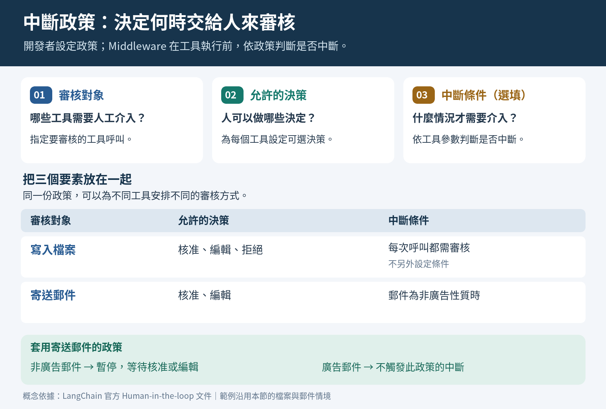
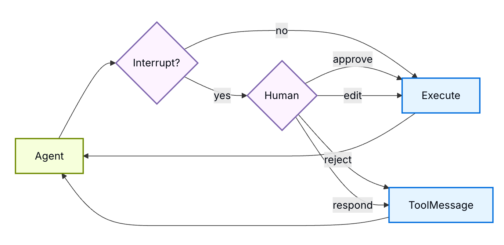
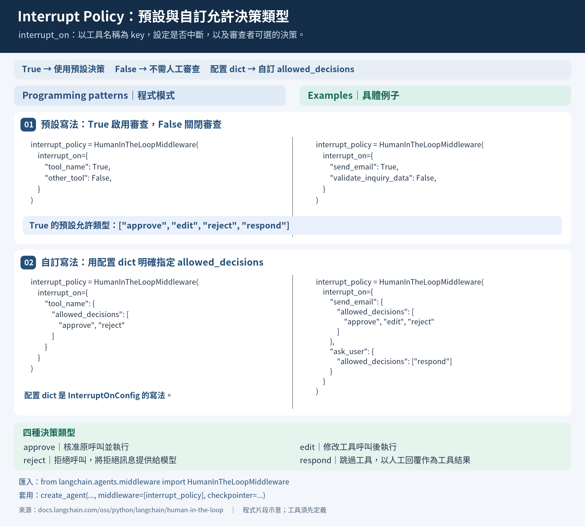
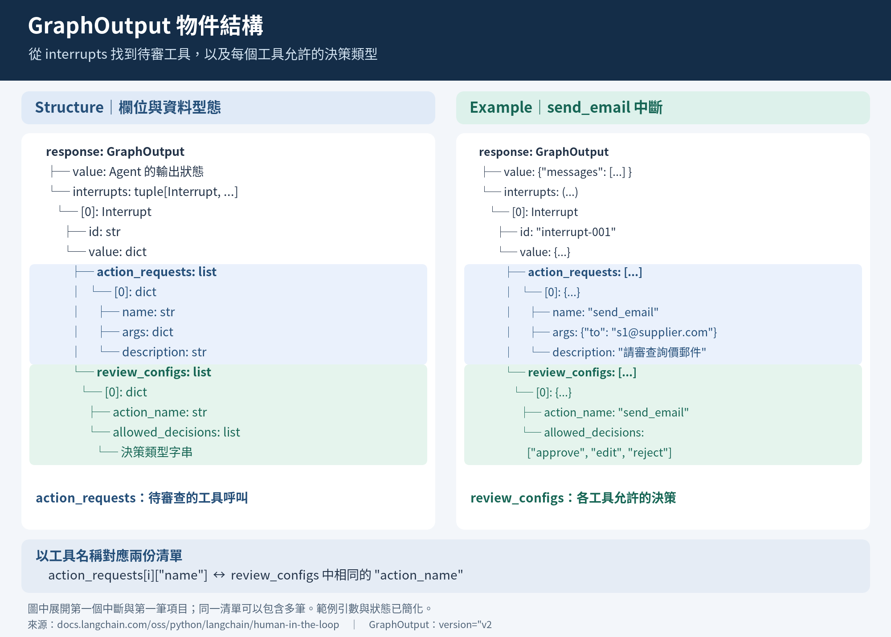

# 人工介入 (Human in the Loop, HITL) (1): 用戶中斷、中斷政策與中斷訊息

## 學習目標

完成本章後，你將能夠：

1. 說明人工介入（HITL）的用途與工具執行前的介入時機。
2. 區分核准、編輯、拒絕與回覆四種決策的用途。
3. 使用 `interrupt_on` 設定需審核的工具、允許的決策與中斷條件。
4. 說明中斷政策、工具清單與 Checkpointer 在建立 Agent 時的用途。
5. 說明 `GraphOutput` 如何呈現中斷時的 Agent State 與中斷訊息。
6. 從中斷訊息的 `action_requests` 與 `review_configs` 取得工具呼叫資訊及允許的決策。

## Human-in-the-Loop 解決什麼問題？

與 Agent 互動時, 某些情境下需要人工介入做決策，告訴 Agent 要做什麼，或是確認 Agent 的決策：
  
例如: 
- 確認: 寄送電子郵件前，讓人確認收件者與內容。
- 核准: 寫入或刪除檔案前，讓人核准。
- 審查: 執行修改資料的 SQL 前，讓人審查。
- 補充資訊: Agent 資訊不足時，要求使用者提供更多資訊。

## 何時需要人工介入？

Human-in-the-Loop (HILP) 讓使用者控管(oversight) 「工具」是否執行

在 Agent 執行工具前，先暫停並等待人類決定。

## 決策類型

Agent 產生 Tool Call 及其參數後，執行工具前，允使使用者介入審核:

審核時有以下幾四種決策類型:

- 核准(Approve): 允許 Agent 執行工具呼叫, 使用 Agent 提供的原始的工具參數。
- 編輯(Edit): 編輯工具的呼叫參數後, 再執行工具呼叫。
  - e.g. Agent 產生的 email 收件人不正確，使用者編輯收件人後，再執行工具呼叫。
- 拒絕(Reject): 拒絕 Agent 執行工具呼叫
  - e.g. Agent 產生的 SQL 會刪除正式環境資料，使用者拒絕執行。
- 回覆(Respond): 針對 `ask_user` 類型的工具呼叫，使用者回覆答案給 Agent。Agent 會將此回覆視為工具呼叫的結果，再繼續下一輪的推理。
  - 例如: email 中沒有收件人，Agent 產生 `ask_user` 類型的工具呼叫, 要求使用者提供收件人。
  - 可視為: Human acting as a tool

## 如何控管那些工具呼叫需要人工介入？

開發者設定一個中斷政策(interrupt policy).

在此政策中，指定:
- 1)需要人工介入的工具呼叫(tool call), 及 2)其允許的決策類型
- 工具呼叫的執行條件(選擇性)

例如，有 `write_file` 及 `send_email`.

依據不同工具可能產生的風險，我們可設定:
- `write_file`: 需要人工介入，允許的決策類型為: 核準、編輯、拒絕、(人工)回覆
- `send_email`: 需要人工介入，允許的決策類型為: 核準、編輯
  - e.g. 當 email 類型為非廣告性質時，才需要人工介入。(執行條件)



## LangChain 的 Human-in-the-Loop 的中斷到執行過程(概覽)

1. 使用者輸入
2. 由 Middleware 負責執行中斷工具的呼叫，並暫停 Agent 執行。
3. 中斷後，Middleware 會保存暫停時的 Agent State
4. 待使用者做出決策後, Middleware 取得原先的 Agent State, 再繼續執行 Agent 被先前中斷的工具。



Source: [Human in the Loop | LangGraph](https://docs.langchain.com/oss/python/deepagents/human-in-the-loop?_gl=1*mwpn4b*_gcl_au*MTUxMzgyNzc4Mi4xNzgzNjk3MDYy*_ga*MTE0ODYzNjc0MC4xNzc0NTczMDU3*_ga_47WX3HKKY2*czE3ODc1ODcxNTQkbzYxJGcxJHQxNzg3NTg3MzUxJGoyNSRsMCRoMA..)

## LangChain 中定義中斷政策的方式

### 先定義 Tool Functions

建立 Agent 所使用的工具函數, 並定義其功能與參數。

之後建立一個工具清單, 並將工具函數加入清單中。

可在 Tool Function 中, 注入 `ToolRuntime`, 以取得 Agent State 或其它的執行時資訊。

```python
from langchain.tools import Tool, ToolRuntime

@tool
def tool_1(param1: str, param2: int, tool_runtime: ToolRuntime) -> str:
    """
    工具 1 的功能描述；使用 ToolRuntime
    """
    ...
    return result

@tool
def tool_2(param1: str) -> str:
    """
    工具 2 的功能描述；不使用 ToolRuntime
    """
    ...
    return result

# 建立工具清單
tools = [tool_1, tool_2]
```

### 定義中斷政策 (Interrupt Policy)

使用 [`langchain.agents.middleware.HumanInTheLoopMiddleware`](https://reference.langchain.com/python/langchain/agents/middleware/human_in_the_loop/HumanInTheLoopMiddleware) 類別定義 HITL 中斷函數。

建立 `HumanInTheLoopMiddleware` 物件時，提供以下兩個參數:
- `interrupt_on`: 指定哪些工具呼叫需要人工介入，以及允許的決策類型(必要)。
- `description_prefix`: 人工審核請求的說明文字前綴，讓審核者知道這次工具呼叫需要確認 (選項)。

```python

from langchain.agents.middleware import HumanInTheLoopMiddleware, InterruptOnConfig

interrupt_policy = HumanInTheLoopMiddleware(
    interrupt_on={...},  # 中斷政策 dict 
    description_prefix="你的中斷訊息前綴字串～～"
)

```

### 中斷政策的基本寫法

`interrupt_on` 參數是一個 `dict[str, bool | InterruptOnConfig]`，用來指定哪些工具呼叫需要人工介入，以及允許的決策類型, 它的 key 與 Value:  

- key: 工具函數名稱, 要和工具清單中的工具函數名稱一致。
- value:  bool 或者 [`InterruptOnConfig` 物件](https://reference.langchain.com/python/langchain/agents/middleware/human_in_the_loop/InterruptOnConfig)。
  - bool: 
    - True: 需要人工介入，允許的決策類型為: 核准、編輯、拒絕、回覆
    - False: 不需要人工介入
  - `InterruptOnConfig`: 允許自訂決策類型與執行條件。

例如，以下中斷政策，指定 `write_file` 與 `send_email` 需要人工介入，使用預設的允許決策類型，其他工具不需要人工介入。

```python
from langchain.agents.middleware import HumanInTheLoopMiddleware
# 工具清單
tools = [write_file, send_email, validate_inquiry_data]
...
interrupt_policy = HumanInTheLoopMiddleware(
    interrupt_on={
        "write_file": True,  #預設允許: 核准、編輯、拒絕、回覆
        "send_email": True,
        "validate_inquiry_data": False
    },
    description_prefix="需要人工介入工具的執行～～"
)
```

### 自訂中斷政策的寫法 (`InterruptOnConfig` 物件)

當要自訂工具的允許決策類型或執行條件時, 可使用 `InterruptOnConfig` 物件。

文字寫法為:

```python
interrupt_on={
    "function_name_1": InterruptOnConfig( # 建立 InterruptOnConfig 物件
        allowed_decisions=["approve", "edit", "reject"],
        when=your_condition_function
    ), 
    "function_name_2": { #或者, 直接使用 dict literal 描述 InterruptOnConfig 物件
        "allowed_decisions": ["approve", "reject"],
        "when": your_condition_function_2
    },
    }
```

`InterruptOnConfig` 物件有兩個重要屬性:
- `allowed_decisions`: 允許的決策類型列表, 例如: `["approve", "edit", "reject"]`
- `when`: 一個函數回傳 bool, 用來判斷是否要執行。

例如: 
假設有兩個工具函數: `write_file` 與 `execute_sql`，我們希望:
- `write_file` 需要人工介入，允許的決策類型為: 核準、編輯、拒絕，且只有在寫入工作目錄以外的檔案時才需要人工介入。
- `execute_sql` 需要人工介入，允許的決策類型為: 核準、拒絕

```python
interrupt_policy = HumanInTheLoopMiddleware(
            interrupt_on={
                "write_file": {
                    "allowed_decisions": ["approve", "edit", "reject"],
                    # 只有在寫入工作目錄以外的檔案時才需要人工介入
                    # writes_outside_workspace() 是一個自訂函數, 回傳 bool
                    "when": writes_outside_workspace,
                },
                "execute_sql": {
                    "allowed_decisions": ["approve", "reject"],
                    "when": is_write_query,
                },
            },
            # 自訂中斷訊息的前綴字串
            description_prefix="需要人工審查以下工具的執行:",
        )
```

上述 `write_outside_workspace()` 與 `is_write_query()` 函數是自訂的函數，回傳 bool。

提醒，在 `interrupt_on` 我們使用 dict literal 描述一個 `InterruptOnConfig` 物件，因為該物件本身是一個 `TypedDict`. 


### 中斷政策撰寫的複習圖卡




### 建立 Agent 並注入中斷政策

在建立 Agent 時, 需要注入以下物件:
- `tools`: 工具列表
- `middlewares`: 中斷政策物件列表, 例如: `[interrupt_policy]`
- `checkpointer`: 用來保存 Agent State 的物件, 例如: `InMemoryCheckpointer()`
  - 一定要使用 `checkpointer` 物件。因為中斷後，Agent 會暫停執行，並保存 Agent State。等使用者做出決策後，再繼續執行被中斷的工具呼叫。

程式碼樣本如下:

```python
from langchain.agents import create_agent, AgentState
from langgraph.checkpoint.memory import InMemorySaver
from langchain.agents.middleware import HumanInTheLoopMiddleware

class EmailState(AgentState):
    email: str

agent = create_agent(
    model="gpt-5-nano",
    tools=[tool_1, tool_2, your_tools]
    checkpointer=InMemorySaver(),
    middleware=[your_HumanInTheLoopMiddleware],
)
```

例如, 延續上面的範例，完整的程式碼如下:

```python
from langchain.agents import create_agent, AgentState
from langgraph.checkpoint.memory import InMemorySaver
from langchain.agents.middleware import HumanInTheLoopMiddleware

agent = create_agent(
    model="gpt-5-nano",
    system_prompt="your system prompt",
    tools=[write_file, execute_sql]
    checkpointer=InMemorySaver(),
    middleware=[interrupt_policy]
)
```

## 中斷後回傳的結果

中斷後，Agent 會暫停執行，並回傳一個 `GraphOutput` 物件。

我們會從`GraphOutput` 物件取得:
- 產生的一個或多個中斷訊息及目前的 AgentState
- 每個中斷下:
  - 決策請求(action request): 列出被中斷的工具呼叫訊息，包含工具名稱、參數與說明文字
  - 決策配置(review config): 列出每個被中斷的工具呼叫允許的決策類型

提供給人工審查介面使用。


註: 部份的 Chatbot UI 可以直接使用這些資訊，產生人工審查介面，讓使用者做出決策。如:
- [Agent Chat UI](https://docs.langchain.com/oss/python/langgraph/ui) 
- [Assistant-UI](https://docs.langchain.com/oss/python/langchain/frontend/integrations/assistant-ui)

### Invoke Agent 要求中斷時產生 `GraphOutput` 物件

在 `config` 中使用 `version` key 指定 `version=2`，回傳 LangGraph 的 v2 輸出格式，讓結果成為具有結構化欄位的 [GraphOutput 物件](https://reference.langchain.com/python/langgraph/types/GraphOutput)。

程式樣版如下:

```python
agent.invoke(
    {"messages":[{"role":"user", "content":"your user input"}]},
    config={"thread_id":"your_thread_id",
            "version":2}
)
```

#### 範例

假設已建立一個 `agent`, 並設定以下 tools 的中斷政策:

```python
from langchain.agents.middleware import HumanInTheLoopMiddleware, InterruptOnConfig

interrupt_policy = HumanInTheLoopMiddleware(
    interrupt_on={
        "ask_user": InterruptOnConfig(allowed_decisions=["respond"]),
        "send_email": InterruptOnConfig(allowed_decisions=["approve", "edit", "reject"]),
        "validate_inquiry_data": False},
        description_prefix="需要人工介入工具的執行～～"
)
```

這個 policy 中: 

- `validate_inquiry_data` 函數用來檢查詢價資料是否完整，不需要人工介入。
- `ask_user` 函數用來詢問使用者補充資料。當 `validate_inquiry_data()` 回傳資料不完整時，會在 `ask_user()` 中斷，等待使用者回覆。
  - 允許的決策類型為: 回覆(respond)
  - `send_email` 函數用來寄送詢價 email，會在中斷等待使用者核准、編輯或拒絕。 


假設 `inquiry_data` 中含有開立需價單中所需要的資料:

```python
inquiry_data = {
    "item_id": "ABC123",
    "request_qty": 100,
    "delivery_date": "2026-12-31",
    "supplier_list": [
        {"supplier_id": "SUP001", "contact_email": "s1@supplier.com"},
        {"supplier_id": "SUP002", "contact_email": "s2@supplier.com"}
    ]
}
```

Invoke agent 時，傳入使用者的輸入，並指定 `thread_id`:

```python
agent.invoke(
    {"messages":[{"role":"user", "content":f"請幫我用以下資料寄詢價單給供應商：{inquiry_data}"}]},
    config={"thread_id":"your_thread_id",
    version="2"}
)
```

### 中斷後的輸出: `GraphOutput` 物件

Agent 被中斷後，回傳的 `GraphOutput` 物件中。

`GraphOutput` 物件中有兩個重要欄位:
- `value`: AgentState 物件，可看到目前所有的 messages
- `interrupts:tuple[Interrupt, ...]`: 一個或多個中斷訊息的 tuple, 每個中斷訊息都是一個 [`Interrupt` 物件](https://reference.langchain.com/python/langgraph/types/Interrupt)。

我們可從 `Interrupt` 物件中取得被中斷的工具呼叫訊息及允許的決策類型，提供給人工審查介面使用。

#### `Interrupt` 物件的結構： value 及 review_configs

`Interrupt` 的 `value` 屬性提供給人工審查介面使用的完整中斷資料。

`value`屬性是一個 dict, 其欄位如下:

```text
Interrupt
└─ value
   ├─ action_requests(可多個 request)
   │     ├─ name
   │     ├─ args
   │     └─ description
   └─ review_configs (可多個 request)
      └─ action_name
      └─ allowed_decisions
```

#### `action_requests` 的結構

`action_requests` 的結構如下:

```python
"action_requests": [
    {
        "name": "your_tool_function_name",
        "args": {...},
        "description": "..."
    }
]
```

- name: 被呼叫的工具函數名稱
- args: 傳入的參數及引數
- description: 供人工審查介面顯示的摘要，重複列出工具函數名稱與參數，方便審查者理解目前要處理什麼. 

例如: 當詢價單資訊不足時，會產生以下中斷訊息:

```python
(Interrupt(value={'action_requests': [
    {'name': 'ask_user', 
     'args': {'errors': [],
               'missing_fields': ['delivery_date'],
               'question': '請提供交貨日期（delivery_date），以完成詢價資料。建議以 '
                            'YYYY-MM-DD 格式，例如 '
                            '2026-09-30。'},
      'description': '需要人工介入工具的執行～～\n'
                            '\n'
                            'Tool: ask_user\n'
                            "Args: {'question': "
                            "'請提供交貨日期（delivery_date），以完成詢價資料。建議以 "
                            'YYYY-MM-DD 格式，例如 '
                            "2026-09-30。', "
                            "'missing_fields': "
                            "['delivery_date'], "
                            "'errors': []}",
    }],
    'review_configs': [...]},
    id='...'),)
```

#### `review_configs` 的結構

`Interrupt` 物件的另一個屬性 `review_configs` 說明多個動作所允許的決策類型，結構如下:

```python
...
"review_configs": [
    {
        "action_name": "your_tool_function_name",
        "allowed_decisions": [...]
    }
]
```

例如，上述中斷訊息的 `review_configs` 內容如下:

```python
(Interrupt(
    ...
    'review_configs': [{'action_name': 'ask_user',
                    'allowed_decisions': ['respond']}]},
    id='...'),)
```

### GraphOutput 物件的結構複習圖卡




