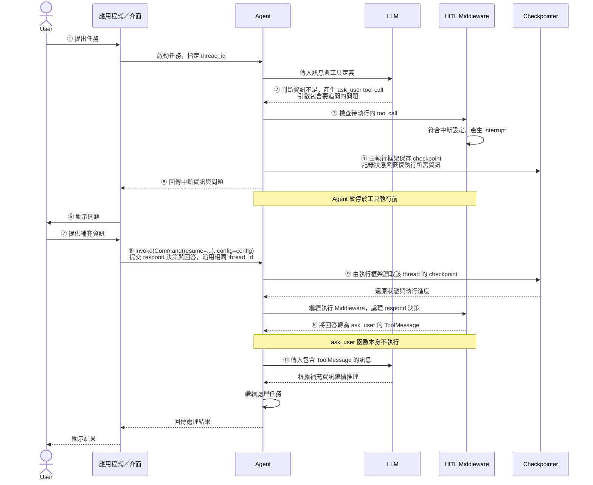
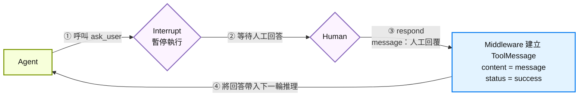
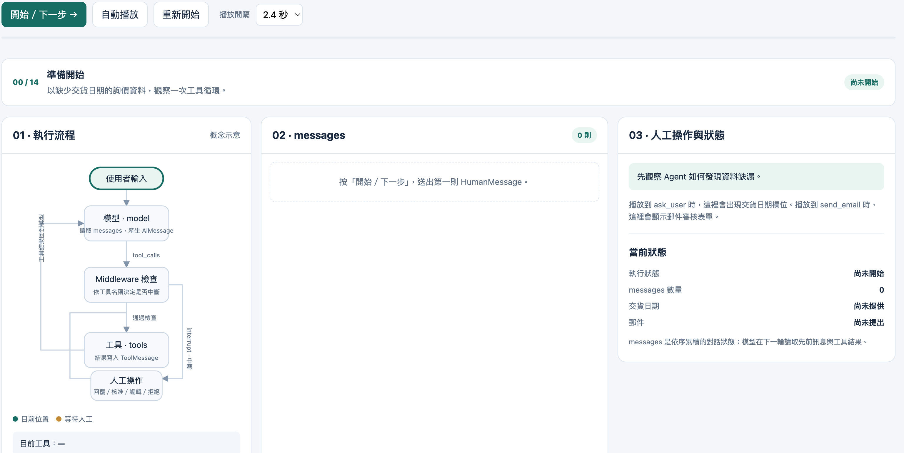

# 人工介入 (Human in the Loop, HITL) (2): 回應中斷、核准、編輯與拒絕

## 學習目標

完成本章後，你將能夠：

1. 區分核准、編輯、拒絕與回覆四種人工決策的用途與執行結果。
2. 使用 `Command(resume={"decisions": [...]})` 提交決策，並沿用相同的 `thread_id` 恢復 Agent 執行。
3. 從 `GraphOutput.interrupts` 讀取待審核工具的名稱與參數。
4. 說明 `ask_user` 佔位工具如何配合 HITL Middleware 暫停 Agent，向使用者追問缺少的資訊。
5. 追蹤人工回覆轉為 `ToolMessage`，再進入模型下一輪推理的資料流。
6. 使用 `EditDecision` 修改工具名稱或參數，並區分直接修改與拒絕後要求 Agent 重寫的處理方式。

## 回應中斷(Responding to interrupts)

### 回應中斷的流程的基本寫法

Agent 中斷工具執行後，等待人工決策。

有四種決策類型: 核準 (approve), 編輯(edit), 拒絕(reject), 回覆(respond)

不論是哪一種決策類型，都是在執行 agent 的 `invoke()` 時，傳入 [`Command` 物件](https://reference.langchain.com/python/langgraph-sdk/schema/Command)，並指定 `resume` 屬性值。

意思是命令是要繼續執行被中斷的工具呼叫。

我們要傳給 `resume` 屬性一個物件，內有 `decisions` 屬性，代表人工的決策列表。

Command 的樣版如下:

```python
command = Command(
    resume={
        "decisions":[ApproveDecision | EditDecision | RejectDecision | RespondDecision]
    }
)
```

Invoke agent 時，除了傳入 command 物件，還要傳入 `config` 物件，指定 `thread_id`，以便取得原先被中斷的 Agent State。

```python
agent.invoke(command, 
            config=config # Same thread ID to resume the paused conversation
)
```

Note: `Command` 物件本身是 `TypedDict`
- LangChain SDK 大部用 `TypedDict` 物件來描述 API 輸出/輸入及事件資料的 schema.
- 這樣可提供更好的靜態型別檢查

回傳 `Command` 的寫法是相同的，不同的是 decision 的內容。

接著我們介紹四種決策類型的回應寫法。


### 回應 - RespondDecision

`ResponseDecision` 是回應 Agent 對於 User 的提問。
- 例如: Agent 要求提供缺少的資訊，以便完成工具呼叫。

#### 如何暫停 Agent, 向 User 追問缺少的資訊？

因為中斷發生在 Tool Call 之前，執行 Tool 之前, 所以我們設計一個「佔位工具」(placeholder tool) `ask_user` 。

在 System Prompt 中提示 Agent, 當資訊不足需要追問 User 時，呼叫此 `ask_user` 工具函數。

此工具函數至少包含 `question:str` 參數, 如下:

```python
from langchain.tools import tool
from typing import Annotated

@tool
def ask_user(
    question: Annotated[str, "Agent 要向使用者補問的問題"]
)
pass
```

LLM 在產生 Tool Call 時，就會將要向 User 追問的問題，變成 `ask_user()` 的引數。
- 也可以加入其它的參數，讓 LLM 提供更多的資訊。

此函數不需要實作，因為此工具函數不會被執行。
- 中斷發生的時間點是在 Tool Call 產生之後。
- Resume 後，Agent 會從產生工具呼叫前再重新繼續. 

#### 暫停、追問與恢復執行流程



#### 範例

當資訊不足無法執行任務時，要求 Agent 告訴 User:
- 要向使用者補問的問題
- 缺少的欄位
- 錯誤訊息

設計相對應的 `ask_user` 工具函數，將上述的資訊變成 `ask_user` 的引數: 

```python
# ask_user 佔位工具，供 Agent 中斷, 以等待使用者回覆

from typing import Annotated
from langchain.tools import tool

@tool
def ask_user(
        question: Annotated[str, "Agent 要向使用者補問的問題"],
        missing_fields: Annotated[list[str], "缺少的欄位"],
        errors: Annotated[list[str], "錯誤訊息"]
) -> Annotated[str, "使用者的回答"]:
    """要求使用者補充詢價資料。"""
    raise NotImplementedError("This is a placeholder tool for user interaction.")
```

### 回覆追問

#### RespondDecision 的使用方式

回覆 `ask_user` 的追問時，`Command` 的 resume 的決策類型為 [`RespondDecision` 物件](https://reference.langchain.com/python/langchain/agents/middleware/human_in_the_loop/RespondDecision)(也是一個 `TypedDict`)

`RespondDecision`: 有兩個屬性:
- `type`: 必須是字串 `"respond"`
- `message`: 表示人工回覆的訊息，是必要的屬性。

Response 決策的處理方式和其它類型有所不同。

Response 產成的 ToolMessage 的狀態永遠是 `status="success"`. 
人工回覆的 `message` 會變成 ToolMessage 中，進到下一輪的推理。



因為此特性，千萬不要使用 Response 決策來拒絕 Agent 的工具呼叫，否則 Agent 會誤以為工具呼叫成功，進入下一輪的推理。

人工回應的寫法如下:

```python
from langgraph.types import Command, RespondDecision

agent.invoke(
    Command(resume={
        "decisions":[RespondDecision(type="respond", message="人工回覆的訊息")]
    }),
    config=config # Same thread ID to resume the paused conversation
)
```

或者使用 dict literal 描述 `RespondDecision` 物件，寫法如下:

```python
agent.invoke(
    Command(resume={
        "decisions":[{"type":"respond", "message":"人工回覆的訊息"}]
    }),
    config=config # Same thread ID to resume the paused conversation
)   
```

提交 `RespondDecision`, Agent 會繼續執行被中斷的工具呼叫。


#### 範例

##### 取得中斷資訊

前一輪的對話，Agent 檢查詢價資料，發現缺少交貨日期，產生中斷訊息。

中斷後產生 `GraphOutput` 物件，內含 `interrupts` 列表，列出被中斷的工具函數。

假設 `response_1` 是輸出的 `GraphOutput` 物件。

從 `response_1.interrupts[0].value['action_requests'][0]` 可取得第一個被中斷(interrupt)的值(value), 再從其 `action_requests` 中找出第一個被中斷的工具的函數名稱、參數與摘要說明:

```text
{'args': {'errors': [],
          'missing_fields': ['delivery_date'],
          'question': '請提供交貨日期（delivery_date），以完成詢價資料。建議以 YYYY-MM-DD 格式，例如 '
                      '2026-09-30。'},
 'description': '需要人工介入工具的執行～～\n'
                '\n'
                'Tool: ask_user\n'
                "Args: {'question': '請提供交貨日期（delivery_date），以完成詢價資料。建議以 "
                "YYYY-MM-DD 格式，例如 2026-09-30。', 'missing_fields': "
                "['delivery_date'], 'errors': []}",
 'name': 'ask_user'}
```

##### 回應中斷

可決策的類型為 `RespondDecision`。

假設交貨日期為 2026-12-31，人工回覆的寫法如下:

```python
agent.invoke(
    Command(resume={
        "decisions":[RespondDecision(type="respond", message="交貨日期: 2026-12-31")]
    }),
    config=config, # Same thread ID to resume the paused conversation
    version="2"
)
```

##### 從中斷繼續

執行後，Agent 會將人工回覆的訊息視為工具呼叫的結果，產生一個新的 ToolMessage，並進入下一輪的推理。

所以到目前為止，從使用者輸入到 Agent 中斷，人工回覆，過程的 messages 的順序：

```python
# 人工提問
HumanMessage(content="請幫我用以下資料寄詢價單給供應商...")

# 產生 validate_inquiry_data 工具呼叫
AIMessage(..., tool_calls=[{'name': 'validate_inquiry_data',...}])

# validate_inquiry_data 工具呼叫回傳訊息，發現資料不完整
ToolMessage(content='{"is_complete": false, "missing_fields": ["delivery_date"], "errors": []}', name='validate_inquiry_data'...)

# Agent 產生 ask_user 工具呼叫，等待人工回覆
AIMessage(..., tool_calls=[{'name': 'ask_user', 'args': {'question': '請提供交貨日期（delivery_date），以完成詢價資料...')

# Middleware 中斷 Agent，等待人工回覆
# 人工回覆交貨日期, 人工回覆的訊息會放到 ToolMessage 中
ToolMessage(content='交貨日期: 2026-12-31', name='ask_user'...)

# 再次呼叫 validate_inquiry_data 工具呼叫，檢查資料是否完整
AIMessage(..., tool_calls=[{'name': 'validate_inquiry_data', 'args':...}])

# 資料完整
ToolMessage(content='{"is_complete": true,...)

# Agent 產生 send_email 工具呼叫，等待人工核准、編輯或拒絕
AIMessage(..., tool_calls=[{'name': 'send_email', 'args':...}]) )
```

[動態流程展示](human-in-the-loop/agent-flow-simulator.html)



### 拒絕 - RejectDecision

#### RejectDecision 的使用方式

中斷後，人工回覆拒絕，需於 invoke 時傳送 [`RejectDecision` 物件](https://reference.langchain.com/python/langchain/agents/middleware/human_in_the_loop/RejectDecision) 的命令。

`RejectDecision` 是一個 `TypedDict`，有兩個屬性:
- `type`: 必須是字串 `"reject"`
- `message`: 選擇性欄位，提供拒絕的訊息說明。

#### invoke 回應拒絕

要回應拒絕，寫法如下:

```python
from langchain.types import Command
from langchain.agents.middleware.human_in_the_loop import RejectDecision

agent.invoke(
    Command(resume={
        "decisions":[RejectDecision(type="reject", message="拒絕的原因")]
    })
)
```

或者使用 dict literal 描述 `RejectDecision` 物件，寫法如下:

```python
agent.invoke(
    Command(resume={
        "decisions":[{"type":"reject", 
        "message":"拒絕的原因"}]
    }),
    config=config # Same thread ID to resume the paused conversation
)
```

執行後, `RejectDecision` 內的 `message` 會被當成 `ToolMessage` 的內容，加入到 Agent State 中。
之後，進下輸一輪的對話 (和 `RespondDecision` 相同)。

#### 範例

假設拒紹 Agent 執行 send_email 工具呼叫，並要求 Agent 產生英文版本的訊息，寫法如下:

```python
response_3 = agent.invoke(Command(resume={
        "decisions":[
            RespondDecision(type="reject", 
                            message="除了中文版本外，要再產生英文版本的訊息.")]
}), 
    config=config, version="v2")
```

回覆的 AIMessage 訊息如下:

```
AIMessage(
        content='''
感謝提供資料。根據中英文需求，以下是英文版本的詢價信內容，供您審核與後續寄送使用。
若要同時寄送中英文版本，我也可以協助分別產生兩封郵件。

一、英文版本郵件內容（適用於 SUP001 與 SUP002）

- 主旨（Subject）：Inquiry for Quotation: ABC123
 ...
若同意，我會在得到批准後，依照您選擇的語言版本（中文、英文或雙語）執行寄送流程。
'''
)
```

這次並沒有產生新的中斷訊息，可檢查 `response_3.interrupts`，其值為空的 tuple。

### 編輯 - EditDecision

#### EditDecision 的使用方式

中斷後，User 可以修改:

1. 要呼叫的工具函數名稱
2. 及其參數

更新後，Agent 會使用修改後的工具函數名稱與參數，繼續執行工具呼叫。

若是提供意見要求 Agent 重新產生內容，則要使用 `RejectDecision`，並在 message 中提供意見。

`invoke`時傳送
[`EditDecision` 物件](https://reference.langchain.com/python/langchain/agents/middleware/human_in_the_loop/EditDecision) 的命令。

`EditDecision` 物件有兩個屬性:

- `type`: 必須是字串 `"edit"`
- `edited_action: Action`: 表示要給 Agent 執行的編輯動作，是 `Action` 物件。

[`Action` 物件](https://reference.langchain.com/python/langchain/agents/middleware/human_in_the_loop/Action), 用來描述 Agent 要執行的 function 及其參數。

`Action` 的兩個欄位：
- `name`: 要執行的函數名稱
- `args`: Key-value pair 的字典，表示函數的參數。

編輯決策的寫法如下:

```python
from langchain.agents.middleware.human_in_the_loop import EditDecision, Action
from langchain.types import Command

agent.invoke(
    Command(resume={
        "decisions":[
            EditDecision(
                type="edit", 
                edited_action=Action(
                    name="function_name", 
                    args={"param1":"value1", "param2":"value2"})
                    )
        ]
    }),
    config=config # Same thread ID to resume the paused conversation
)
```

也可改用 dict literal 的寫法如下(因為 `EditDecision` 也是繼承 `TypedDict` 類別)：

```python
agent.invoke(
    Command(resume={
        "decisions":[
            {"type":"edit", 
             "edited_action":{
                "name":"function_name",
                "args":{"param1":"value1", "param2":"value2"}
             }
            }
        ]
    }),
    config=config # Same thread ID to resume the paused conversation
)   
```

#### 範例

##### 檢視中斷訊息中的工具呼叫的參數

現在我們要求 Agent 用英文版本的訊息寄送詢價單。

```python
response_4 = agent.invoke(input={"messages":[{"role": "user", "content": "請使用英文版寄送詢價郵件。"}]},
                          config=config, version="v2")
```

產生中斷後, 可從 `GraphOutput` 物件中取得 `interrupts` 的值

檢查第一個中斷訊息的 `action_requests` 中的 `args` 可得到 `send_email` 工具呼叫的參數。


```python
response_4.interrupts[0].value['action_requests'][0]['args']
```

```text
{'args': {'body': '...',  # 省略訊息內容
          'contact_emails': ['s1@supplier.com', 's2@supplier.com'],
          'subject': 'RFQ: ABC123 – 100 units, delivery by 2026-10-15',
                                                           ...
```

##### 修改參數

我們要修改 subject 參數的值，在前面加上 "[URGENT]", 並核准執行 send_email 工具呼叫. 

先前 interrupt 中取得的工具呼叫的參數, 並加上 "[URGENT]" 的寫法如下:

```python
send_email_args = response_4.interrupts[0].value['action_requests'][0]['args']
send_email_args['subject'] = "[URGENT] " + send_email_args['subject']
```

##### 回覆 Edit 決策命令

之後，回覆 Edit 的訊息如下:

```python
# 回覆 Edit, 並使用新的 args 寄送郵件
from langchain.agents.middleware.human_in_the_loop import EditDecision, Action

response_5 = agent.invoke(
    Command(resume={
        "decisions":[
            EditDecision(type="edit", 
                         edited_action=Action(
                          name="send_email", 
                                args=send_email_args
                            ))]
    }), 
    config=config, version="v2")
```

這相當於用修改過後的參數去執行 send_email 工具呼叫。

#### 繼續執行後的結果

`send_email` 執行後產生的 ToolMessage 訊息如下:

```python
ToolMessage(content='{"status": "郵件已寄出", "send_date": "2026-08-26T15:27:15.760595", "success": true, "recipient_count": 1}', name='send_email', id='78ada229-16f9-401d-91c9-b31449cb23c4', tool_call_id='call_wijXCSt8aGZFFqREFdbgCGGQ')
```

Agent 依此 ToolMessage 的訊息，產生下一輪的 AIMessage 訊息如下:

```python
AIMessage(
    content=(
        '英文版詢價郵件已寄出，給予供應商資訊如下：\n\n'
        '- supplier_id: SUP001\n'
        '- contact_email: s1@supplier.com\n'
        '- subject: [URGENT] RFQ: ABC123 – 100 units, delivery by 2026-10-15\n'
        ...
    ),
    ...
)
```


### 核準 - ApproveDecision

Invoke 時傳送[`ApproveDecision` 物件](https://reference.langchain.com/python/langchain/agents/middleware/human_in_the_loop/ApproveDecision) 的命令。

`ApproveDecision` 只有一個屬性 `type`. 
- `type` 屬性值必須是字串 `"approve"`。

若要回應核準，寫法如下:

```python
from langchain.agents.middleware.human_in_the_loop import ApproveDecision
from langchain.types import Command

agent.invoke(
    Command(resume={
        "decisions":[ApproveDecision(type="approve")]
    })
)
```

或者直接使用 dict literal 描述 `ApproveDecision` 物件，少去匯入 `ApproveDecision` 類別的麻煩，寫法如下:

```python
agent.invoke(
    Command(resume={
        "decisions":[{"type":"approve"}]
    }),
    config=config # Same thread ID to resume the paused conversation
)   
```

## 複習問題

### 1. 設定中斷政策

請完成 `interrupt_on`，讓 `validate_inquiry_data` 直接執行、`ask_user` 只允許回覆、`send_email` 允許核准、編輯與拒絕。

```python
policy = HumanInTheLoopMiddleware(
    interrupt_on={
        # 請完成設定
    }
)
```

當模型產生 `send_email` 的 Tool Call 時，由哪個元件檢查這份政策？中斷發生時，郵件是否已寄出？

### 2. 保存與恢復 Agent 狀態

建立 Agent 時，為什麼需要提供 `checkpointer`？恢復執行時，`thread_id` 如何協助框架找到先前暫停的狀態？請說明這兩者的分工。

### 3. 讀取中斷資料

假設 `response` 是中斷後回傳的 `GraphOutput`，請寫出程式碼，取得第一個中斷中的：

- 第一個待審核工具的名稱與參數。
- 該工具允許的決策類型。

這些資料分別位於哪個欄位？人工審查介面如何使用它們？

### 4. 編輯參數並恢復執行

`send_email` 已暫停等待審核。請完成程式碼，在主旨前加上 `[URGENT]`，再提交編輯決策。

```python
args = dict(
    response.interrupts[0].value["action_requests"][0]["args"]
)
args["subject"] = "[URGENT] " + args["subject"]

agent.invoke(
    Command(resume={
        "decisions": [
            # 請完成決策內容
        ]
    }),
    config=config
)
```

恢復後，誰執行 `send_email`？使用的是哪一組參數？

### 5. 追蹤 `respond` 的資料流

Agent 呼叫 `ask_user` 詢問交貨日期，人工提交以下決策：

```python
Command(resume={
    "decisions": [
        {"type": "respond", "message": "交貨日期為 2026-12-31"}
    ]
})
```

請依序說明：Middleware 如何處理這個決策、`ask_user` 函數是否執行、人工回答如何成為 `ToolMessage`，以及模型下一輪會收到什麼資訊。

### 6. 區分拒絕與回覆的執行結果

人工希望阻止寄信，並要求 Agent 重寫內容。下列哪一個決策符合需求？請從「工具是否執行」及「模型如何解讀回傳訊息」說明兩者差異。

```python
# A
{"type": "reject", "message": "請補上英文版本，再交給我審核。"}

# B
{"type": "respond", "message": "請補上英文版本，再交給我審核。"}
```


