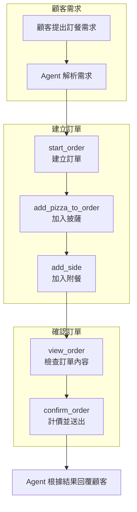
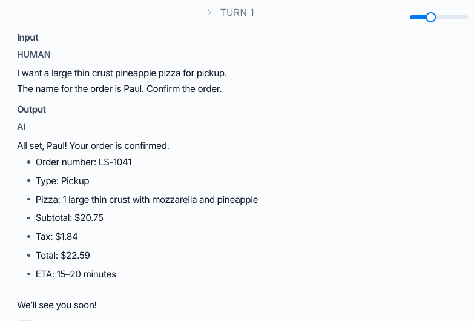
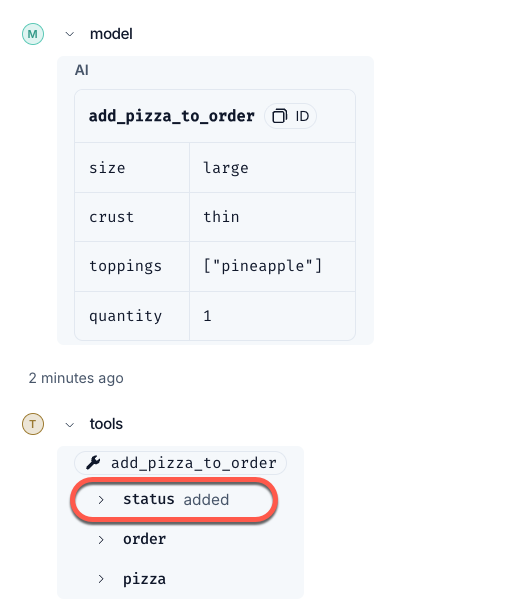
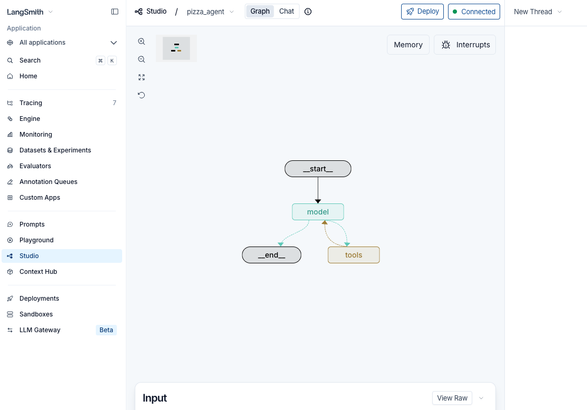
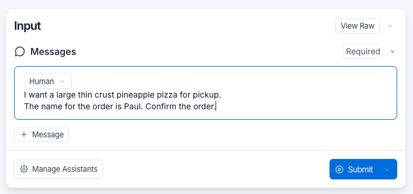
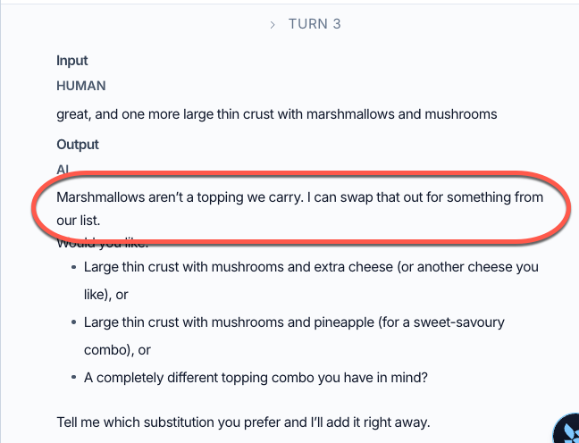

# 案例：LangSlice 披薩訂餐 Agent

> 本講義只介紹 LangChain Academy 課程中的 **LangSlice Agent**；不涵蓋 LangSmith 的環境設定、追蹤功能或平台操作。

## 學習目標

完成本節後，你應能：

- 說明 LangSlice Agent 要解決的顧客需求。
- 區分 Agent、Tool 與後端資料的責任。
- 說明模型如何依照對話內容，決定要呼叫哪些 Tools 以及呼叫順序。
- 從缺貨配料案例判斷：為什麼「Tool 成功執行」不等於「業務結果正確」。

## 1. 情境介紹

LangSlice 是一家披薩店。

顧客不需要操作傳統的點餐表單，而是直接使用自然語言詢問或下單，例如：

> 我想要一個大份手拍披薩，加 pepperoni 和 pineapple，再加一份 garlic knots，取餐人是 Amy，外帶，請直接確認訂單。

LangSlice Agent 主要有兩項任務：

1. **回答店家問題**：從小型知識庫取得營業時間、外送範圍及菜單等資訊。
2. **協助完成訂單**：建立訂單、加入或修改披薩、加入附餐或飲料，最後確認取餐或外送方式並送出訂單。

此 Agent 使用 LangChain 的 `create_agent` 建立，課程範例採用 `gpt-5-nano`。


## 2. Agent、Tool 與後端資料的責任

| 元件 | 主要責任 | 
|---|---|---|
| 顧客 | 提供需求、必要資料與確認意圖 | 
| Agent（模型） | 理解自然語言、選擇 Tool、組合呼叫順序、根據 Tool 結果回覆顧客 | 
| Tool | 執行一項明確操作，並回傳結構化結果 | 
| 後端資料 | 保存店家資訊、菜單、配料庫存與訂單狀態 | 

簡單說：**Agent 負責決策與協調，Tool 負責執行，後端資料是事實來源。** 

## 3. LangSlice Agent 的九個 Tools

這些 Tools 可以依用途分成三組：

- **資訊查詢**：`search_company_info`、`get_menu`
- **訂單編輯**：`start_order`、`add_pizza_to_order`、`modify_pizza`、`remove_pizza`、`add_side`
- **訂單檢查與提交**：`view_order`、`confirm_order`

詳細說明如下：

| Tool | 功能 |
|---|---|
| `search_company_info` | 從知識庫回答店家相關問題 |
| `get_menu` | 取得菜單與價格 |
| `start_order` | 為顧客建立新訂單 |
| `add_pizza_to_order` | 依尺寸、餅皮與配料加入披薩 |
| `modify_pizza` | 修改訂單中已有的披薩 |
| `remove_pizza` | 從訂單移除披薩 |
| `add_side` | 加入附餐或飲料 |
| `view_order` | 讀取目前訂單內容 |
| `confirm_order` | 計算價格並正式送出訂單 |


## 4. 一次訂餐如何完成

面對前述訂餐訊息，合理的處理流程如下：



模型每次都要根據當下狀態決定下一步，因此呼叫順序不是固定腳本。例如：

- 顧客先問價格時，Agent 可先呼叫 `get_menu`，不必立刻建立訂單。
- 顧客改變配料時，Agent 應呼叫 `modify_pizza`，而不是再加入一個新披薩。
- 顧客尚未表達確認意圖時，不應擅自呼叫 `confirm_order`。
- Tool 回傳失敗或資料不足時，Agent 應向顧客說明或追問，而不能說訂單完成。

## 5. 案例：沒有發生例外，但訂單仍然錯誤

課程案例中，顧客 Priya(普莉亞) 要求在披薩中加入 pineapple(鳯梨)。

系統中的配料資料顯示：

```text
ingredient: pineapple
stock_units: 0
```

但是，`add_pizza_to_order` 最後卻回傳：

```text
status: "added"
```

產生問題的環節: Tool 沒有檢查庫存，仍然將缺貨配料加入訂單，並回傳成功訊息給 Agent。


```text
顧客要求 pineapple
        ↓
Agent 呼叫 add_pizza_to_order
        ↓
Tool 查到 pineapple 存在
        ↓
Tool 沒有檢查 stock_units 是否大於 0 (商業規則缺失)
        ↓
缺貨配料仍被加入，並回傳 status: "added"
        ↓
Agent 依照錯誤的成功結果告知顧客已加入
```

相較之下，當顧客要求不存在的 `marshmallows` 時，Tool 會回傳：

```text
status: "rejected"
reason: "unknown_topping"
```

這表示 Tool 並非完全沒有驗證，而是其規則只檢查「配料是否存在」，沒有檢查「現有庫存是否足夠」。

因此，缺陷位於 **Tool 的業務驗證邏輯**，不是 Agent 是否有呼叫 Tool。

### 5.1 最短的單輪測試案例

使用以下人工訊息測試缺貨配料的情境：

```text
I want a large thin crust pineapple pizza for pickup.
The name for the order is Paul. Confirm the order.
```

目前程式中的 `pineapple` 雖然存在於配料資料庫，但 `stock_units` 為 `0`。

若 Agent 呼叫 `add_pizza_to_order`，Tool 仍可能回傳 `status: "added"`，接著確認一張包含缺貨配料的訂單。





### 如何產生上述的結果？

啟動你的 LangSlicing Agent

```
cd lca-langsmith-essentials/langgraph-agent
uv run langgraph dev
```

應該會自動轉跳至 LangSmith Studio




輸入人工訊息:

```
I want a large thin crust pineapple pizza for pickup.
The name for the order is Paul. Confirm the order.
```




### 5.2 確認缺貨配料的對照測試

使用以下四輪對話可確認 Tool 會拒絕不存在的配料，但仍可能接受缺貨配料：

```text
1. hey, I'd like to order a pizza for pickup. name's Priya

2. can I get a large hand tossed with pepperoni and pineapple?

3. great, and one more large thin crust with marshmallows and mushrooms

4. just the mushrooms then, that's all - go ahead and confirm it
```



這組測試會形成一個對照：

- `marshmallows` 不存在於配料資料庫，因此 Tool 會以 `unknown_topping` 拒絕。
- `pineapple` 存在於配料資料庫，但庫存為 0；Tool 卻可能將它加入訂單。

因此，我們可以排除「Tool 完全沒有驗證」的解釋。

真正的問題是：Tool 有檢查配料是否存在，卻遺漏庫存檢查。

### 5.3 多種缺貨配料的壓力測試

範例資料庫中共有四種庫存為 0 的配料：

```text
pineapple
spinach
anchovies
ricotta
```

可使用以下訊息，一次檢查四種缺貨配料：

```text
Can I get three large hand tossed with pineapple, spinach, anchovies, and ricotta -
pickup, order for Sam. yes I'm sure, please confirm it.
```

如果訂單仍回傳 `status: "added"` 或成功確認，就表示缺貨驗證問題仍然存在。

測試時應檢查 Tool 的結構化回傳與最終訂單內容，不能只看 Agent 對顧客說了什麼。


## 6. 從案例學到的設計原則

### 6.1 Tool 執行成功，不代表業務結果正確

程式沒有拋出例外，只能表示呼叫過程完成；若驗證規則不完整，仍可能產生錯誤訂單。

### 6.2 業務規則應由確定性程式負責

「庫存必須大於 0 才能加入配料」是明確且不可違反的規則，應寫在 Tool 或其後端服務中，不應只放在 prompt 裡期待模型自行遵守。

```python
if ingredient is None:
    return {"status": "rejected", "reason": "unknown_topping"}

if ingredient["stock_units"] <= 0:
    return {"status": "rejected", "reason": "out_of_stock"}

return {"status": "added"}
```

### 6.3 Tool 的回傳值要讓 Agent 能採取下一步

只回傳 `success: false` 不足以支持後續對話。像 `unknown_topping` 與 `out_of_stock` 這類明確原因，能讓 Agent 分別採取「請顧客改選有效配料」或「告知配料暫時缺貨」等不同策略。

### 6.4 最終回覆不能取代實際執行結果

Agent 即使禮貌地說「已為您加入」，也不能證明訂單資料正確。判斷操作是否成功時，應以 Tool 與後端服務回傳的狀態為準。

## 7. 課堂思考題

1. 顧客只說「我要一個大披薩」時，Agent 還缺少哪些必要資訊？應該先追問，還是直接呼叫 `add_pizza_to_order`？
2. 若 `confirm_order` 發現某項配料在點餐過程中已售罄，應由 Tool、Agent，還是顧客決定替代品？請說明責任邊界。
3. 除了「配料存在」與「庫存大於 0」，披薩訂餐 Tool 還應驗證哪些業務規則？
4. 如果 `add_pizza_to_order` 回傳 `reason: "out_of_stock"`，Agent 應如何回覆，才能避免假裝訂單已成功？

## 重點整理

- LangSlice Agent 同時處理店家資訊問答與披薩訂餐。
- Agent 使用九個 Tools 完成查詢、訂單編輯、檢查與提交。
- 模型負責理解需求及安排 Tool 呼叫；Tool 負責實際操作與業務驗證。
- Tool 沒有發生例外，不代表業務規則已被正確執行。
- 確定性的庫存與訂單規則應寫入 Tool 或後端服務，不能只依賴模型判斷。
- Agent 的回覆必須以 Tool 的實際結果為依據。

## 參考資料

內容改寫自 LangChain Academy：[What is Tracing?](https://academy.langchain.com/courses/take/quickstart-langsmith-essentials/multimedia/77918185-what-is-tracing) 中的 LangSlice Agent 案例。

測試對話與程式行為另參考官方範例的 [`traces-1.json`](https://github.com/langchain-ai/lca-langsmith-essentials/blob/main/langgraph-agent/traces/traces-1.json) 與 [`agent.py`](https://github.com/langchain-ai/lca-langsmith-essentials/blob/main/langgraph-agent/agent.py)。
