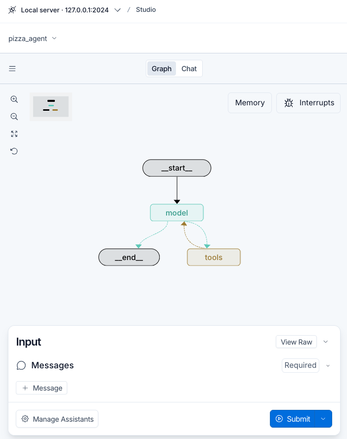
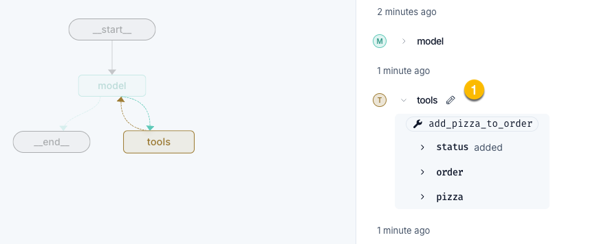
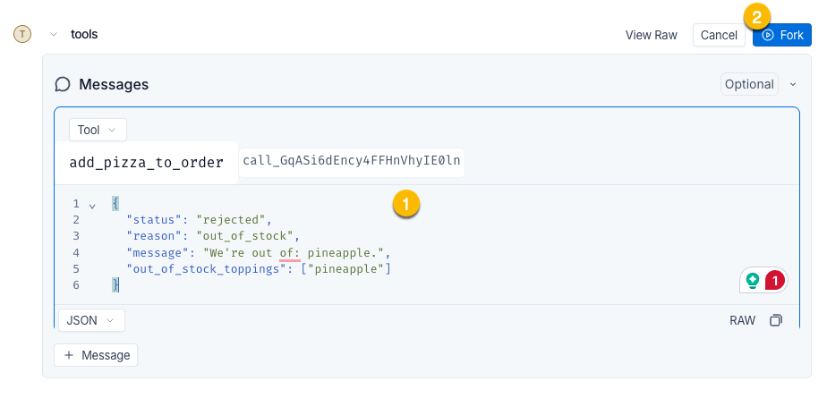
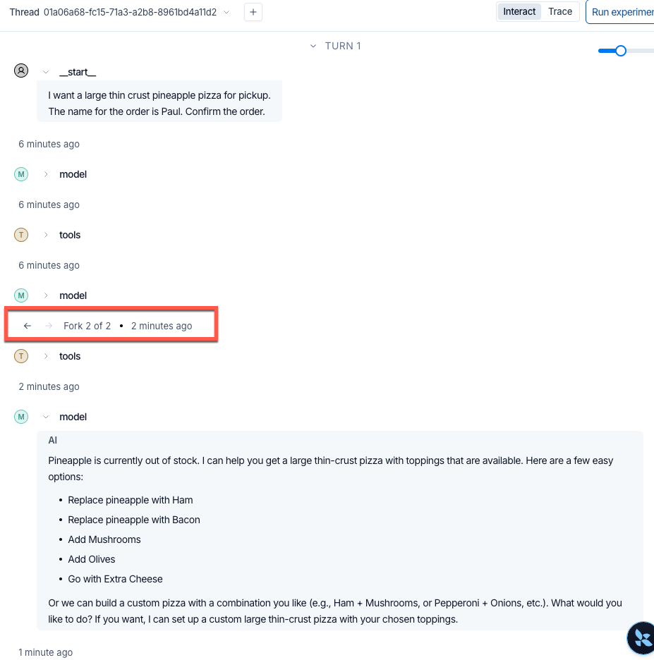
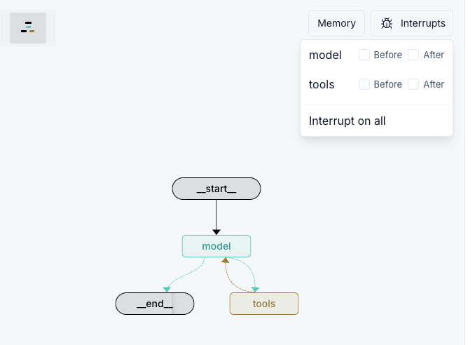
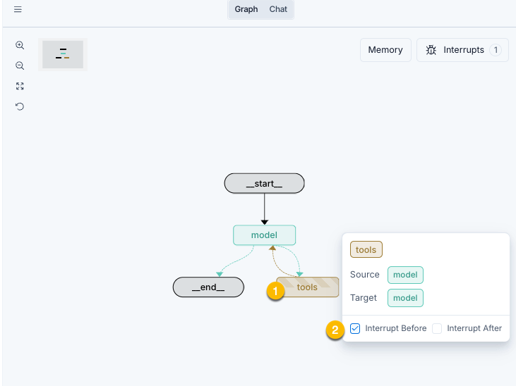
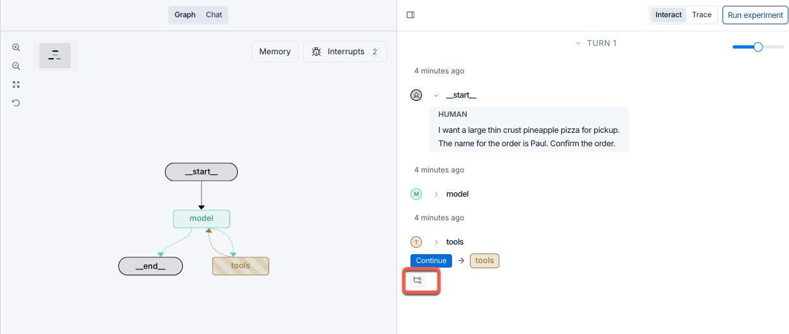
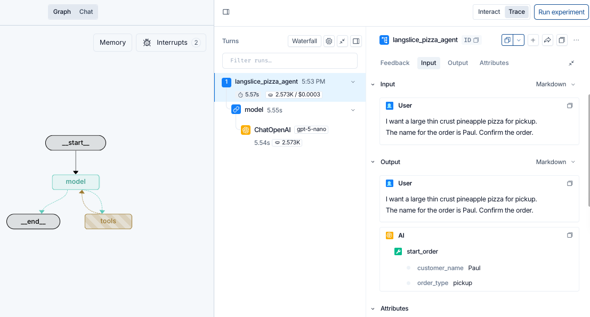
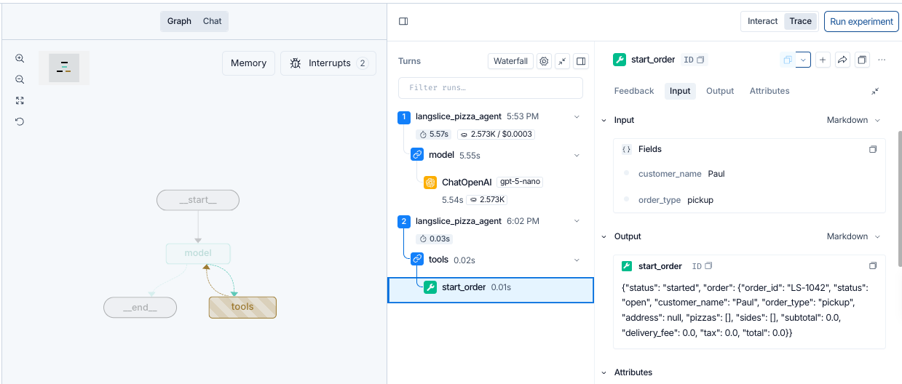

# 使用 LangSmith Trace 與 Studio 除錯 Agent (Debugging)

## 學習目標

完成本章後，你應能：

1. 從 Trace 的 Run tree 追查 Agent 實際呼叫的 Model、Tool 與自訂函數。
2. 使用 `@traceable` 將一般 Python 函數納入 Trace。
3. 說明 checkpoint、Forking 與 Interrupt 的因果關係。
4. 使用 Fork 建立 What-if 測試，判斷錯誤位於 Model、Prompt 或 Tool。
5. 使用 Studio Interrupt 在節點執行前或後暫停，檢查下一步是否安全。

---

## 1. Tracing 快速回顧

本節只回顧後續除錯會用到的 Tracing 基礎；完整的介面操作、Run tree 閱讀方法、鳳梨缺貨案例與修正後驗證，請參閱[〈使用 LangSmith Tracing 觀察 Agent 執行流程〉](tracing.md)。

- Thread, Turn, Trace 與 Run 的關係：
  - **Thread** 則串連多個 Turns
  - **Turn** 是一輪對話。一輪對話對會有一個 Trace. 
  - **Trace** 是一輪對話(Turn)下的完整 Run tree
  - **Run** 是一次 Model、Tool 或受追蹤函數的工作紀錄
- Agent 的最終回答只能呈現「它說了什麼」。
  - 判斷「它實際做了什麼」時，應沿 Run tree 核對 Tool 名稱、arguments、inputs 與 outputs，找出資料第一次出錯的邊界。
- LangSlice 案例中，Model 正確要求 `pineapple`，`get_ingredient()` 也正確回傳 `stock_units: 0`. 
  - 但 `add_pizza_to_order` 仍回傳 `status: "added"`；
  - 因此缺陷位於 Tool 的庫存判斷，而非 Model、Prompt 或資料查詢。
- Run 沒有 error 只代表程式完成執行，不代表輸出符合業務規則；
  - 修正後仍須建立新 Trace，以相同輸入核對查詢結果、Tool output 與 Agent 回覆。

Trace 是已發生執行的唯讀紀錄。它能協助定位實際資料流，卻不能直接回答「若某個中間值不同，後續會怎樣」(What-if 問題)；

使用 Studio Forking 功能可以測試 What-if 問題。


---

## 2. 追蹤設定與追蹤自訂 Python 函數

### LangChain / LangGraph 的基本設定

在 `.env` 設定：

```bash
LANGSMITH_TRACING=true
LANGSMITH_API_KEY=lsv2_...
LANGSMITH_PROJECT=langslice-pizza-agent
```

三個變數的責任不同：

| 環境變數 | 責任 |
|---|---|
| `LANGSMITH_TRACING` | 決定是否送出 Trace |
| `LANGSMITH_API_KEY` | 驗證 LangSmith 身分；正式講義、Git 或畫面截圖中不可放入真實金鑰 |
| `LANGSMITH_PROJECT` | 指定 Trace 收納的 Project，便於依應用或環境分類 |

### 自動追蹤的原則

若 Agent 使用 LangChain 或 LangGraph（例如 `create_agent` 或 LangGraph）提供的物件，框架會自動追蹤 Model 與 Tool 呼叫，不必逐一替它們增加紀錄程式碼。

自訂函數或一般 Python helper function，預設不會成為獨立 Run。

### 追蹤自訂 Python 函數

Tool 內部呼叫的一般 Python helper function，預設不會成為獨立 Run。

例如 `add_pizza_to_order` 內部會呼叫 `get_ingredient` 查詢配料。若要看見查詢的輸入、輸出與執行時間，使用 `@traceable` 裝飾該函數：

```python
from typing import Any

from langsmith import traceable


@traceable
def get_ingredient(name: str) -> dict[str, Any] | None:
    """查詢配料，並處理別名與複數名稱。"""
    # 完成名稱正規化與 catalog 查詢
    ...
```

設定後，呼叫關係會由：

```text
add_pizza_to_order  ← 只能看到整個 Tool 的輸入與輸出
```

變成：

```text
add_pizza_to_order
└── get_ingredient
    ├── input:  name = "pineapple"
    └── output: stock_units = 0
```


追蹤原則：
- **LangSmith 管理的工作通常會自動追蹤；自己撰寫、且需要獨立觀察的一般函數，才加上 `@traceable`。** 
- 優先追蹤資料查詢、外部服務、關鍵規則與成本較高的步驟。
  - 不必把每個小函數都追蹤，否則 Run tree 會過度零碎。

---

## 3. 使用 LangGraph Studio 進行互動式除錯

### 啟動 Agent Server 進入 LangSmith Studio 


依[〈使用 LangSmith Tracing 觀察 Agent 執行流程〉](tracing.md)的步驟啟動範例 Agent.

```
cd langsmith-essentials/langgraph-agent
uv run langgraph dev
```

LangGraph API server 會讀取所在目錄的 `langgraph.json`，找出需要載入的 graph：

```json
{
  "dependencies": ["."],
  "graphs": {
    "pizza_agent": "./agent.py:pizza_agent"
  },
  "env": "../.env",
  "http": {
    "app": "./ui/app.py:app"
  }
}
```

上述設定中:
- `graphs`：將 Studio 中的 graph 名稱指向 Python 模組內的 Agent 物件。
- `dependencies`：指出需安裝或載入的專案相依項目。
- `env`：指定環境變數檔案。
- `http.app`：在相同 server 上掛載顧客使用的 Chat UI。

之後，Browser 會自動開啟 Studio:





Studio 顯示 `__start__ → model ↔ tools → __end__`。

九個 Tools 並不是九個 graph nodes，而是由單一 `tools` node 依 Model 產生的 Tool Call 選擇並執行。

每次 graph 從一個 node 前進到下一個 node，會保存一份 **checkpoint**。checkpoint 是當時 Agent state 的快照，也是 Fork 與恢復執行的基礎。

### 互動除錯功能

LangSmith Studio 提供的互動除錯功能:

- **Forking**：從 checkpoint 建立新分支，測試 What-if 假設。
- **Interrupt**：在 node 執行前或後暫停，檢查下一步是否安全。

以下分別說明。

---


## 4. Forking：改變歷史中的一個值，觀察新的未來

### 4.1 Fork 是什麼？

Fork 會選定既有 Thread 中的一個 checkpoint，複製到該點為止的歷史，再以編輯後的 state 建立新分支並繼續執行。原始分支仍然保留，因此可以比較「只改變一個條件」前後的結果。

```text
共同歷史 ── checkpoint ── 原始 Tool output ── 原始回答
                  └────── 編輯後 Tool output ── Fork 回答
```

它利用 checkpoint 重建一個新的執行分支。
- 不是重頭開始執行，而是從某個中間狀態繼續。

### 4.2 LangSlice 的 Fork 操作

1. 在 Studio 重現鳳梨訂單錯誤。

輸入以下人工訊息以產生錯誤:

```
I want a large thin crust pineapple pizza for pickup.
The name for the order is Paul. Confirm the order.
```

1. 在右側 Interact 找到 `add_pizza_to_order` tool 節點。
2. 展開該步驟並選擇 "鉛筆" 符號，編輯狀態。



1. 將錯誤的 Tool 結果替換成正確的結果(`status: "rejected", reason: "out_of_stock"`)。
2. 按下 **Fork**，讓 graph 從該 checkpoint 繼續執行。
   - 注意，Agent 會從 被修改的 Tool 的方產生一個 Fork , 供我們切換不同分支。
3. 比較原始分支和 Fork 分支中 Model 的下一個回答。

原本的 Tool output：

```json
{
  "status": "added",
  "pizza": {
    "size": "large",
    "crust": "hand tossed",
    "toppings": ["mozzarella", "pepperoni", "pineapple"]
  }
  ...
}
```

替換成正確 Tool 應回傳的資料形狀：

```json
{
  "status": "rejected",
  "reason": "out_of_stock",
  "message": "We're out of: pineapple.",
  "out_of_stock_toppings": ["pineapple"]
}
```



Fork 後，可在 Thread Log 看到原始分支和 Fork 分支的兩個不同回答。
點擊 左右箭頭 可切換不同的輸出結果。



若 Fork 後，Model 能主動告知缺貨並詢問顧客要移除或更換配料，就代表：

- Prompt 已足以讓 Model 處理拒絕結果；
- Model 具有合理的恢復能力；
- 缺陷集中在 Tool 沒有產生 `out_of_stock` 拒絕分支。

這是一次**受控制的 假設情況(what-if) 實驗**。因為 Model、Prompt、先前訊息與其他 state 都未改變，只有 Tool output 不同，所以能更有把握地定位原因。

### Fork 的限制

Fork 能證明「這次執行在此替換值後會如何改變」，適合找機制與建立修正假設

但是, 錯誤率與修正穩定性仍需 Dataset、Evaluator 與 Experiment 驗證。

---

## 5. Interrupt：在下一步發生前或發生後中斷

中斷(Interrupt) 是暫停目前執行的 graph node，讓使用者介入。
之後再從被中斷的 node 繼續執行(resume) graph。

### 5.1 Studio Interrupt 的用途

Studio 可對 node 設定 **before** 或 **after** breakpoint：

- **before node**：node 尚未執行便暫停，可先檢查即將使用的 state 或 Tool Call 參數。
- **after node**：node 已執行後暫停，可檢查輸出再決定是否繼續。

典型使用情境是在 `tools` node 前暫停，以檢查 Tool Call 的函數名稱與 arguments:

```text
Model 產生 Tool Call
        ↓
[Interrupt before tools]
        ↓  人員檢查 Tool 名稱與 arguments
Tools 真正執行
        ↓
Model 讀取 ToolMessage / Tool 結果
```

在 LangSlice 範例中, Graph 有 model node 與 tools node, 所以可在這兩個 node 前後設定 interrupts。

如果在 tools node 前暫停, 就可以檢查即將呼叫的 Tool 名稱與參數, 確認是否安全再繼續執行。



### 設定中斷的方式

1. 游標移到中斷的節點上方，會彈現出節點資訊視窗。
2. 選擇 Interrupt before 或 Interrupt after 選項。
3. 輸入 Human message 後執行，Agent 會在該節點前或後暫停，等待使用者決定是否繼續。


### 中斷後的操作

產生斷後，你可以
- 編輯某個 Run 的狀態，並產生 Fork. 
- 也可以檢視目前的 Trace 的 Run tree，

要檢視目前的 Trace 的 Run tree, 在 Studio 右側 Interact 面板中，點擊目標 node 下方的按鈕: 



下方為展開的 Run Tree. 

Agent 中斷在進入 Tool Node 之前。
可以看到 model 產生的 Tool Call, 請求呼叫 `start_order` 並傳入 `customer_name` 與 `order_type` 參數。



回到 Interactive, 可按下 **Continue** 讓 graph 繼續執行: 

下方顯示，Agent 已經呼叫 `start_order` 並回傳結果, 但停在 tools node 後的中斷點, 尚未回到 model node 產生下一個回答。




### 5.2 Fork 與 Interrupt 不同

| 比較 | Forking | Studio Interrupt |
|---|---|---|
| 核心問題 | 「如果當時這個值不同，後續會怎樣？」 | 「現在是否應讓下一步執行？」 |
| 操作對象 | 已保存的 checkpoint | 正在執行的 graph node |
| 時間方向 | 從歷史節點建立新分支 | 在當前執行流程中暫停 |
| 原始執行 | 保留，另建 Fork | 等待繼續執行 |
| 適合用途 | 根因隔離、反事實測試、比較輸出 | 逐步除錯、檢查參數、攔截高風險動作 |

一句話區分：**Fork 改變一個已發生的中間狀態，觀察另一種結果；Interrupt 暫停尚未完成的流程，決定下一步怎麼走。**

### 5.3 不要與應用程式的 HITL `interrupt()` 混淆

本章的 Studio Interrupt 是開發者在 Studio 中設定的除錯 breakpoint。

它不是 Agent 程式為正式業務流程設計的 Human-in-the-loop interrupt。

- **Studio breakpoint**：開發／除錯控制，由開發者臨時設定。
- **LangGraph `interrupt()` 或 HITL middleware**：應用程式控制流程的一部分，會定義要交給人員的資料，以及 approve、edit、reject、respond 等決策契約。

---

## 6. 建議的 Agent 除錯順序


1. **提出可驗證的因果假設**：明確說明要替換哪一個中間值，以及預期下游如何改變。
2. **用 Fork 測試單一變因**：從對應 checkpoint 建立分支，比較原始與替換後的結果。
3. **用 Interrupt 檢查下一步**：尤其是在具有外部副作用的 Tool 執行前暫停。
4. **修正真正負責的元件**：根據 Trace 與 Fork 證據修改 Model、Prompt 或 Tool。
5. **用 Evaluation 驗證範圍**：以多筆案例衡量修正後的通過率與回歸風險。


## 重點整理

- `@traceable` 讓一般 Python 函數成為獨立 child run，補足框架自動追蹤看不到的內部步驟。
- checkpoint 是 Agent state 的快照，也是 Fork 與恢復執行的基礎。
- Fork 從 checkpoint 建立新分支，適合用單一變因測試根因假設。
- Studio Interrupt 在 node 前或後暫停，適合逐步除錯及攔截具有真實副作用的 Tool。
- Fork 解釋一條執行路徑的機制；Evaluation 才能衡量錯誤頻率與修正的穩定性。


## 參考資料

- [LangChain Academy：Debugging with Studio](https://academy.langchain.com/courses/take/quickstart-langsmith-essentials/multimedia/77918187-debugging-with-studio)
- [LangSmith：Trace LangChain applications](https://docs.langchain.com/langsmith/trace-with-langchain)
- [LangSmith：Annotate code for tracing](https://docs.langchain.com/langsmith/annotate-code)
- [LangSmith Studio overview](https://docs.langchain.com/langsmith/studio)
- [LangSmith：Use Studio（breakpoints、threads、forking）](https://docs.langchain.com/langsmith/use-studio)
- [LangGraph：Checkpointers 與 Threads](https://docs.langchain.com/oss/python/langgraph/checkpointers)
