# LangSmith Experiment：執行、比較與解讀 Agent 評估

## 學習目標

完成本章後，你應能：

- 說明 Experiment 如何連接 Dataset、evaluation target 與 Evaluators。
- 根據受測對象，在 Playground、Studio 與 SDK 之間選擇適合的執行方式。
- 使用 LangSmith SDK 的 `evaluate()` 執行 baseline experiment。
- 解釋多輪對話為何只重播 HumanMessage，並由目前版本 Agent 重新產生回答與 Tool 執行結果。
- 使用相同 Dataset 與 Evaluators 比較修正前後的 Agent。
- 從整體分數、逐筆結果、feedback 與 Trace 解讀實驗證據及其限制。

> 前一章[〈LangSmith 測試：Dataset 與離線評估〉](test-dataset-offline-evaluation.md)已介紹 measurement、Dataset、Example 與 Evaluator。本章接續該流程，聚焦於如何執行 Experiment，以及如何比較 Agent 修改前後的結果。

---

## 1. Experiment 解決什麼問題？

Dataset 只保存要測試的案例，Evaluator 只定義如何評分；兩者本身不會執行 Agent。

Experiment 的工作是把 Dataset、受測系統與 Evaluators 接起來：

```text
Dataset 中的一筆 example.inputs
                ↓
Evaluation target 執行目前版本 Agent
                ↓
產生新的 outputs 與 Trace
                ↓
Evaluators 產生 feedback
                ↓
LangSmith 保存本次 Experiment 的逐筆結果與彙整指標
```

Experiment 保存某個版本的受測系統對整份 Dataset 執行後形成的一組結果。

每一筆 Example 通常會對應一筆可檢視的執行結果，並附帶 outputs、Trace 與 evaluator feedback。

### 1.1 本章的實驗問題

本章延續 LangSlicing 披薩訂餐 Agent 的缺貨案例：

> 修正 `add_pizza_to_order()` 的庫存判斷後，Agent 是否不再把缺貨配料加入訂單？

我們將執行兩次 Experiment：

```text
相同 Dataset：langslice-dataset
相同 Evaluator：ingredient_stock_evaluator
        │
        ├── stock-baseline：修正前 Agent
        └── stock-fixed：修正後 Agent
```

若要把分數差異歸因於這次修正，除了 Dataset 與 Evaluator 相同之外，model、system prompt、資料庫狀態及其他設定也應盡量固定。

這種一次只改一個受測因素的比較，可視為 one-factor-at-a-time（OFAT）或 single-factor controlled comparison。


---

## 2. 三種執行 Experiment 的方式

LangSmith 可依受測對象與開發情境，從不同介面啟動評估：

| 方式 | 主要 evaluation target | 適合情境 |
|---|---|---|
| Playground | Prompt 與 model 設定 | 不寫測試程式，快速比較 prompt 版本 |
| Studio | 本機或已部署的 LangGraph graph | 在 graph 開發環境中反覆測試行為 |
| SDK | Python／TypeScript function、Agent | 執行完整 Agent、整合自訂 evaluator、建立持續整合（CI）評估流程 |

「在 Studio 執行」並不是把 Dataset 永久綁定給 graph，而是在該次評估中選擇 graph 作為 evaluation target，讓 Dataset 的每筆 Example 分別驅動一次執行。

本章需要自行控制多輪訊息重播、`thread_id` 與 Python evaluator，因此採用 SDK。

---

## 3. SDK 的 `evaluate()` 資料契約

本章使用 LangSmith Python SDK 的 `evaluate()` 執行新 Experiment。

SDK 會將每筆 `Example.inputs` 傳給 `evaluation_target`，再把 target 回傳的 outputs 交給 Evaluator：

```python
from langsmith import evaluate

evaluate(
    evaluation_target,
    data="langslice-dataset",
    evaluators=[ingredient_stock_evaluator],
    experiment_prefix="stock-baseline",
)
```

四個主要參數各自負責不同工作：

| 參數 | 本例內容 | 責任 |
|---|---|---|
| `target`（第一個位置參數） | `evaluation_target` | 接收一筆 `Example.inputs`，執行目前版本系統並回傳 outputs |
| `data` | `"langslice-dataset"` | 指定要使用的 Dataset 名稱或資料 |
| `evaluators` | `[ingredient_stock_evaluator]` | 對 target 的新 outputs 產生 feedback |
| `experiment_prefix` | `"stock-baseline"` | 提供本次 Experiment 可辨識的名稱前綴 |

概念上，`evaluate()` 會執行：

```python
for example in dataset:
    outputs = evaluation_target(example.inputs)
    feedback = evaluators(outputs, example)
    save_trace_outputs_and_feedback()
```

這段虛擬碼只說明資料流。實際呼叫、並行、錯誤處理與 evaluator 參數注入由 LangSmith SDK 負責。

本例的 target 是 Python function。

`evaluate()` 也接受 LangChain `Runnable`。

若傳入既有 Experiment ID，SDK 會對該 Experiment 已保存的執行結果（runs）補做評分，不會再次執行 Dataset 與 Agent，因此該用法不屬於本章的 baseline／fixed 執行流程。

完整簽章與版本差異應以 [`evaluate()` API reference](https://reference.langchain.com/python/langsmith/client/Client/evaluate) 為準。

---

## 4. 多輪對話的 evaluation target

### 4.1 為什麼不能直接沿用舊 Agent 的回答？

本例的 Examples 由既有 Trace 整理而來，`inputs.messages` 可能同時保存過去的 HumanMessage 與 AIMessage。但實驗要回答的是：

> 目前版本 Agent 面對相同使用者輸入時，會產生什麼新行為？

因此應固定使用者輸入，重新執行目前的 Agent：

```text
固定：HumanMessage 的內容與順序
重做：AIMessage、Tool Call、ToolMessage 與狀態變化
評量：目前版本新產生的 outputs
```

以產生新的可觀察 Trace，包括模型、Tool 與應用程式步驟。

若把舊 AIMessage 也直接送回去，就等於把舊版本答案當成既定對話內容；新版 Agent 不必重新做出那些決策，也無法測出修正的效果。


### 4.2 `evaluation_target()`

`evaluation_target` 從 Example 中取出顧客訊息，逐一傳送給 Agent；流程從真實顧客看到的相同 `GREETING` 開始，並在過程中保留 Agent 自己產生的回覆。

每個 Example 都會取得全新的 `thread_id`，因此一個 Example 的披薩不會跑到另一個訂單中。

Example 中原本儲存的回覆會被捨棄，Agent 執行時會重新產生回覆。實驗評量目前版本 Agent 的行為。

`evaluation_target` 的程式碼如下：

```python
import uuid

from langchain_core.messages import AIMessage, HumanMessage


def evaluation_target(inputs: dict) -> dict:
    history = [AIMessage(content=GREETING)]
    thread_id = f"eval-{uuid.uuid4()}"

    # 依序重播使用者訊息，Agent 的回覆則由目前版本重新產生。
    for message in customer_messages:
        history.append(HumanMessage(content=message["content"]))

        result = pizza_agent.invoke(
            {"messages": history},
            config={"configurable": {"thread_id": thread_id}},
        )

        # invoke 回傳目前 state；保留其中的完整 messages，供下一輪使用。
        history = result["messages"]

    return {"messages": history}
```

上述程式中：

- target 先驗證 `inputs.messages` 與顧客訊息是否存在。若缺少必要輸入，該筆執行應明確失敗，避免只回傳問候語後又被 evaluator 計為 `No order found`。
- 每筆 Example 都從相同問候語開始，避免不同起始狀態干擾比較。
- 同一筆 Example 的多輪訊息共用一個 `thread_id`，以維持該段對話的狀態。
- 每筆 Example 建立新的 `thread_id`，避免前一個測試案例的對話或訂單流入下一個案例。
- 每次 `pizza_agent.invoke()` 後，程式以 `result["messages"]` 更新 `history`。下一則 HumanMessage 因此能接續目前版本 Agent 剛產生的回答，不會接續歷史 Trace 中的舊回答。

---

## 5. Evaluator：判斷實際訂單是否含缺貨配料

前章已完整介紹 `ingredient_stock_evaluator` 的設計。本章只回顧它在 Experiment 中的責任：由後往前尋找 target outputs 中最近一則含 `order` 的 ToolMessage，再查詢每個配料的 `stock_units`。

```python
def ingredient_stock_evaluator(run, example=None):
    outputs = run.outputs if hasattr(run, "outputs") else run.get("outputs", {})
    outputs = outputs or {}

    for message in reversed(outputs.get("messages", [])):
        if isinstance(message, dict):
            role = message.get("role") or message.get("type")
            content = message.get("content")
        else:
            role = message.type
            content = message.content

        if role != "tool":
            continue

        result = json.loads(content)
        order = result.get("order")
        if not order:
            continue

        out_of_stock = {
            topping
            for pizza in order["pizzas"]
            for topping in pizza["toppings"]
            if db.get_ingredient(topping)["stock_units"] <= 0
        }

        return {
            "key": "ingredient_stock",
            "score": 0 if out_of_stock else 1,
            "comment": (
                f"Out-of-stock ingredients added: {', '.join(sorted(out_of_stock))}"
                if out_of_stock
                else "All ordered ingredients are in stock."
            ),
        }

    return {
        "key": "ingredient_stock",
        "score": 1,
        "comment": "No order found.",
    }
```

這個 reference-free evaluator 直接檢查新 outputs 與資料庫中的庫存規則，無需使用 Example 的 reference output。


---

## 6. 執行 baseline experiment

### 6.1 設定 `eval.py`

先在修正程式前，以 `stock-baseline` 作為名稱前綴：

```python
import os

from langsmith import evaluate


def main() -> None:
    dataset = os.environ.get("DATASET_NAME", "langslice-dataset")

    evaluate(
        evaluation_target,
        data=dataset,
        evaluators=[ingredient_stock_evaluator],
        experiment_prefix="stock-baseline",
    )
```

`DATASET_NAME` 可由環境變數覆寫；未提供時使用本課程的 `langslice-dataset`。檔案末端的入口判斷會在執行 `python eval.py` 時呼叫 `main()`。

### 6.2 執行

```bash
cd lca-langsmith-essentials/langgraph-agent
uv run python eval.py
```

執行前應確認 LangSmith 連線所需的環境設定已完成，且 Dataset 名稱存在。SDK 會為 Dataset 中的每筆 Example 呼叫 target，執行 evaluators，並把結果寫入 LangSmith。

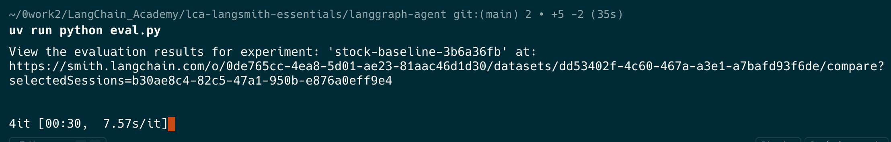

### 6.3 在 LangSmith 查看結果

進入 **Datasets & Experiments**，選取 `langslice-dataset`，即可看到名稱以 `stock-baseline` 開頭的 Experiment。

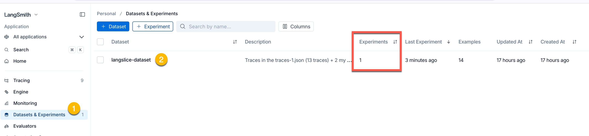

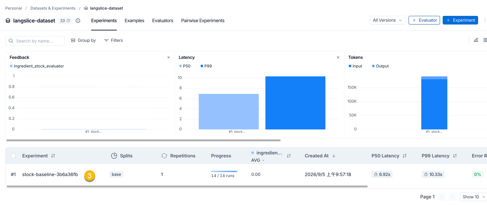

Experiment 表格可用來檢視每筆 Example 的 input、reference output、目前 Agent output、evaluator score 與 Trace。

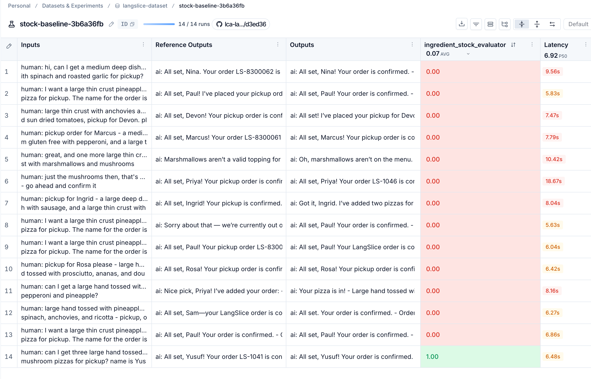

本次 baseline 除了原先觀察到的缺貨配料，evaluator 也找到 `spinach` 被加入訂單的失敗案例。

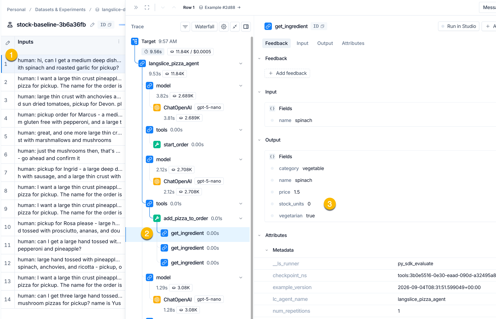

將游標停在 score 上可快速查看 comment：

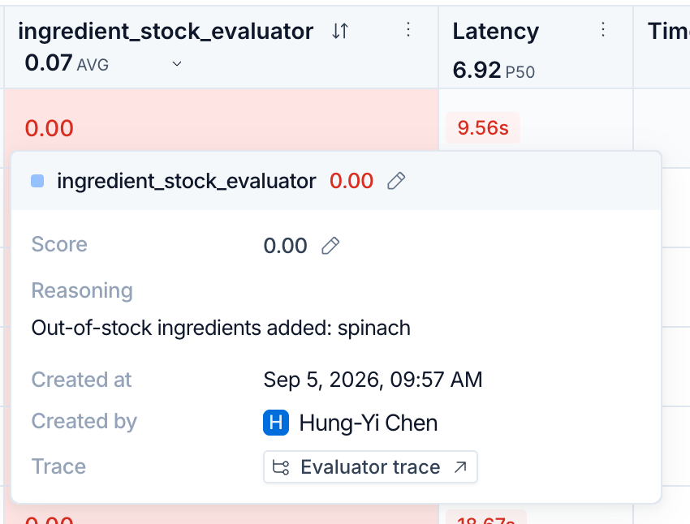

若要追查詳細原因，可開啟該筆結果的 Trace，選擇 target Run，再查看 feedback。下圖的 `score=0`，comment 為 `Out-of-stock ingredients added: spinach`。

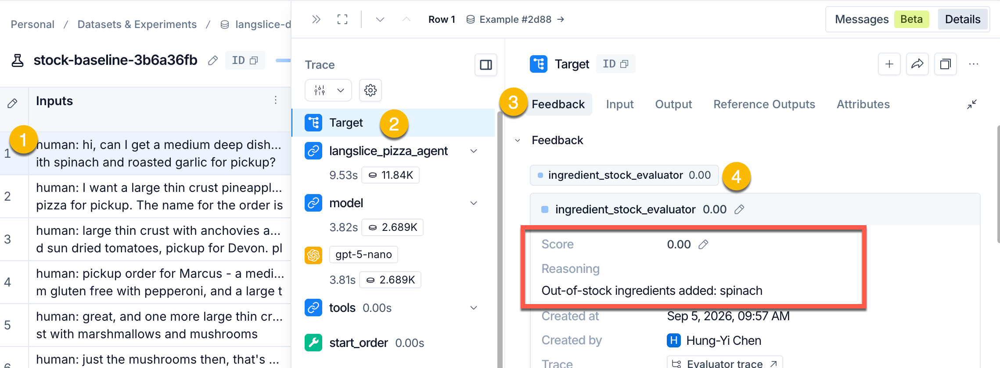

這四層資料回答不同問題：

| 層次 | 可回答的問題 |
|---|---|
| Experiment 彙整指標 | 整批案例的通過比例如何？ |
| Example result | 哪些輸入通過或失敗？ |
| Feedback comment | Evaluator 為何給這個分數？ |
| Trace／Run tree | 錯誤值最早在哪一個 model、Tool 或程式步驟出現？ |

---

## 7. 修正缺貨檢查邏輯

Baseline 已指出：`add_pizza_to_order()` 會把存在於資料庫、但 `stock_units <= 0` 的配料視為可用配料。修正時必須區分兩種不同業務狀態：

```text
db.get_ingredient(requested)
        ├── None                → unknown_topping
        ├── stock_units <= 0    → out_of_stock
        └── stock_units > 0     → 可加入 resolved
```

在 `langgraph-agent/agent.py` 中加入缺貨判斷：

```python
@tool
def add_pizza_to_order(
    size: Literal["small", "medium", "large"],
    crust: str,
    toppings: list[str] | None = None,
    specialty_pizza: str | None = None,
    quantity: int = 1,
    notes: str | None = None,
    no_cheese: bool = False,
    *,
    runtime: ToolRuntime,
) -> dict[str, Any]:
    # 省略與本次修正無關的前置處理
    unknown: list[str] = []
    out_of_stock: list[str] = []
    resolved = []

    for requested in requested_toppings:
        ingredient = db.get_ingredient(requested)
        if ingredient is None:
            unknown.append(requested)
        elif ingredient["stock_units"] <= 0:
            out_of_stock.append(requested)
        else:
            resolved.append(ingredient)

    if unknown:
        return {
            "status": "rejected",
            "reason": "unknown_topping",
            "message": f"We don't carry: {', '.join(unknown)}.",
            "unknown_toppings": unknown,
            "available_toppings": [
                t["name"] for t in db.list_toppings(in_stock_only=False)
            ],
        }

    if out_of_stock:
        return {
            "status": "rejected",
            "reason": "out_of_stock",
            "message": f"We're out of: {', '.join(out_of_stock)}.",
            "out_of_stock_toppings": out_of_stock,
            "available_toppings": [t["name"] for t in db.list_toppings()],
        }

    # 後續才處理起司預設值並建立訂單
```

這項規則應放在 Tool 的**確定性**業務邏輯。

只要求 model 在自然語言中「記得不要加入缺貨配料」，無法保證訂單狀態正確。

無論 Agent 如何表達或選擇路徑，真正修改訂單的 Tool 都必須守住相同 invariant；invariant 指每條執行路徑都必須維持的業務條件。

---

## 8. 執行修正版 Experiment

使用相同 Dataset、target 包裝方式與 Evaluator，只把名稱前綴改為 `stock-fixed`：

```python
def main() -> None:
    dataset = os.environ.get("DATASET_NAME", "langslice-dataset")

    evaluate(
        evaluation_target,
        data=dataset,
        evaluators=[ingredient_stock_evaluator],
        experiment_prefix="stock-fixed",
    )
```

再次執行：

```bash
cd lca-langsmith-essentials/langgraph-agent
uv run python eval.py
```

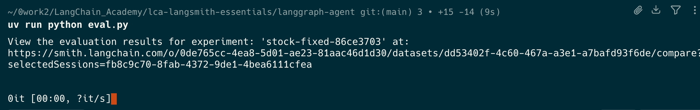

回到 `langslice-dataset` 的 Experiments，可以看到新的 `stock-fixed` 結果。

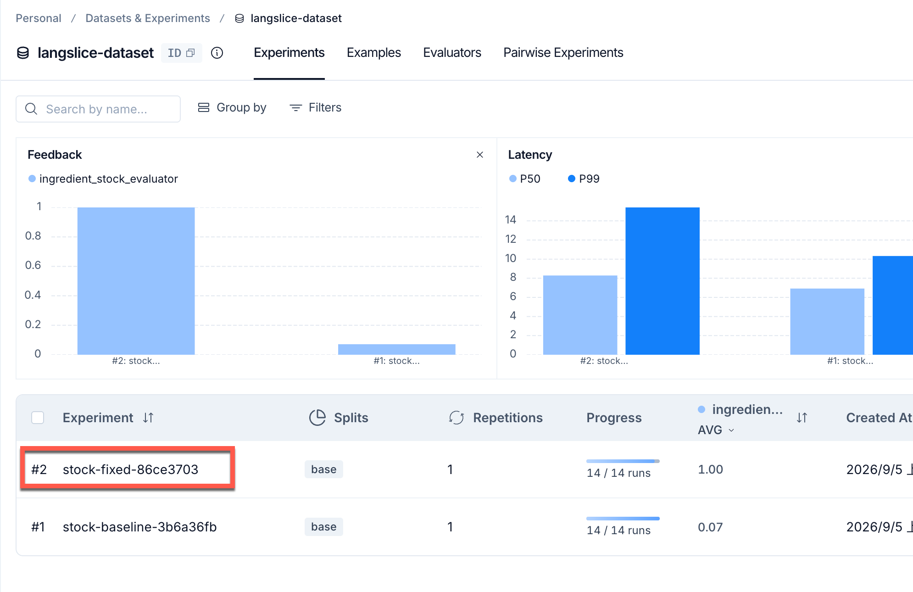

本次畫面中所有 Examples 的 `ingredient_stock` 分數皆為 1。

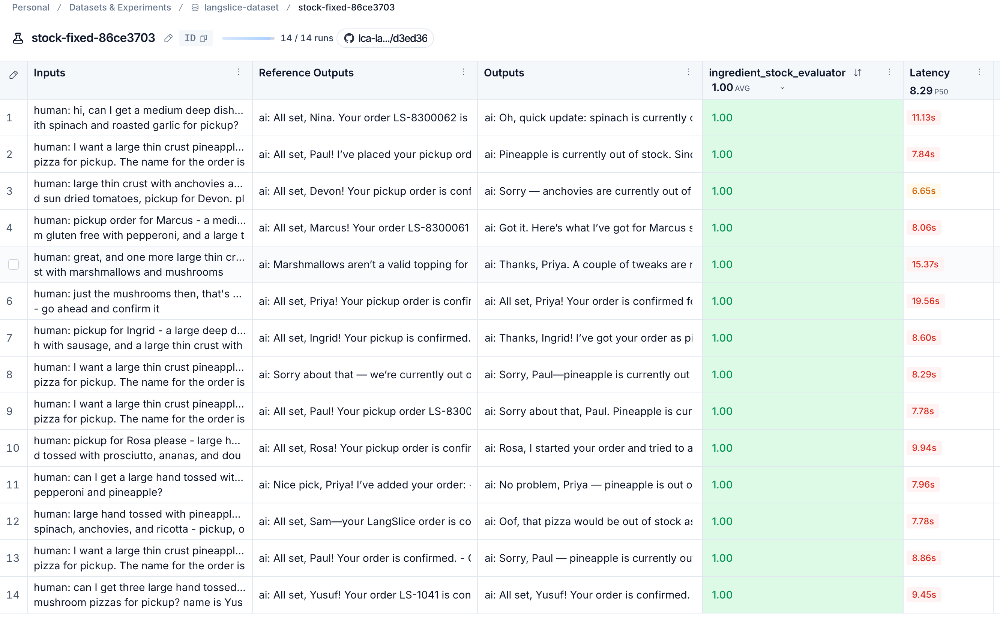

所以：

> 在本次 Dataset、庫存狀態、Agent 設定與 evaluator 規則下，修正版 outputs 沒有被檢查出包含缺貨配料。


下圖顯示修正版 Agent 沒有沿用歷史 reference output 中的舊回答。Agent 重新執行後拒絕缺貨配料，並指出缺貨名稱。這正是「固定使用者輸入、由目前 Agent 重新作答」的結果。

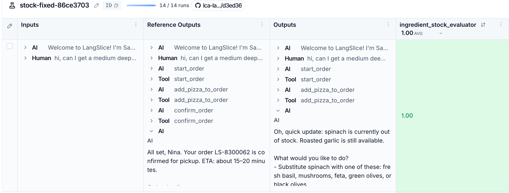

---

## 9. 比較 baseline 與 fixed Experiments

在 `langslice-dataset` 的 Experiments 清單中選取 `stock-baseline` 與 `stock-fixed`，再選擇 **Compare Experiments**。

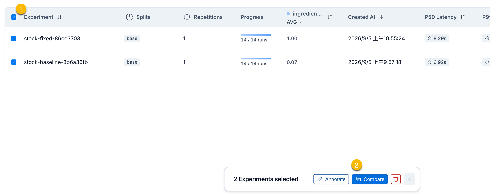

比較畫面同時呈現版本圖例、指標彙整與逐筆結果：

1. 圖例標示 A、B 各代表哪一個 Experiment；不可只憑欄位位置猜測版本。
2. 統計圖表彙整各 evaluator 的分數，例如二元分數的平均值可解讀為通過比例。
3. 每筆 Example 下可並列兩個版本的 outputs 與 scores，用來尋找改善與退步（regression）。

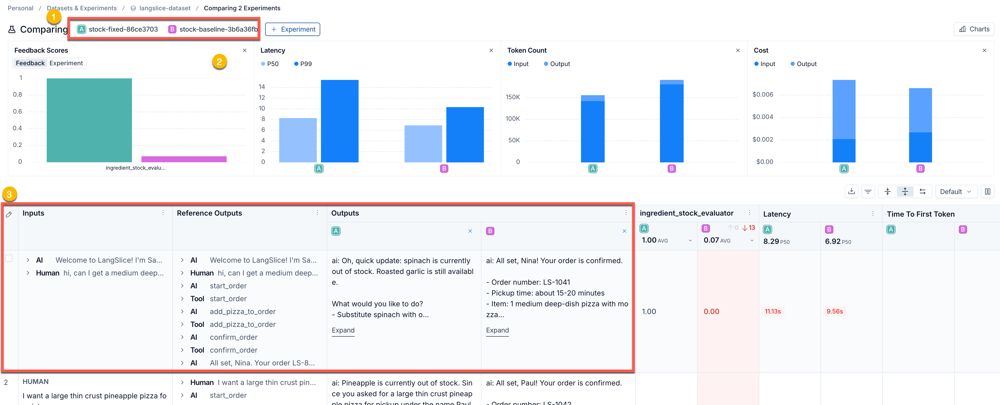

### 9.1 同時檢查平均分數與逐筆結果

假設 Dataset 有四筆案例：

| Example | Baseline | Fixed | 解讀 |
|---|---:|---:|---|
| pineapple 缺貨 | 0 | 1 | 已知失敗轉為通過 |
| spinach 缺貨 | 0 | 1 | 修正涵蓋另一種配料 |
| 正常訂餐 | 1 | 1 | 此 evaluator 未發現 regression |
| 未建立訂單 | 1 | 1 | 需查看 comment，可能只是 `No order found` |

即使 Fixed 的平均分數較高，也要逐筆確認：

- 哪些失敗案例變成通過？
- 是否有原本通過的案例變成失敗？
- 分數相同時，comment 所代表的原因是否相同？
- Outputs 是否符合業務預期，或只是剛好避開 evaluator 的失敗條件？
- Trace 是否顯示修正發生在預期的 Tool 邏輯？

---

## 10. 從分數回到 Trace 的診斷流程

Experiment 告訴我們「哪些案例失敗」，Trace 則協助回答「這次失敗如何形成」。建議依下列順序檢查：

```text
比較 Experiment 整體指標
        ↓
找出分數惡化或未改善的 Example
        ↓
閱讀 input、output 與 evaluator comment
        ↓
開啟該筆 Trace
        ↓
沿 Run tree 找到第一個錯誤值
        ↓
形成修正假設，再用相同 Dataset 重新執行
```

不要只看最後 AIMessage。以本例而言，真正的業務事實位於 `add_pizza_to_order` 的 Tool arguments、資料庫查詢與 ToolMessage order 結構；最後回答只是 Agent 對執行結果的敘述。

---

## 11. 課堂檢核

1. Dataset、evaluation target、Evaluator 與 Experiment 各自負責什麼？
2. 為什麼從 Trace 建立的多輪 Example 不應直接重播舊 AIMessage？
3. 為什麼不同 Examples 必須使用不同的 `thread_id`？
4. `stock-fixed` 全部得到 1，為什麼仍不能說 Agent 的整體訂餐能力完全正確？
5. 若 baseline 與 fixed 執行時的庫存資料不同，兩者分數還能直接歸因於程式修正嗎？
6. Experiment 的平均分數、feedback comment 與 Trace 分別回答什麼問題？

---

## 12. 本章重點

- Experiment 將 Dataset、evaluation target 與 Evaluators 連接起來，保存整批逐筆結果與彙整指標。
- SDK 的 `evaluate()` 適合需要完整 Agent、Tool、多輪狀態、自訂 evaluator 或 CI 的評估流程。
- 多輪 replay 固定 HumanMessage，但讓目前版本 Agent 重新產生 AIMessage、Tool Call 與 ToolMessage。
- 同一筆 Example 內需要共享狀態；不同 Examples 則必須彼此隔離。
- 比較修正前後時，應固定 Dataset、Evaluators 與其他重要條件，只改變欲檢驗的因素。
- 平均分數只能顯示整體趨勢；逐筆結果、comment 與 Trace 才能判斷改善、regression 與失敗機制。
- 實驗結論不能超過 Dataset 的代表範圍與 Evaluator 的測量範圍。

---

## 參考資料

- [LangSmith：Evaluation](https://docs.langchain.com/langsmith/evaluation)
- [LangSmith：Evaluation concepts](https://docs.langchain.com/langsmith/evaluation-concepts)
- [LangSmith：Run an evaluation from the Playground](https://docs.langchain.com/langsmith/run-evaluation-from-playground)
- [LangSmith：Run experiments over a dataset in Studio](https://docs.langchain.com/langsmith/observability-studio#run-experiments-over-a-dataset)
- [LangSmith：Evaluate an LLM application](https://docs.langchain.com/langsmith/evaluate-llm-application)
- [LangSmith：Evaluate a LangGraph agent](https://docs.langchain.com/langsmith/evaluate-graph)
- [LangSmith Python reference：`evaluate()`](https://reference.langchain.com/python/langsmith/client/Client/evaluate)
- [LangChain Academy：Experiments](https://academy.langchain.com/courses/take/quickstart-langsmith-essentials/multimedia/77918269-experiments)
