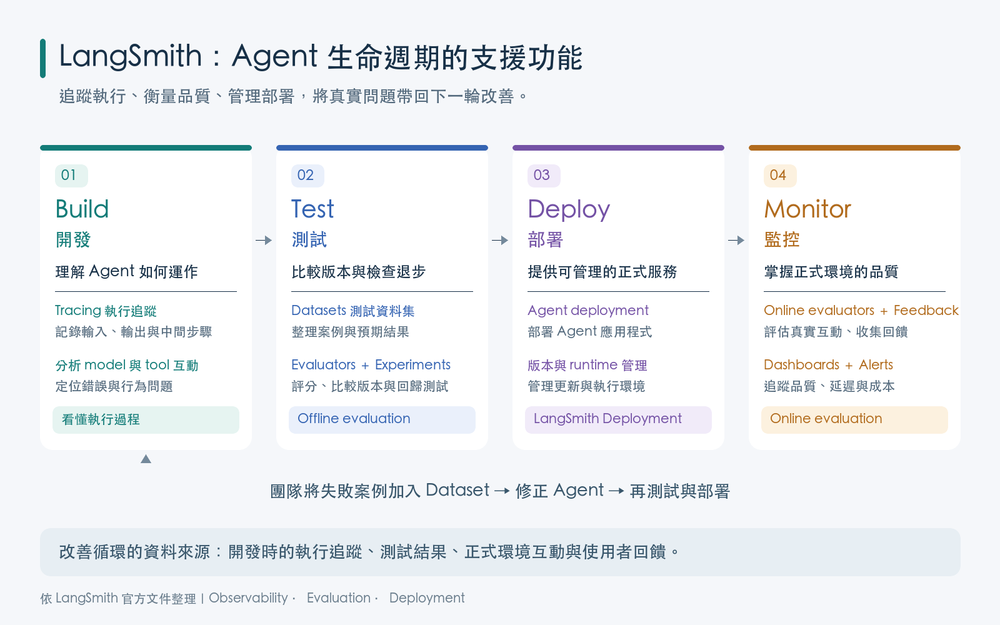
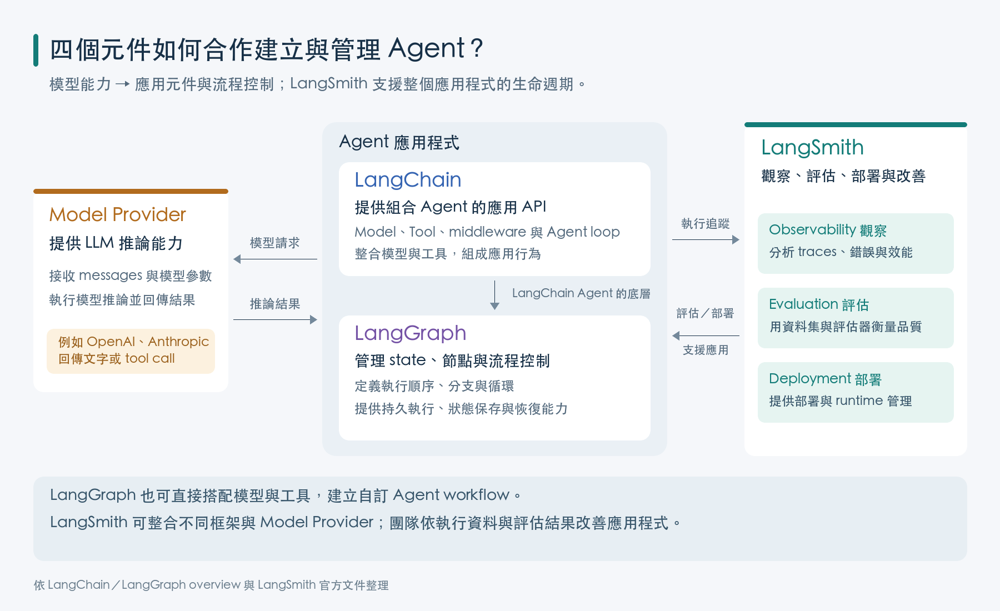
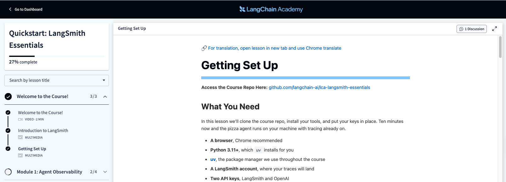

# LangSmith 入門：建立可持續改善的 Agent 開發流程

## 學習目標

完成本章後，你應能：

- 說明 LangSmith 在 Agent 開發中的定位。
- 比較傳統軟體與 Agent 應用程式在測試與品質管理上的差異。
- 說明 Build、Test、Deploy、Monitor 四個階段如何形成持續改善的循環。
- 區分 LangChain、LangGraph、模型供應商與 LangSmith 的責任。
- 說明 dataset、evaluator、experiment 與 production feedback 在品質改善流程中的角色。

> 本章只建立 LangSmith 的整體觀念與開發生命週期。Tracing 及 Debugging 設定與操作，將在後續講義分別介紹。

---

## 1. 什麼是 LangSmith？

LangSmith 是 LangChain 提供的 Agent engineering platform，用來支援 LLM 應用程式與 AI Agent 的觀察、評估、部署及持續改善。

它提供的是一組橫跨開發與正式環境的工具，協助團隊回答下列問題：

- Agent 實際執行了什麼？
- 目前版本的表現是否符合需求？
- 修改 prompt、model、tool 或流程後，品質是改善還是退步？
- 正式環境出現的新問題，如何轉換成下一輪測試案例？
- Agent 要如何部署、管理並持續監控？

因此，LangSmith 的核心價值是讓 Agent 的行為可以被觀察、衡量、比較與改善。

### LangSmith 的三個核心功能(core features)

| 能力 | 要解決的問題 | 在開發流程中的作用 |
|---|---|---|
| Observability | Agent 內部包含多個 model、tool 與程式步驟，只看最後回答無法了解完整執行狀況 | 保留執行紀錄與整體指標，使行為可以被分析 |
| Evaluation | LLM 輸出具有變異，不能只靠少數人工試問判斷品質 | 以 datasets、evaluators 與 experiments 系統化測量及比較版本 |
| Deployment | Agent 除了程式碼，還需要可持續執行、擴充與管理的 runtime | 將 Agent 部署為可供應用程式呼叫的服務，並支援正式環境運作 |


## 2. 為什麼 「Agent 應用程式開發」 需要不同的工程方法？

傳統應用程式通常由開發者明確撰寫判斷條件與處理流程。
- 只要輸入、程式狀態與執行環境相同，多數商業邏輯會產生可預期的結果；
- 若程式拋出例外，也常能從 error message 或 stack trace 找到發生問題的位置。

Agent 應用程式使用了 LLM 與自然語言輸入，使得程式的行為具隨機性(stochastic)
- 相同的輸入可能產生不同的輸出
- Agent 動態選擇工具，產生不同的推理路徑(reasoning path)

| 面向 | 傳統程式的典型情況 | Agent 應用程式的典型情況 |
|---|---|---|
| 輸入 | 格式與允許值通常可由 schema 或 UI 限制 | 使用者能以大量不同說法表達意圖，也可能提出未預期的要求 |
| 輸出 | 規則固定時，結果通常可重現 | 模型輸出具有機率性，相同問題可能得到不同措辭、推理路徑或結果 |
| 執行流程 | 控制流程主要由程式碼預先決定 | Agent 可能動態選擇 tool、產生參數並決定下一步 |
| 失敗形式 | 常見失敗會形成 exception、錯誤碼或測試失敗 | 回答可能語句流暢、程式也沒有當機，但內容或業務決策仍然錯誤 |
| 品質判斷 | 許多功能可用精確 expected output 驗證 | 正確性以外，還可能要評量相關性、安全性、風格與完整性 |

### Agent 的測試目標

Agent 使用 LLM 與自然語言輸入，導致輸出具有隨機性(stochastic)。

測試目標需要從「每次文字必須完全相同」調整為「重要行為是否符合可衡量的品質標準」。

例如：
- 是否選擇正確的 Tool？
- Tool arguments 是否符合資料契約？
- 回答是否引用正確的訂單內容？
- 是否遵守不得販售缺貨商品的業務規則？
- 面對不同說法時，成功率與失敗型態是否保持穩定？

換句話說，Agent 測試是:
- 把能精確檢查的部分交給程式規則
- 把需要語意判斷的部分交給適當的評估方法
  - LLM-as-a-Judge: 將使用者問題、訂單資料、Agent 回答及評分標準交給另一個 LLM，判斷回答是否切題、完整且有資料依據。
  - 人工評估: 由教師或領域人員依相同標準審查回答，也可抽查 LLM 評分是否合理。

### 為何不能只看最後回答？

一則 Agent 回答可能是多個步驟共同產生的結果：

```text
使用者需求
    ↓
Model 判斷意圖與下一步
    ↓
Agent 選擇 Tool 並產生 arguments
    ↓
Tool 查詢或修改外部資料
    ↓
Model 根據結果組成最後回答
```

最後回答只呈現流程的終點。

即使文字看起來合理，前面的 Tool 仍可能收到錯誤參數、使用過期資料，或違反業務規則。

因此，Agent 的品質不能只靠聊天畫面中的最後一句話判斷。


## 3. Agent 開發生命週期 (Agent Development Lifecycle)

自然語言輸入近乎無限，正式上線前不可能列舉所有使用方式。

Agent engineering 因此不是「完成開發、測試通過、工作結束」的直線流程，而是一個持續循環：先建立系統、用已知案例評估、部署到真實環境，再把新發現的問題帶回下一輪開發。

四個階段: Build → Test → Deploy → Monitor，形成持續改善的迴圈。


### Build：建立可以被理解與改善的 Agent

Build 階段的工作包括選擇 model、設計 prompt、定義 tools、安排控制流程，以及建立必要的安全與業務規則。

這個階段不只追求「能執行」，還要先界定什麼叫做「做得好」。

例如，披薩訂餐 Agent 至少應符合：

- 正確辨識顧客要新增、刪除或查詢的品項。
- 只使用允許的 Tool 執行訂單操作。
- 缺貨時不得向顧客宣稱品項已成功加入。

這些條件日後會成為測試資料與 evaluator 的設計依據。

### Test：把「看起來可以」轉換成可量化的數據

零星地在對話框輸入幾個問題，適合快速探索，但不足以證明功能正確或者新版本較為可靠。

Test 階段會把:
1. 代表性的案例整理成 dataset，
2. 再用 evaluators 判斷輸出或行為是否符合要求。
3. 每次的評估所產生的結果，稱為 experiment。

| 概念 | 角色 | 披薩 Agent 範例 |
|---|---|---|
| Dataset | 保存可重複使用的測試案例 | 一般訂餐、缺貨品項、錯誤數量、取消訂單等輸入 |
| Evaluator | 定義如何判斷結果的品質 | 檢查是否選對 Tool、是否拒絕缺貨商品、回答是否完整 |
| Experiment | 保存某一版本在 dataset 上的執行與評估結果 | 比較修改 prompt 前後的成功率與失敗案例 |

Evaluator 可以採用:
- 程式規則
  - 適合格式、數值、業務規則等可精確檢查的部分
- 人工審查(含成對比較)
  - 適合沒有標準答案，需要人工判斷。
- LLM-as-a-judge
  - 適合需要語意判斷的部分，或是人工審查成本過高的情況。


### Deploy：部署 Agent 至正式環境

Deploy 是把已完成測試的 Agent 放入可供前端或其他系統呼叫的執行環境。

部署不只是檔案放到伺服器，還涉及服務介面、執行狀態、串流、擴充、版本與基礎設施管理。

LangSmith Deployment 可提供適合 Agent 工作負載的 runtime 與管理能力. 

團隊也能把 Agent 部署在自有環境，另外使用 LangSmith 進行觀察與評估。

### On-Line Monitor：持續衡量正式環境中的品質

上線前的 dataset 只能代表開發者已想到的案例；

production traffic 才會帶來真實措辭、罕見情境與未預期的組合。

因此，Monitor 關注回答品質、安全、延遲、成本及使用者回饋。

LangSmith 的 online evaluation 可針對正式環境互動自動進行品質判斷，並搭配 dashboards、alerts 等機制觀察趨勢。

這與上線前的 offline evaluation 形成互補：

- Offline evaluation：在部署前，使用整理好的 dataset 比較版本並檢查 regression。
- Online evaluation：在部署後，從真實互動中偵測品質問題與新案例。

### 讓 production failure 回到下一輪測試

四個階段形成循環的關鍵，是將正式環境中的失敗轉換成可重複測試的案例：

```text
production 發現失敗案例
          ↓
釐清預期行為與品質標準
          ↓
將案例加入 dataset，補上 evaluator
          ↓
修改 prompt、model、tool 或程式邏輯
          ↓
執行 experiment，確認修正且沒有 regression
          ↓
重新部署並持續 monitor
```

例如，顧客要求鳳梨披薩，而庫存已經是 0，Agent 卻回覆「已成功加入」。

開發者不應只修正當下的程式碼，也應把「缺貨配料不得加入訂單」加入 dataset 與 evaluator。

如此一來，未來更換 model 或 prompt 時，這項業務規則仍會被重新驗證。


## 4. LangSmith 在生命週期中的角色




| 階段 | 主要問題 | LangSmith 的支援 |
|---|---|---|
| Build | Agent 的組成與行為是否可被了解？ | 保存可供分析的執行資料，協助開發者理解 model、tool 與應用邏輯的互動 |
| Test | 如何證明新版本較好，且沒有破壞既有能力？ | 使用 datasets、evaluators 與 experiments 進行 offline evaluation 與版本比較 |
| Deploy | 如何讓 Agent 成為可管理的正式服務？ | 提供 Agent deployment、版本與 runtime 管理能力 |
| Monitor | 如何知道 production 中的品質正在下降？ | 使用 online evaluators、feedback、dashboards 與 alerts 觀察真實互動 |

LangSmith 的價值並不只存在於其中一個階段:
- Build 產生的行為需要在 Test 被衡量；
- Deploy 之後取得的真實資料會在 Monitor 中暴露新問題；
- 新問題再回到 Dataset 與下一輪 Build。
- 平台將這些活動連接成同一套品質改善流程。


## 5. LangSmith 與其他元件的責任分工

LangChain、LangGraph、模型 API 與 LangSmith 在 Agent 開發中扮演不同角色:




| 元件 | 主要責任 |
|---|---|---|
| Model provider | 提供 LLM 推論能力 | 
| LangChain | 提供建立 Agent、Model、Tool 與 middleware 等應用元件的 API | 
| LangGraph | 建立需要明確 state、節點、流程控制與 durable execution 的 Agent workflow | 
| LangSmith | 觀察、評估、部署及改善 LLM 應用程式與 Agent | 

可將它們的關係簡化為：

```text
Model provider 提供模型能力
              ↓
LangChain／LangGraph 建立 Agent 應用程式
              ↓
LangSmith 支援觀察、評估、部署與持續改善
```

LangSmith 可與 LangChain／LangGraph 深度整合，但它的 observability 與 evaluation 並不限於特定 model provider。


---

## 6. 課程範例：A Pizza Ordering Agent

後續單元將使用 LangChain Academy 的 **A Pizza Ordering Agent** 作為共同案例。開始前請完成下列準備：

1. 申請 LangSmith 帳號。
2. 建立 LangSmith API key，並妥善保存在本機環境變數或 `.env`；不要將真實 key 暴露在截圖或 Git repository。
3. 準備課程所使用之 model provider API key，例如 OpenAI API key。
4. 依官方課程的 Getting Set Up 指示下載範例專案並完成環境設定。

範例專案與設定入口：[Getting Set Up — Quickstart: LangSmith Essentials](https://academy.langchain.com/courses/take/quickstart-langsmith-essentials/multimedia/77918169-getting-set-up)



本章不操作 LangSmith 的執行紀錄或除錯介面。完成環境準備後，後續講義將介紹：

- 如何啟用及閱讀 tracing。
- 如何根據執行證據 debugging Agent。


## 7. 本章重點整理

1. LangSmith 是 Agent engineering platform，不是 LLM，也不是 Agent 建構框架的替代品。
2. Agent 面對開放式自然語言輸入、機率式輸出與動態 Tool 使用，因此「程式未報錯」不代表行為正確。
3. Agent 品質必須透過 datasets、evaluators 與 experiments 被重複衡量，而不能只依賴少數人工試問。
4. Build、Test、Deploy、Monitor 是循環；production 中的新失敗應回到 dataset，成為下一版的 regression test。
5. LangSmith 的 observability、evaluation 與 deployment 可以依團隊架構分開採用；使用 LangSmith 不代表必須把 Agent 部署在 LangSmith。


## 官方參考資料

- [LangChain overview](https://docs.langchain.com/oss/python/langchain/overview)
- [LangGraph overview](https://docs.langchain.com/oss/python/langgraph/overview)
- [LangChain Documentation：LangSmith overview](https://docs.langchain.com/)
- [LangSmith Observability](https://docs.langchain.com/langsmith/observability)
- [LangSmith Evaluation](https://docs.langchain.com/langsmith/evaluation)
- [Evaluation concepts](https://docs.langchain.com/langsmith/evaluation-concepts)
- [LangSmith Deployment](https://docs.langchain.com/langsmith/deployment)
- [Self-hosted LangSmith](https://docs.langchain.com/langsmith/self-hosted)
- [Create an account and API key](https://docs.langchain.com/langsmith/create-account-api-key)
- [LangChain Academy：Quickstart — LangSmith Essentials](https://academy.langchain.com/courses/take/quickstart-langsmith-essentials)
