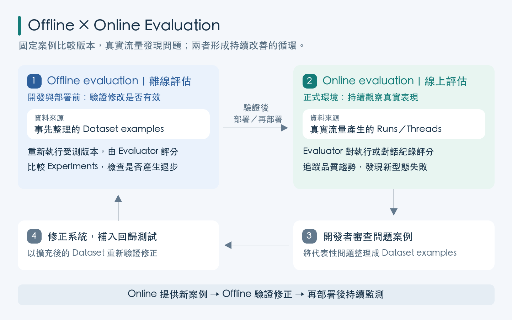
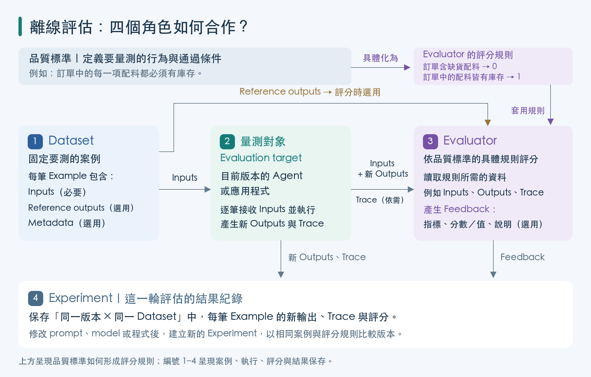
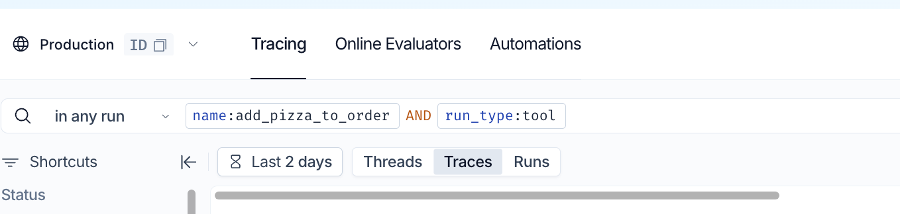
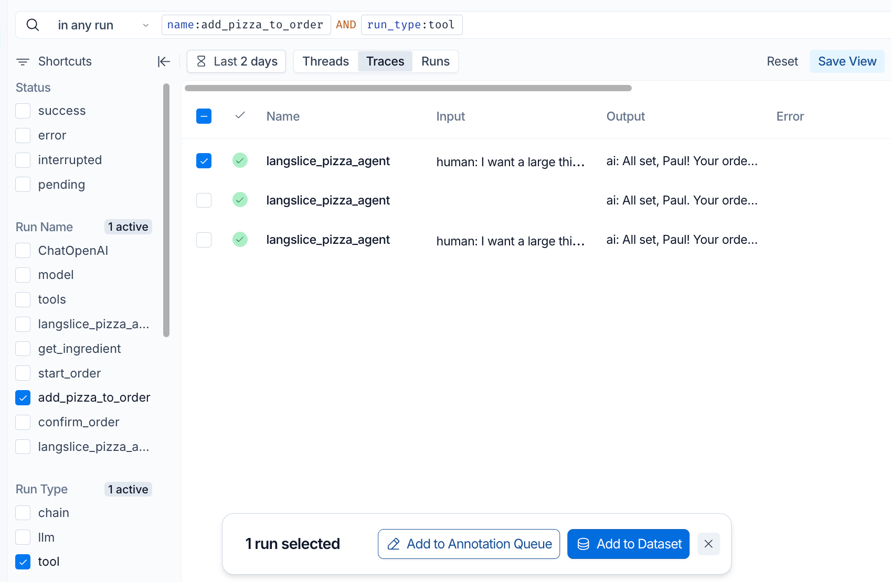

# LangSmith 測試：Dataset 與離線評估

## 學習目標

完成本章後，你應能：

- 說明離線評估（offline evaluation）要回答的工程問題。
- 說明 measurement、dataset、example、evaluator 與 experiment 的關係。
- 區分 reference-based 與 reference-free evaluation。
- 根據評量目標選擇人工、程式規則、LLM-as-a-judge 或 pairwise evaluator。
- 將具有代表性的 Trace 整理成可重複使用的測試資料。
- 解釋缺貨配料 Code Evaluator 的資料來源、評分規則與限制。
- 說明如何以相同 Dataset 比較修改前後的 Agent

> 本章聚焦於測量設計、Dataset 與 Evaluator。
> Experiment 的 SDK 執行、多輪對話重播及實驗比較，將在後續 Experiment 單元完整介紹；online evaluation 也不在本章範圍。

---

## 1. 為什麼需要離線評估？

Tracing 可以協助開發者回答「這一次執行發生了什麼」，但單一 Trace 無法回答下列問題：

- 這個錯誤在不同輸入中出現的頻繁次數？
- 修正某段 Tool 邏輯後，原本的錯誤是否真的消失？
- 修改 prompt、model 或 Agent code 後，是否產生新的錯誤(副作用)？
- 兩個版本在同一批案例時，哪個比較穩定？

離線評估會在開發或部署前，使用事先選定的 Dataset 執行受測系統。

因為輸入與評分方法可以固定，同一批案例能反覆用來比較修正前後、不同模型或不同 prompt 的表現。

```text
單一 Trace
    └── 解釋一次執行如何出錯

Dataset + Evaluator + Experiments
    └── 測量錯誤頻率，並比較不同版本
```

LangSmith 將 evaluation 分成 offline 與 online 兩種：

| 類型 | 評估對象 | 主要用途 |
|---|---|---|
| Offline evaluation | 事先整理的 Dataset examples | 開發期間測試、比較版本、建立 benchmark、發現 regression |
| Online evaluation | 正式環境中的 Runs 或 Threads | 上線後監測真實流量、品質趨勢與新型態失敗 |

兩者互補, 提供上線前的品質保證與上線後的品質監控。

Online evaluation 找到的新問題，可以整理成 Dataset examples，再納入下一輪 offline regression test。



---

## 2. 離線評估的四個步驟

一套可解釋的評估流程包含四個步驟：

1. 決定要測量什麼（measurement）。
2. 建立 Dataset。
3. 建立 Evaluator。
4. 執行 Experiment。

它們的關係如下：

```text
先定義品質標準及要量測的行為
      ↓
Dataset：固定要測的案例
  └── Example
      ├── Inputs（必要）
      ├── Reference outputs（選用）
      └── Metadata（選用）
      ↓
Evaluation target：目前版本的 Agent 或應用程式
      ↓
Evaluator：依量測規則產生 feedback 
  ├── key：指標名稱
  ├── score 或 value：評量結果
  └── comment：評分說明（選用）
      ↓
Experiment：保存每筆新輸出、Trace 與評分
```

執行 Experiment 時，LangSmith 會讓 evaluation target 對 Dataset 中的每一筆 input 重新執行，將新 outputs 與必要的 reference outputs 交給 Evaluators，以得到評分結果。
這些結果可在 LangSmith 中看到。




## 3. Step 1：決定要測量什麼

### 從「重要行為」而不是「整體感覺」開始

「這個 Agent 好不好？」過於籠統，無法直接轉換成穩定的測試。

較好的做法是把「品質」拆成可觀察、可判斷的行為。

以披薩訂餐 Agent 為例：

| 品質要求 | 可測量的問題 | 適合的初步方法 |
|---|---|---|
| 庫存規則 | 訂單是否包含 `stock_units <= 0` 的配料？ | Code Evaluator |
| Tool 使用 | Agent 是否呼叫正確的 Tool，且 arguments 符合契約？ | Code Evaluator |
| 澄清行為 | 資訊不足時，Agent 是否先追問而不是自行猜測？ | Code Evaluator 或 LLM-as-a-judge |
| 格式有效性 | 輸出是否為合法 JSON，且必要欄位存在？ | Code Evaluator |
| 回答品質 | 回答是否正確、清楚、簡潔且有幫助？ | 人工評分或 LLM-as-a-judge |
| 安全與隱私 | 是否出現有害內容或 PII 外洩？ | Code、LLM-as-a-judge 或組合規則 |

一個 Evaluator 最好只回答一個清楚的問題。

例如: 若把 correctness、helpfulness、conciseness 與 safety 全部混成「overall quality」，分數下降時便無法知道是哪一項行為退步。

上述的評估方法:
- Code Evaluator：用程式規則檢查結構化資料、數值或業務條件。
- LLM-as-a-judge：用語意理解判斷開放式文字
- 人工評分：由領域專家依 rubric 評分


### 常見的測量項目

確定性代碼評估（Code/Deterministic Evaluators）
  - e.g. 配料 out-of-stock 的情況下，`add_pizza_to_order` 函數是否會阻止缺貨配料被加入訂單。
  - e.g. Format Validity（格式有效性）： 當要求模型輸出特定結構時，檢查它有沒有成功輸出合法的 JSON、XML、YAML 等格式。

內容品質 - 需要主觀判斷
- Correctness（正確性）： 與資料集中的標準答案（Ground Truth）進行比對，評估回答是否正確。
- Conciseness（簡潔度）： 評估回答是否精煉，有沒有包含過多無意義的廢話。
- Helpfulness（幫助性）： 評估模型的回答對使用者是否有實質建設性。
- Toxicity / Moderation（有害性 / 安全審查）： 檢查輸出內容是否包含偏見、仇恨言論、暴力或敏感內容。
- PII Detection（隱私外洩檢查）： 測量模型是否不小心在回答中洩漏了身份證字號、信用卡、電話等個人隱私資訊

### 定義通過與失敗及其具體判斷規則

假設一業務規則是：

> 訂單中的每一項配料都必須有庫存；只要實際訂單含有任何 `stock_units <= 0` 的配料，本次執行就不通過。

因此，可定義通過與失敗的具體條件如下：

| `ingredient_stock` 分數 | 意義 |
|---|---|
| `1` | 找到訂單，而且訂單中沒有缺貨配料 |
| `0` | 訂單中至少包含一項缺貨配料 |

不應只寫「檢查庫存是否正確」，因為這句話沒有說明檢查哪一份資料、何時算失敗，以及沒有建立訂單時該如何處理。

### 判斷輸出是否正確: Reference-based 與 reference-free 

**Reference-based 評估**

有參考資料的評估（Reference-based Evaluation）
- 通常在 off-line evaluation 中使用 dataset 來進行評估，因為我們可以事先準備好標準答案（Ground Truth）作為參考資料。
- 這些參考資料通常稱為 "gold standard" 

常見的五種評估方式:

| 方法 | 評估原理 | 適用情境 |
|---|---|---|
| Exact Match | 實際輸出是否與標準答案完全一致 | 分類結果、固定格式 |
| Token-Level F1 | 比較詞彙或 Token 的 Precision / Recall | 簡短問答、資訊抽取 |
| Semantic Similarity | 計算實際回答與參考答案的語意相似度 | 開放式文字回答 |
| LLM-as-a-Judge | 讓 LLM 根據標準答案與 Rubric 判斷正確性 | 複雜問答、教學提示 |
| Execution-Based | 比較實際執行結果與預期結果 | 程式生成、工具操作 |

**Reference-free Evaluation**

沒有參考資料的評估（Reference-free Evaluation）
- 是指在沒有預先提供標準答案（Ground Truth 或 Reference Answer）的情況下，評估系統的輸出是否符合預期行為或規則。
- 改採用尺規（Rubric）或規則來判斷輸出是否正確。
- 通常在 on-line evaluation 中使用，因為真實使用者的問題通常是動態且不可預期的，不可能事先為每個問題建立標準答案。

常見的評估方式：
  - LLM-as-a-Judge： 由另一個 LLM 依據 rubric (尺規) 給予分數與評語。
  - Rule-Based Evaluator： 使用程式檢查輸出格式、必要欄位、工具呼叫等可明確判定的規則。


離線評估也可以使用 reference-free evaluator, 如有明確的規則可判斷的情況；或採用 LLM-as-a-judge 來判斷

**尺規的例子**

例如，評估披薩訂購 Agent 是否清楚說明無法加入配料的原因。

評估者會收到工具回傳的結果：蘑菇缺貨，以及 Agent 給使用者的回答，依下表評分：

| 分數 | 評分標準 | 回答範例 |
|---|---|---|
| 2 分 | 說明哪個配料缺貨，以及因此無法加入 | 「蘑菇目前缺貨，因此無法加入你的披薩。」 |
| 1 分 | 提到缺貨，但未指出是哪個配料 | 「有配料缺貨，所以無法加入。」 |
| 0 分 | 沒有說明缺貨原因，或提供錯誤原因 | 「操作失敗，請稍後再試。」 |

---

## 4. Step 2：建立 Dataset

### 4.1 Dataset 的結構(schema)

Dataset 是一組用來評估應用程式的 Examples。

每筆 Example 可包含：

| 欄位 | 必要性 | 責任 |
|---|---|---|
| Inputs | 必要 | 提供給 evaluation target，shape 必須符合 target 的輸入契約 |
| Reference outputs | 選用 | 只供 Evaluator 比較，不會當作 target 的輸入 |
| Metadata | 選用 | 記錄案例來源、failure mode、難度或分組標籤，供篩選與分析 |

例如：

```json
{
  "inputs": {
    "messages": [
      {"role": "user", "content": "我要一個大披薩，加 pineapple。"}
    ]
  },
  "reference_outputs": {
    "expected_status": "rejected",
    "expected_reason": "out_of_stock"
  },
  "metadata": {
    "failure_mode": "out_of_stock_topping",
    "source": "production_trace"
  }
}
```

Experiment 執行過程中，Agent 收到 `inputs`, 產生 Outputs。

之後，Evaluator 讀取 reference output，判斷新輸出的分數。

### 4.2 在 LangSmith 中建立 Dataset

LangSmith Dataset 可以由多種來源建立：

1. 人工撰寫代表性案例。
2. 匯入 CSV 或 JSONL。
3. 從既有 production traces 挑選案例。
4. 從人工標記 (annotation) 流程整理校訂過的案例。
5. 產生人工合成案例 (synthetic examples)。

建立測試案例時，除了要涵蓋正常情境(happy path)，也要涵蓋各種失敗模式與邊界情境，以確保評估結果能反映 Agent 的穩定性與可靠性。
- e.g. 披薩 Agent 的 Dataset 至少可涵蓋：正常訂餐、缺貨配料、未知配料、資訊不足、多輪修改，以及不應建立訂單的請求。

對於人工標記或合成案例有興趣的讀者，可參考 [Annotation Queues 與 Synthetic Examples](./dataset-annotation-and-synthetic-examples.md)

### 4.3 從 Trace 建立 Dataset Example

若正式環境已出現具有代表性的錯誤，可在 LangSmith 的 Tracing Project 中篩選相關 Trace，再加入 Dataset。

例如，要尋找曾執行 `add_pizza_to_order` 的 Trace：

1. 在 Search Bar 中選擇 "in any run", 並輸入以下條件：

```text
name:add_pizza_to_order AND run_type:tool
```



"in any run" 會比對整棵 trace tree，包含 root 與所有層級的子 run；任一 run 符合即可. 


2. 選取具有代表性的 Trace，下方會出現提示對話框，選擇 "Add to Dataset", 將 Trace 轉成 Example。



---

## 5. Step 3：Evaluator (評估器) 的設計與選擇

Evaluator 是依據品質特性展開後，針對某個品質特性的具體判斷規則，產生量化的分數。
- 把抽象的品質要求，轉成 Evaluator 能實際判斷的規則。

```
score = evaluator(example)
```

以披薩訂餐 Agent 為例：

| 層次 | 具體內容 |
|---|---|
| 品質特性 | 資訊不足時會先澄清 |
| 測試輸入 | 使用者說：「我要一個披薩。」但未指定尺寸 |
| 判斷規則 | 檢查 Agent 是否詢問尺寸，以及是否在取得尺寸前呼叫建立訂單的 Tool |
| 通過條件 | 有詢問尺寸，且尚未呼叫建立訂單的 Tool |
| 失敗條件 | 沒有詢問尺寸，或自行決定尺寸並建立訂單 |
| Feedback | `clarification = 1` 表示通過；`0` 表示失敗 |


常見評估器類型:

| 方法 | 適用情況 | 優點 | 主要風險 |
|---|---|---|---|
| Human evaluation | 需要領域專家判斷或建立可信標籤 | 最能反映團隊標準 | 速度慢、成本高，評審間可能不一致 |
| Code Evaluator | 條件可由格式、數值或業務規則精確表達 | 可重複、快速、容易定位失敗 | 規則寫錯時會穩定地給出錯誤分數 |
| LLM-as-a-judge | 語意正確性、語氣、清晰度等難以完全程式化的品質 | 能處理開放式文字 | 有模型成本、變異與偏誤，需以人類標籤校準 |
| Pairwise Evaluator | 絕對分數難定義，但兩個版本可直接比較，通常給 end users 判斷 | 適合 A/B 版本比較 | 只回答相對偏好，不代表勝者已達最低品質門檻 |

### 設計 LLM-as-a-judge 的三項原則

1. **問題要窄。** 不要只問「回答好不好」，而要指定一項品質及其可觀察條件。
- "這個回答好嗎？" → 太籠統不知道要怎麼評分
- "這個回答是否清楚說明缺貨原因？" → 指定品質

2. **尺度要有清楚錨點。** Binary pass/fail 或少數有明確定義的類別，通常比沒有描述的 1–10 分更容易一致。
- "請給 1–10 分" → 尺度太細，無法區分 5 和 6 間的差別；同個人對於同個問題多次評分可能無法產生穩定的結果
- "成功/失敗" → 只要有明確定義的通過與失敗條件，評分者就能一致判斷
- "沒有/部份/完全" → 小範圍的類別，較容易產生穩定的評分結果 

3. **要與人類判斷校準。** 
- LLM judge 的分數應該與人類評審的分數進行比對，以確保 LLM judge 的評分與人類的判斷一致。
- LangSmith 的 Annotation Queues 可將 Runs 集中交由人員依 rubric 評分，也可使用 pairwise queue 讓評審比較兩個版本。


---

## 6. Code Evaluator 案例：檢查缺貨配料

### 6.1 為什麼讀 ToolMessage？

訂單是否真的加入配料，應以 Tool 的結構化執行結果為準，只解析 Agent 最後的自然語言敘述並不能保證訂單狀態正確。

```text
Agent 最後回答：「已經幫您加入披薩」
                  │
                  └── 只是敘述，不一定等於實際訂單狀態

ToolMessage.content → order.pizzas[*].toppings[*]
                  └── 實際業務資料，才是本規則的檢查對象
```

### 6.2 Evaluator 程式

以下 evaluator 由後往前尋找最近一則含 `order` 的 ToolMessage，再用資料庫的庫存資料檢查訂單配料：

```python
"""Code evaluator for out-of-stock ingredients in pizza orders."""

import json

import database as db


def ingredient_stock_evaluator(run, example=None):
    outputs = run.outputs if hasattr(run, "outputs") else run.get("outputs", {})
    outputs = outputs or {}
    # 反向遍歷 messages，找到最近一則含 order 的 ToolMessage
    for message in reversed(outputs.get("messages", [])):
        if isinstance(message, dict):
            role = message.get("role") or message.get("type")
            content = message.get("content")
        else:
            role = message.type
            content = message.content

        if role != "tool":
            continue

        # 轉換成 json dict
        result = json.loads(content)
        # 取出 order
        order = result.get("order")
        if not order:
            continue
        
        # 產生缺貨配料集合 (使用 Set - 避免重複)
        out_of_stock = {
            topping
            for pizza in order["pizzas"]
            for topping in pizza["toppings"]
            if db.get_ingredient(topping)["stock_units"] <= 0
        }

        return {
            "key": "ingredient_stock",
            "score": 0 if out_of_stock else 1,
            "comment": (
                f"Out-of-stock ingredients added: {', '.join(sorted(out_of_stock))}"
                if out_of_stock
                else "All ordered ingredients are in stock."
            ),
        }

    return {
        "key": "ingredient_stock",
        "score": 1,
        "comment": "No order found.",
    }
```

本章明確提供 `key: "ingredient_stock"`，使 Experiment 報表中的指標名稱能直接表達所測量的規則；`score` 是可進行彙整的數值型結果，`comment` 則說明失敗原因。

在 LangSmith 中，`comment` 會顯示成為 feedback 的文字。

官方 SDK 允許 Code Evaluator 依參數名稱取得所需資料，包括 `run`、`example`、`inputs`、`outputs` 與 `reference_outputs`。實際函數可以只宣告需要的參數。

這個 evaluator 雖接收 `example`，卻沒有讀取 reference output，因此屬於 reference-free evaluator。

### 6.3 資料流

`ingredient_stock_evaluator` 的資料流如下：

```text
run.outputs
    ↓
由後往前檢查 messages
    ↓
找到最近一則含有 order 的 ToolMessage
    ↓
取出 order.pizzas[*].toppings[*]
    ↓
以 db.get_ingredient() 查詢庫存
    ↓
是否存在 stock_units <= 0 的配料？
    ├── 是 → ingredient_stock = 0，列出缺貨配料
    └── 否 → ingredient_stock = 1
```

完整的逐行程式解說與實際 Run 結構，可另見[〈使用 Code Evaluator 檢查訂單配料庫存〉](ingredient-stock-evaluator.md)。


## 7. Step 4：Experiment 如何形成比較證據？

Experiment 會讓 evaluation target 對 Dataset 中的每一筆 input 重新執行，將新 outputs 與必要的 reference outputs 交給 Evaluators，再保存每筆 Trace、feedback 與整體結果。

```python
from langsmith import evaluate

results = evaluate(
    evaluation_target,
    data="langslice-dataset",
    evaluators=[ingredient_stock_evaluator],
    experiment_prefix="stock-baseline",
)
```

這段程式的責任分工是：

| 參數 | 責任 |
|---|---|
| `evaluation_target` | 接收一筆 Example inputs，執行目前版本 Agent 並回傳新 outputs |
| `data` | 指定要重複使用的 Dataset |
| `evaluators` | 指定如何評量每次新執行 |
| `experiment_prefix` | 為這次實驗結果提供可辨識的名稱前綴 |

若要評估 bug fix 或是其它設計修改的成效，至少應保留：

```text
同一份 Dataset + 同一組 Evaluators
        ├── Experiment A：修正前 baseline (控制組)
        └── Experiment B：修正後版本 (對照/比較組)
```

比較時不只看平均分數，也要查看：

- 哪些 Examples 由失敗變成通過？
- 是否有原本通過的 Examples 變成失敗？
- 失敗的 comment 與 Trace 指向哪一種機制？
- 若 target 含隨機性，結果是否經適當 repetitions 後仍一致？
- 成本、latency 或其他品質指標是否出現不可接受的交換？

Experiment 能提供版本比較證據，但證據範圍仍受 Dataset 代表性與 Evaluator 效度限制。
沒有出現在 Dataset 的情境，或 Evaluator 沒有測量的品質，不能從實驗分數推論其表現。

---

## 8. 建議的實作順序

以「缺貨配料被加入訂單」為例，一個完整且可追溯的流程是：

1. 從 Trace 確認第一個錯誤值出現在 Tool 的庫存判斷與訂單結果。
2. 把已知失敗案例加入 Dataset，並補上其他缺貨配料、不同說法與正常案例。
3. 明確定義 `ingredient_stock` 的通過、失敗與無訂單情況。
4. 以固定庫存 fixture 執行 baseline Experiment。
5. 修正 `add_pizza_to_order()` 的缺貨判斷。
6. 使用相同 Dataset 與 Evaluator 執行修正版 Experiment。
7. 比較每筆 Example，而不只看總平均。
8. 將新發現的 production failure 經審查後加入 Dataset，持續擴充 regression suite。

---

## 9. 課堂檢核

1. 為什麼一個成功的 Trace 不能證明 Agent 的缺貨規則已經穩定？
2. 從錯誤 production Trace 建立 Example 時，為什麼不能直接把歷史 output 當成 gold standard？
3. `ingredient_stock_evaluator()` 為什麼是 reference-free evaluator？它仍可用於 offline evaluation 嗎？
4. `No order found` 回傳 `score: 1` 可能造成什麼錯誤解讀？
5. 若 `db.get_ingredient()` 查到的是會持續變動的正式庫存，如何改善實驗的可重複性？
6. 若修正版的庫存分數提高，但正常訂餐成功率下降，應如何解讀結果？

---

## 10. 本章重點

- Offline evaluation 使用事先整理的 Dataset，適合在部署前比較版本、驗證修正與發現 regression。
- Measurement 先定義品質；Dataset 固定案例；Evaluator 定義評分；Experiment 保存目前版本重新執行後的結果。
- Reference-based／reference-free 描述評分是否需要標準答案，不等同於 offline／online。
- 從 Trace 建立的歷史 output 未必正確，必須經審查才能成為可信的 reference output。
- 能用明確規則判斷的格式、數值與業務條件，優先使用 Code Evaluator；主觀品質才考慮人工或經校準的 LLM-as-a-judge。
- 一個 Evaluator 應測量一項清楚行為；通過庫存檢查不代表 Agent 的整體訂餐品質正確。
- 可重複性不只取決於 Dataset，也取決於模型設定、evaluation target 與外部資料來源是否受到控制。

---

## 參考資料

- [LangSmith Evaluation](https://docs.langchain.com/langsmith/evaluation)
- [Evaluation concepts](https://docs.langchain.com/langsmith/evaluation-concepts)
- [Evaluation types](https://docs.langchain.com/langsmith/evaluation-types)
- [Create and manage datasets in the UI](https://docs.langchain.com/langsmith/manage-datasets-in-application)
- [How to define a code evaluator with the SDK](https://docs.langchain.com/langsmith/code-evaluator-sdk)
- [How to evaluate an LLM application](https://docs.langchain.com/langsmith/evaluate-llm-application)
- [Use annotation queues](https://docs.langchain.com/langsmith/annotation-queues)
- [LLM Evaluation Metrics: Measuring What Matters for Your Users](https://www.langchain.com/resources/llm-evaluation-metrics)
