# 使用 LangSmith Tracing 觀察 Agent 執行流程

## 學習目標

完成本章後，你應能：

- 區分 Run、Trace、Turn 與 Thread。
- 從 Trace tree 說明 Agent、Model 與 Tool 的實際執行順序。
- 檢查 Run 的 inputs、outputs 與 attributes，追查資料在哪一個步驟發生錯誤。
- 區分「程式成功執行」與「業務結果正確」。
- 比較修正前後的 Trace，判斷修改是否產生預期效果。

> 本章聚焦 LangSmith Tracing 的概念、介面與追蹤方法。
> LangSlice Agent 的情境、Tools 與業務規則另見[〈案例：LangSlice 披薩訂餐 Agent〉](case-LangSlice-Agent.md)，本章不重複介紹個案架構。

---

## 1. 為什麼 Agent 需要 Tracing？

Agent 的最後回答只呈現執行結果，無法完整說明產生結果的過程。

一輪互動可能包含多次 Model 呼叫、Tool 呼叫與應用程式函數執行；即使畫面上的回答很自然，內部仍可能出現下列問題：

- Model 選錯 Tool。
- Tool Call 傳入錯誤參數。
- Tool 查到正確資料，卻套用錯誤的業務規則。
- 某一步驟耗費過多時間、tokens 或成本。
- 程式沒有拋出例外，但最後的業務結果仍然錯誤。

Tracing 會保存這些步驟之間的父子關係及執行資料，讓開發者能沿著實際資料流回答：「Agent 做了什麼？資料在哪一步改變？錯誤最早出現在哪裡？」

```text
使用者輸入
    ↓
Model 判斷下一個動作
    ↓
Tool Call：名稱與參數
    ↓
Tool 執行及回傳結果
    ↓
Model 根據結果產生回覆
```

---

## 2. Tracing 的重要名詞

Thread、Turn、Trace 與 Run 是 Tracing 的核心概念。它們的關係如下：

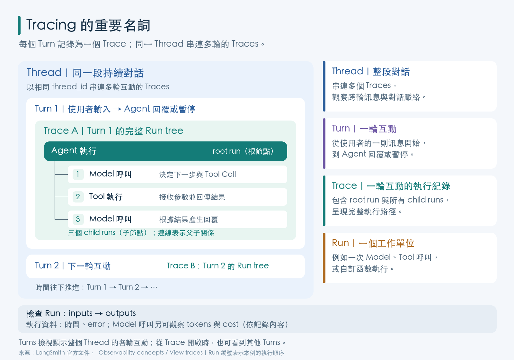


```
Thread
│
├── Turn 1 -> Trace
│             ├── Run 1
│             ├── Run 2
```

| 名詞 | 定義 | 觀察重點 |
|---|---|---|
| **Thread** | 以相同 `thread_id` 串連的持續對話或 session，可包含多個 Turns | 跨輪訊息、狀態及完整對話脈絡 |
| **Turn** | 對話中的一輪互動，通常從一則使用者訊息開始，到 Agent 回覆或暫停為止 | 這一輪使用者需求及 Agent 的處理結果; 一個 Turn 對到一個 Trace     |
| **Trace** | 一輪對話所形成的完整 Run tree，包含 root run 與其所有 child runs | 整體執行路徑及 Run 之間的父子關係 |
| **Run** | 一個被記錄的工作單位，例如一次 Model 呼叫、Tool 呼叫或自訂函數執行 | inputs、outputs、執行時間、tokens、cost、error |

Run 與 Trace 是 **observability 的執行紀錄**；Turn 與 Thread 則是 **對話組織方式**。

在本章範例中，一個 Turn 會產生一個主要 Trace。

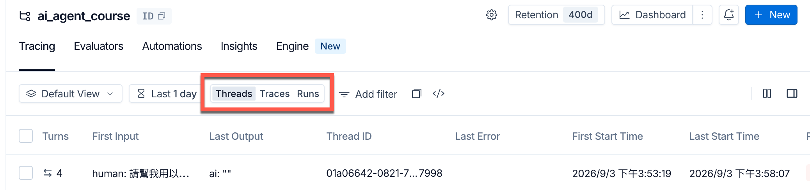

以下是一個 Thread 中第一輪互動的 Trace tree：

```text
Thread
│
├── Turn 1 -> Trace
│            ├── agent                         ← Run
│            ├── model                         ← Run
│            │       └── ChatOpenAI            ← Run
│            ├── HumanInTheLoopMiddleware      ← Run
│            ├── tools                         ← Run
│            │    └── validate_inquiry_data    ← Run
│            ├── model                         ← Run
│            │    └── ChatOpenAI               ← Run
│            └── HumanInTheLoopMiddleware      ← Run
│
├── Turn 2 -> Trace
├── Turn 3 -> Trace
└── Turn 4 -> Trace
```

這棵樹同時表達兩種資訊：

1. **先後順序**：Model 先決定是否呼叫 Tool，Tool 回傳後，Model 再決定下一步。
2. **父子關係**：`validate_inquiry_data` 是在 `tools` 之下執行的 child run。

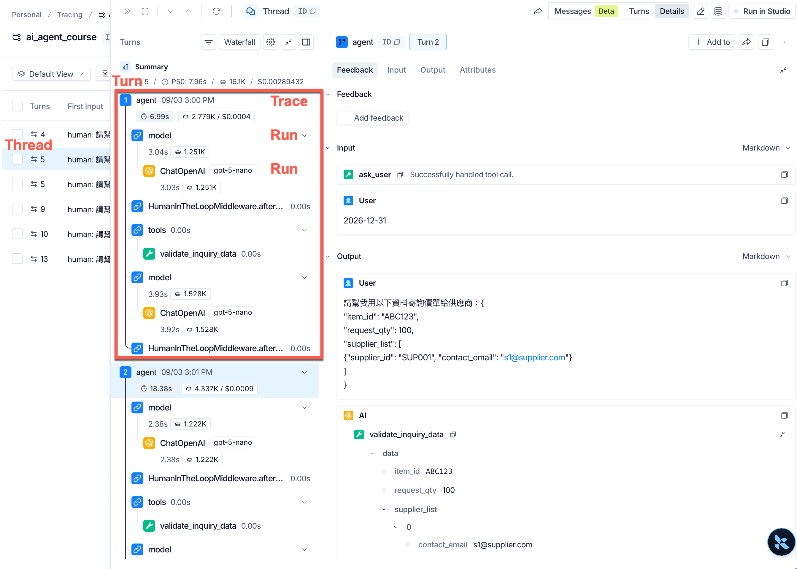

---

## 3. 啟動範例 Agent 並產生 Trace

本章使用已完成設定的 LangSlice 範例專案。若尚不了解其功能與 Tools，請先閱讀[個案講義](case-LangSlice-Agent.md)。

在範例專案目錄執行：

```bash
cd lca-langsmith-essentials/langgraph-agent
uv run langgraph dev
```

開發伺服器啟動後，會自動開啟 LangSmith Studio 頁面。


建立一個新的 Thread，輸入：

```text
I want a large thin crust pineapple pizza for pickup.
The name for the order is Paul. Confirm the order.
```


Agent 完成處理後，Studio 會顯示其回覆。

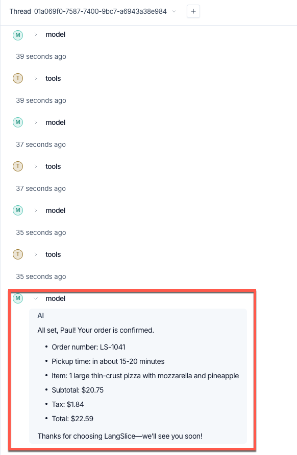

這段自然語言可能觸發多個動作，因此不能只根據最後回覆判斷訂單是否正確。

下一步要到 LangSmith 的 Tracing 頁面檢查實際執行紀錄。

> 提醒:
> Model 如何拆解需求與安排 Tool Calls 可能因執行而異。操作時應以當次 Trace 顯示的實際 Run tree 為準。

---

## 4. 從 Project、Thread 進入 Trace

### 4.1 開啟 Project 的 Traces

在 LangSmith 中找到 `langslice-pizza-agent` Project，開啟其 Traces。

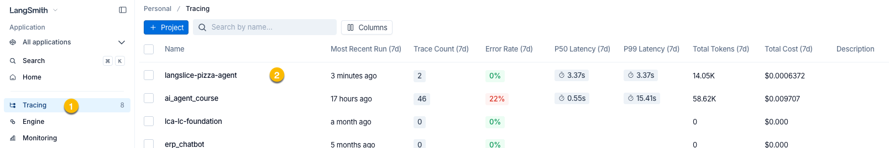

Project 用來收納同一應用或環境的執行紀錄；Thread 則把同一段持續對話中的 Traces 串在一起。

切換到 **Threads** 檢視，可以從對話緒絡尋找剛才建立產生的 Trace.

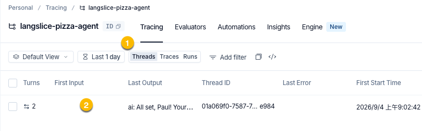

### 4.2 選擇本次 Thread 與 Trace

點選剛才建立的 Thread，查看其中各輪互動及對應的 Trace。

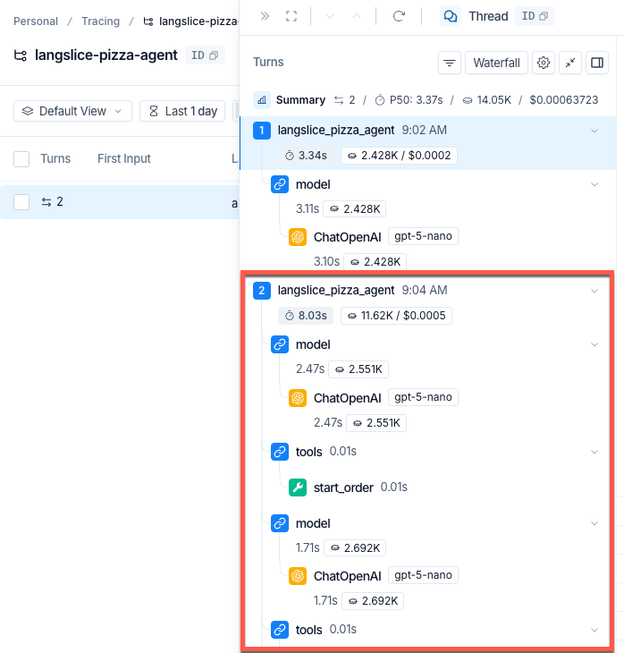

滑鼠移到上方的 Root Node 的名稱，會顯示 Trace ID, Run ID 及 Turn ID。

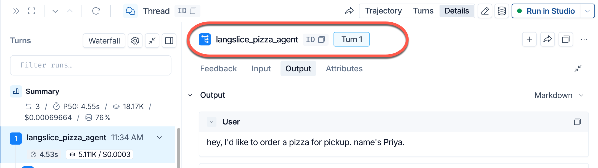

若操作畫面出現額外 Turn，先核對使用者輸入及時間；例如誤按 Enter 也可能建立另一輪互動。

Thread 內可有多輪(Turn)對話，選錯 Turn 就會檢查到不同的 Trace。

---

## 5. 先讀 Root Run：確認整輪互動

點選 Trace tree 最上層的 root run，右側面板會顯示該 Run 的主要資料：

- **Inputs**：這次執行收到的輸入，例如使用者訊息或進入 graph 的 state。
- **Outputs**：這次執行結束時的輸出，例如 Agent 回覆或更新後的 state。
- **Attributes**：執行相關的 metadata 與指標，例如 latency、token usage、cost 及 error 狀態。

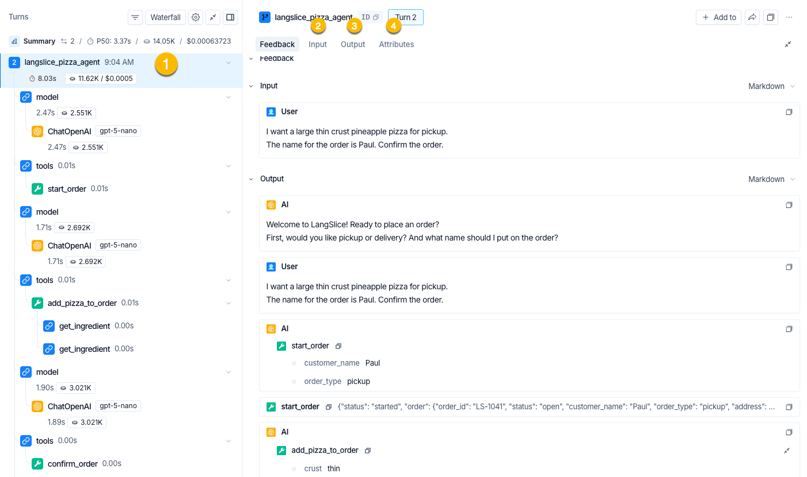

本例 root run 的 input 為先前輸入的人工訊息。

若 Agent 的 state 會保存 message history，root output 也可能包含累積的多輪訊息。

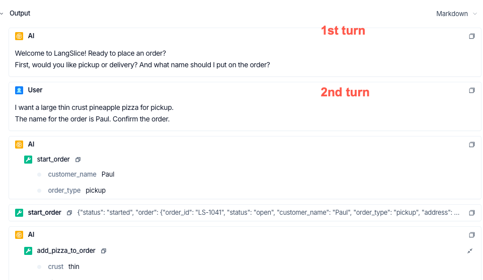

閱讀 root run 的目的，是先確認「這是不是要分析的那一次執行」，並了解**整輪**輸入與最終狀態。

要判斷中間哪一步出錯，還必須繼續展開 child runs。

---

## 6. 展開 Run Tree：檢查實際 Tool Calls

從左側 Run tree 可以看到，本次執行的主要 Tool 呼叫順序為：

```text
start_order → add_pizza_to_order → confirm_order
```

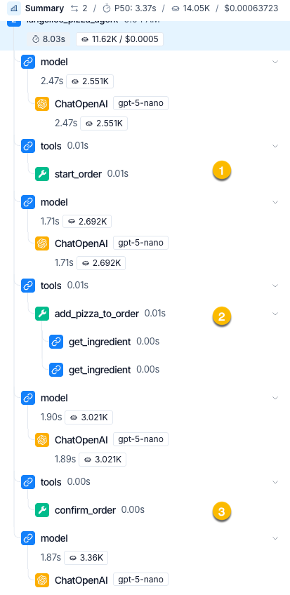

這項紀錄顯示了 Agent 的實際行為：它顯示哪些 Tools 確實被執行，以及執行的先後關係。

點選 `add_pizza_to_order` Run，檢查 Agent 傳入的 arguments：

- `crust`: `"thin"`
- `size`: `"large"`
- `quantity`: `1`
- `toppings`: `["pineapple"]`

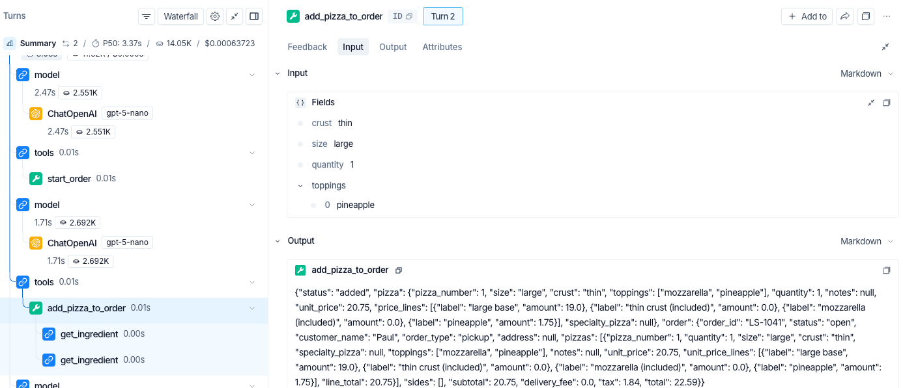

這裡可以先排除一種可能性：Agent 並沒有把顧客的 `pineapple` 誤解成其他配料，Tool Call 的主要參數符合使用者輸入。

接著展開 `add_pizza_to_order` 下層的函數呼叫。本次執行呼叫 `get_ingredient()` 兩次，分別查詢 `pineapple` 與預設配料 `mozzarella`；其中 `pineapple` 的 `stock_units` 為 `0`。

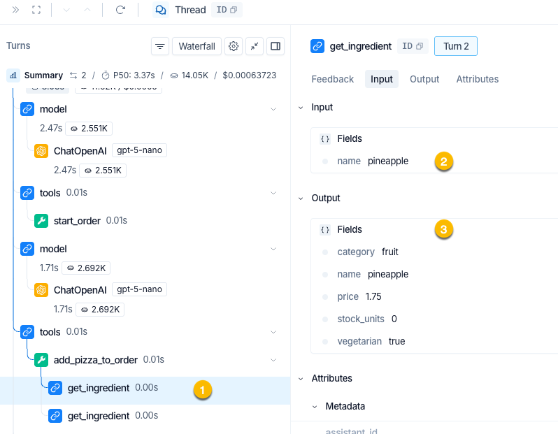

然而，`add_pizza_to_order` 的 output 仍顯示：

```json
{
  "status": "added",
  "pizza": {
    "size": "large",
    "crust": "thin",
    "toppings": ["mozzarella", "pineapple"],
    "unit_price": 20.75
  },
  "order": {
    "status": "open",
    "subtotal": 20.75,
    "tax": 1.84,
    "total": 22.59
  }
}
```

不只缺貨配料被加入 `toppings`，訂單金額也包含 pineapple 的價格。這表示程式雖然沒有拋出例外，業務結果卻不正確。

---

## 7. 沿資料流定位錯誤責任

診斷時不要看到錯誤回答就直接歸因於 Model。應逐層比較相鄰 Runs 的 input 與 output：

```text
使用者要求 pineapple
        ↓  正確
Model 傳入 toppings: ["pineapple"]
        ↓  正確
get_ingredient 回傳 stock_units: 0
        ↓  此處仍正確
add_pizza_to_order 回傳 status: "added"
        ↓  錯誤第一次出現
Model 根據 Tool 結果產生後續回覆
```

因此，Trace 能支持的診斷是：資料查詢已辨識出庫存為 0，但 `add_pizza_to_order` 仍接受該配料；

錯誤第一次出現在 Tool 的 output，而不是使用者輸入、Tool arguments 或庫存查詢結果。

Tracing 在這裡負責提供**定位證據**，不會自動修正業務邏輯。

確認錯誤位於 `add_pizza_to_order` 後，下一步才是檢查該 Tool 的程式碼，而不是先修改 prompt 或 Model。

### 7.1 檢查造成錯誤的程式碼

在 `agent.py` 的 `add_pizza_to_order` 中，原有的 `for` loop 只檢查配料是否存在：若 `db.get_ingredient()` 回傳 `None`，便將配料加入 `unknown`；只要查得到配料，就直接加入 `resolved`。

```python
for requested in requested_toppings:
    ingredient = db.get_ingredient(requested)
    if ingredient is None:
        unknown.append(requested)
    else:
        resolved.append(ingredient)
```

`pineapple` 確實存在於配料資料中，因此不會進入 `ingredient is None` 分支。即使它的 `stock_units` 是 `0`，仍會被加入 `resolved`。這正好解釋了 Trace 中觀察到的結果：`get_ingredient` 正確回傳庫存資料，但 `add_pizza_to_order` 仍回傳 `status: "added"`。

### 7.2 加入缺貨驗證

修正時增加 `out_of_stock` 清單，明確區分「不存在的配料」與「存在但目前缺貨的配料」：

```python
out_of_stock: list[str] = []

for requested in requested_toppings:
    ingredient = db.get_ingredient(requested)
    if ingredient is None:
        unknown.append(requested)
    elif ingredient["stock_units"] <= 0:
        out_of_stock.append(requested)
    else:
        resolved.append(ingredient)

if out_of_stock:
    return {
        "status": "rejected",
        "reason": "out_of_stock",
        "message": f"We're out of: {', '.join(out_of_stock)}.",
        "out_of_stock_toppings": out_of_stock,
        "available_toppings": [t["name"] for t in db.list_toppings()],
    }
```

修正後的判斷流程如下：

1. `ingredient is None`：配料不存在，沿用原本的 `unknown` 處理流程。
2. `ingredient["stock_units"] <= 0`：配料存在但缺貨，加入 `out_of_stock`。
3. 只有存在且庫存大於 `0` 的配料，才加入 `resolved`。
4. 只要 `out_of_stock` 不為空，Tool 就回傳 `status: "rejected"`、`reason: "out_of_stock"`、缺貨配料清單及目前可用的配料清單。

這項修正把不可違反的庫存規則放在 Tool 的確定性程式邏輯中。Agent 的責任是根據拒絕結果向顧客說明並詢問替代選擇，而不是自行忽略 Tool 的結果或猜測庫存。

修改並儲存 `agent.py` 後，LangGraph 開發伺服器會重新載入程式碼。接下來必須以相同輸入建立新的 Trace，確認實際執行結果已經改變。

---

## 8. 修改後以新 Trace 驗證結果

程式重新載入後，回到 Studio，建立**新的 Thread**，再輸入相同測試訊息。

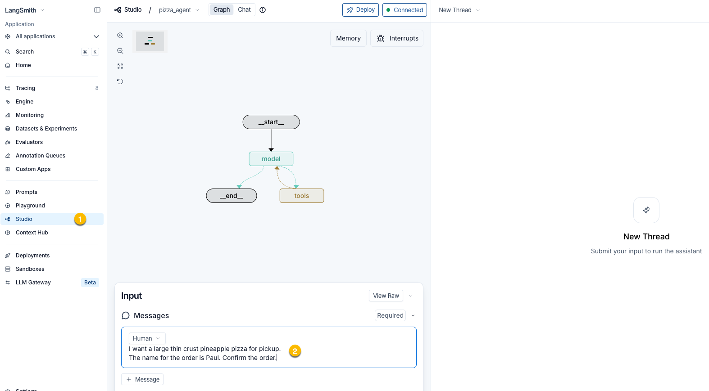

本次 Agent 告知 pineapple 缺貨，並詢問顧客是否要更換其他配料。

文字回覆看起來合理，但仍要回到 Tracing 檢查最新 Thread 中的 `add_pizza_to_order` Run。

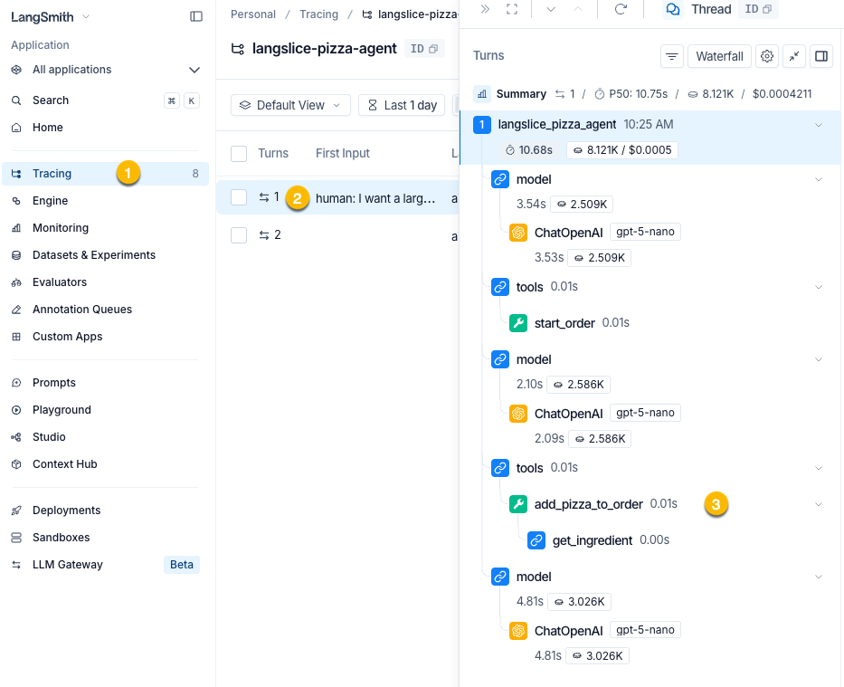

修正後的 output 應呈現明確的拒絕狀態與可供 Agent 使用的結構化資料：

```json
{
  "status": "rejected",
  "reason": "out_of_stock",
  "message": "We're out of: pineapple.",
  "out_of_stock_toppings": ["pineapple"],
  "available_toppings": [
    "bacon",
    "bell pepper",
    "black olives"
  ]
}
```

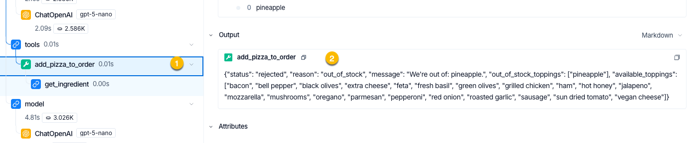

修正驗證至少要同時確認三層證據：

| 層次 | 應確認的內容 |
|---|---|
| 查詢 Run | `pineapple` 的庫存仍為 `0`，測試前提沒有改變 |
| Tool Run | `status` 為 `rejected`，`reason` 為 `out_of_stock`，缺貨配料未進入訂單 |
| Agent 回覆 | Model 根據 Tool 的拒絕結果告知缺貨，沒有宣稱訂單已成功加入 pineapple |

使用新的 Thread 可避免舊對話狀態影響測試；使用相同輸入則有助於比較修正前後的差異。

不過，單次 Trace 只能證明本次執行的結果，不能取代完整 dataset 與 regression evaluation。


## 9. 重點整理

- Run 是單一工作單位；Trace 是一輪對話形成的 Run tree；Thread 串連多輪對話。
- Trace tree 顯示實際執行路徑； Agent 的最後回答無法反推出完整過程。
- inputs 與 outputs 用來追查資料流；attributes 用來觀察錯誤、延遲、tokens 與成本。
- 定位問題時，應找出「上一步仍正確、下一步首次出錯」的 Run 邊界。
- 程式成功執行不等於業務結果正確；應檢查 Tool 的結構化回傳及後端狀態。
- 修正後要以新 Trace 驗證查詢結果、Tool 結果與 Agent 回覆。
- 單次 Trace 適合診斷個別執行；系統性的品質與 regression 仍需 datasets、evaluators 與 experiments。

## 參考資料

- [LangSmith Documentation：Observability concepts](https://docs.langchain.com/langsmith/observability-concepts)
- [LangSmith Documentation：Trace an application](https://docs.langchain.com/langsmith/observability-quickstart)
- [LangChain Academy：What is Tracing?](https://academy.langchain.com/courses/take/quickstart-langsmith-essentials/multimedia/77918185-what-is-tracing)
- [本課程：案例—LangSlice 披薩訂餐 Agent](case-LangSlice-Agent.md)
